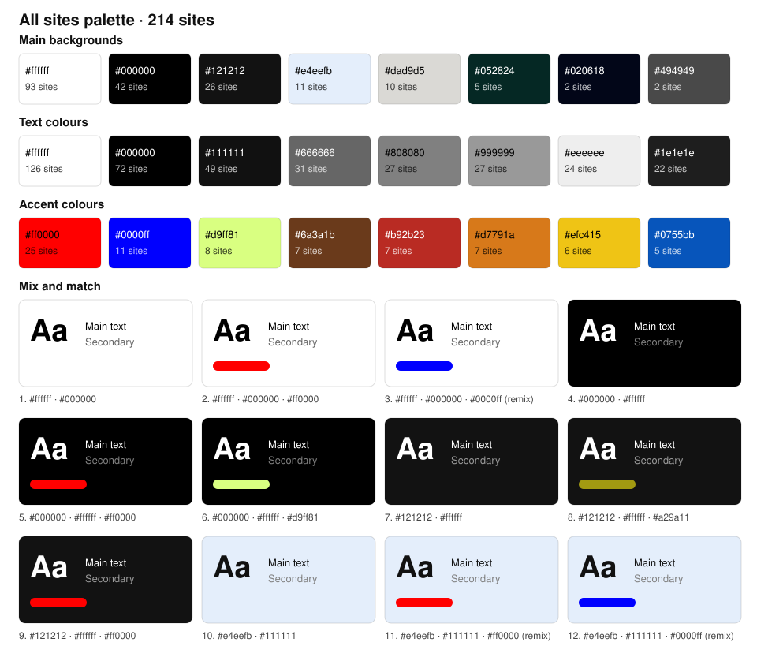

# All sites palette

214 sites. 79 of them were captured as one screen only, so their colours come from the first screen. Left out as failed captures: [Seek and Deploy](../../seekanddeploy.com/overview.md), [The Future In Black](../../thefutureinblack.com/overview.md).

Colours that look alike are merged and named by the most used shade; the counts are sites, not uses. Translucent colours are mixed onto each site's main background first.

## Main backgrounds

| Colour | Sites | Merged shades | Seen on |
| --- | --- | --- | --- |
| `#ffffff` | 93 of 214 | `#f1f1f1`, `#f2f2f2`, `#f4f4f4`, `#f5f5f5` | [360 Lexington Ave](../../360lexingtonave.com/overview.md), [AAT Architecten](../../aat-architecten.be/overview.md), [Achilles Heel](../../achillesheel.co.uk/overview.md), [Alicia Dubuis](../../aliciadubuis.com/overview.md) and 89 more |
| `#000000` | 42 of 214 | `#080808`, `#050505`, `#010101`, `#04040e` | [Allan Leone - Product Designer](../../allanleone.com/overview.md), [aorum](../../aorum.io/overview.md), [Awards Racing](../../awards.racing/overview.md), [Camper & Nicholsons](../../camperandnicholsons.com/overview.md) and 38 more |
| `#121212` | 26 of 214 | `#111111`, `#171717`, `#1b1b1b`, `#08090d` | [montarville](../../montarville.ca/overview.md), [Sam Thies](../../samthies.com/overview.md), [Share Bien](../../sharebien.com/overview.md), [Arc's Portfolio](../../arcmarumo.com/overview.md) and 22 more |
| `#e4eefb` | 11 of 214 | `#e9e9ea`, `#eaece5`, `#ececec`, `#edeee5` | [Zesiger.net](../../zesiger.net/overview.md), [AI Uis](../../aiu.is/overview.md), [Melike Turgut](../../meliketurgut.com/overview.md), [Huy Phan Vol.2](../../huyml.co/overview.md) and 7 more |
| `#dad9d5` | 10 of 214 | `#dbdcd7`, `#dddbe7`, `#dddcd7`, `#e3e7eb` | [Grafik](../../grafik.nz/overview.md), [Driftime's 2025 Impact Report](../../2025.driftime.com/overview.md), [Made in May](../../madeinmay.studio/overview.md), [Half the Sky](../../halfthesky.app/overview.md) and 6 more |
| `#052824` | 5 of 214 | `#212121`, `#222124`, `#222222`, `#262626` | [Leome and Partners](../../leome-and-partners.com/overview.md), [Pilato](../../pilato.it/overview.md), [Ingrassia Daniel - Portfolio](../../ingrassiadaniel.it/overview.md), [FORMAT](../../format.obys.agency/overview.md) and 1 more |
| `#020618` | 2 of 214 | `#0f0723` | [Redesigning Trust: Level2](../../trylevel2.com/overview.md), [Imogen: Agentic AI](../../vsproject-imogen.vendredi-society.com/overview.md) |
| `#494949` | 2 of 214 | `#594037` | [Onseis Studio](../../onseis.com/overview.md), [dsgn Interior](../../dsgninterior.se/overview.md) |

## Second backgrounds

Section and panel colours that differ from the site's main background.

| Colour | Sites | Merged shades | Seen on |
| --- | --- | --- | --- |
| `#000000` | 32 of 214 | `#020203`, `#050505`, `#070506`, `#080808` | [A24](../../a24.raviklaassens.com/overview.md), [AUGE Experience](../../auge-xp.com/overview.md), [Truth Generation](../../blurthetruth.com/overview.md), [Carter Ogunsola](../../carterogunsola.com/overview.md) and 28 more |
| `#ffffff` | 31 of 214 | `#f0f2f4`, `#f4f5f7`, `#f5f5f5`, `#f6f5f4` | [Driftime's 2025 Impact Report](../../2025.driftime.com/overview.md), [Auremin](../../auremin.com/overview.md), [Boldium](../../boldium.com/overview.md), [Camper & Nicholsons](../../camperandnicholsons.com/overview.md) and 27 more |
| `#0a0a0a` | 18 of 214 | `#101010`, `#070b00`, `#090b10`, `#0a0908` | [Petrillo.studio](../../petrillo.studio/overview.md), [Night Drive Racing Game](../../threejspunk.com/overview.md), [Vantra (Featured Template)](../../vantra-studio.webflow.io/overview.md), [Extrafazant](../../extrafazant.nl/overview.md) and 14 more |
| `#efefef` | 17 of 214 | `#e4e4e4`, `#e5e5e5`, `#e7e5df`, `#e8e4e0` | [Save for later](../../clicktokeep.com/overview.md), [.txt](../../dottxt.ai/overview.md), [Palace Skateboards](../../palaceskateboards.com/overview.md), [Here & Away](../../here-away.com/overview.md) and 13 more |
| `#282828` | 12 of 214 | `#1d1d1d`, `#201d1d`, `#212121`, `#212a15` | [Readymag Madrid Meetup](../../readymag.com-madrid-meetup/overview.md), [Second Ride](../../second-ride.de-en/overview.md), [Imperiale Bolgheri](../../imperialebolgheri.com-en/overview.md), [ViV Management](../../vivmgmt.com/overview.md) and 8 more |
| `#bfded0` | 6 of 214 | `#cdcdcd`, `#d3d3d3`, `#d9d5d5`, `#d9d9d9` | [Lajoya](../../lajoya-foods.com-en/overview.md), [Lesse Studio](../../lessestudio.com/overview.md), [Butter](../../butter.video/overview.md), [pu—ente](../../pu-ente.com-en/overview.md) and 2 more |
| `#031b36` | 5 of 214 | `#0a1030`, `#13193b`, `#16181f`, `#161d25` | [Think Company](../../thinkcompany.com/overview.md), [Tommy Biglow](../../tommybiglow.com/overview.md), [8am Showcase '26 Fall Release](../../showcase.8am.com/overview.md), [Interract](../../interractlabs.com/overview.md) and 1 more |
| `#ff0000` | 5 of 214 | `#e8271c`, `#ff003d` | [Elva](../../elva-labs.com/overview.md), [Studio OL](../../ol.studio/overview.md), [Petrillo.studio](../../petrillo.studio/overview.md), [Unbelievably Crap](../../unbelievablycrap.com/overview.md) and 1 more |

## Text colours

| Colour | Sites | Contrast on `#ffffff` | Contrast on `#000000` | Seen on |
| --- | --- | --- | --- | --- |
| `#ffffff` | 126 of 214 | 1.0 | 21.0 | [360 Lexington Ave](../../360lexingtonave.com/overview.md), [Allan Leone - Product Designer](../../allanleone.com/overview.md), [Almada Label](../../almadalabel.com/overview.md), [Anthracite Studio](../../anthracitestudio.be/overview.md) and 122 more |
| `#000000` | 72 of 214 | 21.0 | 1.0 | [A24](../../a24.raviklaassens.com/overview.md), [Achilles Heel](../../achillesheel.co.uk/overview.md), [Arrova](../../arrova.eu/overview.md), [ATO 痕時の器](../../atotimecapsule.com/overview.md) and 68 more |
| `#111111` | 49 of 214 | 18.9 | 1.1 | [Boldium](../../boldium.com/overview.md), [Brandon Yasin](../../brandonyasin.com/overview.md), [Pixelismo Studio](../../pixelismo.it/overview.md), [SYBIOSME](../../sybiosme.com-en/overview.md) and 45 more |
| `#666666` | 31 of 214 | 5.7 | 3.7 | [Best Website Template](../../bestwebsitetemplate.com/overview.md), [Faers](../../faers.tech/overview.md), [Junca Studio](../../juncastudio.com/overview.md), [UNDPLUS](../../undplus.com/overview.md) and 27 more |
| `#808080` | 27 of 214 | 3.9 | 5.3 | [DeepBook](../../deepbook-v2-wip.webflow.io/overview.md), [Grail](../../grail-app.com/overview.md), [Martin Foucaut](../../martinfoucaut.com/overview.md), [Petrillo.studio](../../petrillo.studio/overview.md) and 23 more |
| `#999999` | 27 of 214 | 2.8 | 7.4 | [aorum](../../aorum.io/overview.md), [AVEA](../../avea.studio/overview.md), [Brady Perron](../../bradyperron.com/overview.md), [Huxley Saga](../../huxleysaga.com/overview.md) and 23 more |
| `#eeeeee` | 24 of 214 | 1.2 | 18.1 | [Pilato](../../pilato.it/overview.md), [TREY HOLLINGER](../../treyhollinger.com/overview.md), [Giga](../../giga.ai/overview.md), [Readymag Madrid Meetup](../../readymag.com-madrid-meetup/overview.md) and 20 more |
| `#1e1e1e` | 22 of 214 | 16.7 | 1.3 | [Butter](../../butter.video/overview.md), [Huy Phan Vol.2](../../huyml.co/overview.md), [Nod Marketing](../../nodmarketing.se/overview.md), [The Design Society](../../thedesignsociety.fr/overview.md) and 18 more |

## Accent colours

Any colour with real saturation (OKLab chroma 0.06 or more) that is not near-black, wherever the site uses it.

| Colour | Sites | Merged shades | Seen on |
| --- | --- | --- | --- |
| `#ff0000` | 25 of 214 | `#e12431`, `#e8271c`, `#e94e1b`, `#ea3323` | [David Spaeth](../../davidspaeth.com/overview.md), [Elva](../../elva-labs.com/overview.md), [galekto](../../galekto.com/overview.md), [GOBOLD™ Agency](../../gobold.live/overview.md) and 21 more |
| `#0000ff` | 11 of 214 | `#0000ee`, `#0038ff`, `#0625ee`, `#0c00ff` | [AI Uis](../../aiu.is/overview.md), [Design by Ency](../../designbyency.com/overview.md), [galekto](../../galekto.com/overview.md), [MECHA](../../mecha-xyz.webflow.io/overview.md) and 7 more |
| `#d9ff81` | 8 of 214 | `#e7e72b`, `#f9fb00`, `#fcee0a`, `#fdf48b` | [tricks GmbH](../../tricks.de/overview.md), [Where Opportunity Takes Root](../../opportunity.waltonfamilyfoundation.org/overview.md), [Hello Party](../../thisishelloparty.com/overview.md), [Night Drive Racing Game](../../threejspunk.com/overview.md) and 4 more |
| `#6a3a1b` | 7 of 214 | `#6b2130`, `#754402`, `#762530`, `#762a27` | [Nicolás Zarcero — Box Office](../../zarcerog.com/overview.md), [Night Drive Racing Game](../../threejspunk.com/overview.md), [Sweet Tape](../../sweet-tape.com/overview.md), [Agrumea Farm](../../agrumeafarm.it-en/overview.md) and 3 more |
| `#b92b23` | 7 of 214 | `#c0342a`, `#c1121f`, `#c31f26`, `#cc4300` | [Shinkei Systems](../../shinkei.systems/overview.md), [Dont Look up game](../../dontlookup.app/overview.md), [A tribute to Piet Mondrian](../../mondriantribute.com/overview.md), [bleibtgleich'26](../../bleibtgleich.dev/overview.md) and 3 more |
| `#d7791a` | 7 of 214 | `#e45e3f`, `#f25f36`, `#f38422`, `#fa6b2a` | [Sweet Tape](../../sweet-tape.com/overview.md), [ATO 痕時の器](../../atotimecapsule.com/overview.md), [Flesh and Bones](../../wearefleshandbones.com/overview.md), [Strawberry Group](../../strawberrygroup.no/overview.md) and 3 more |
| `#efc415` | 6 of 214 | `#facc15`, `#ffb000`, `#ffc840`, `#ffcb00` | [Henrietta Said](../../henrietta.wearetattoodigital.com/overview.md), [galekto](../../galekto.com/overview.md), [Readymag Madrid Meetup](../../readymag.com-madrid-meetup/overview.md), [Design by Ency](../../designbyency.com/overview.md) and 2 more |
| `#0755bb` | 5 of 214 | `#0859d4`, `#1051b4`, `#1447e6`, `#1f66dc` | [Wild Week - Athens](../../week.wild.plus-athens-26/overview.md), [Onlines](../../onlines.com.ar/overview.md), [Garvin Promotion Group](../../gpg.dops.agency/overview.md), [Kalok Yeung](../../kalokyeung.com/overview.md) and 1 more |

## Mix and match

For each of the most common backgrounds: a main text colour at 7:1 or more where one exists (never below 4.5:1, WCAG AA body text), a muted secondary text between 3:1 and 7:1, and up to two accents at 3:1 or more (large text and UI parts). Colours that appear together on the same site are picked first; a remix borrows colours from different sites in this category.

| # | Background | Text | Secondary | Accent | Contrast text / secondary / accent | Source |
| --- | --- | --- | --- | --- | --- | --- |
| 1 | `#ffffff` | `#000000` | `#666666` | — | 21.0 / 5.7 / — | seen on [A24](../../a24.raviklaassens.com/overview.md), [Achilles Heel](../../achillesheel.co.uk/overview.md) and 35 more |
| 2 | `#ffffff` | `#000000` | `#666666` | `#ff0000` | 21.0 / 5.7 / 4.0 | seen on [David Spaeth](../../davidspaeth.com/overview.md), [Shinkei Systems](../../shinkei.systems/overview.md) |
| 3 | `#ffffff` | `#000000` | `#666666` | `#0000ff` | 21.0 / 5.7 / 8.6 | remix: ground from [360 Lexington Ave](../../360lexingtonave.com/overview.md), text from [A24](../../a24.raviklaassens.com/overview.md), accent from [AI Uis](../../aiu.is/overview.md) |
| 4 | `#000000` | `#ffffff` | `#808080` | — | 21.0 / 5.3 / — | seen on [Allan Leone - Product Designer](../../allanleone.com/overview.md), [Anthracite Studio](../../anthracitestudio.be/overview.md) and 29 more |
| 5 | `#000000` | `#ffffff` | `#808080` | `#ff0000` | 21.0 / 5.3 / 5.3 | seen on [Save for later](../../clicktokeep.com/overview.md), [Dragonfly Redux](../../dragonfly2.studiofreight.dev/overview.md) and 4 more |
| 6 | `#000000` | `#ffffff` | `#808080` | `#d9ff81` | 21.0 / 5.3 / 18.6 | seen on [Palace Skateboards](../../palaceskateboards.com/overview.md) |
| 7 | `#121212` | `#ffffff` | `#999999` | — | 18.7 / 6.6 / — | seen on [Arc's Portfolio](../../arcmarumo.com/overview.md), [Boc.Studio](../../boc.studio/overview.md) and 18 more |
| 8 | `#121212` | `#ffffff` | `#999999` | `#a29a11` | 18.7 / 6.6 / 6.4 | seen on [Night Drive Racing Game](../../threejspunk.com/overview.md) |
| 9 | `#121212` | `#ffffff` | `#999999` | `#ff0000` | 18.7 / 6.6 / 4.7 | seen on [Elva](../../elva-labs.com/overview.md) |
| 10 | `#e4eefb` | `#111111` | `#808080` | — | 16.1 / 3.4 / — | seen on [Kelvin Music Festival 2027](../../kelvin.8b.com/overview.md), [Mathis Biabiany](../../mathis-biabiany.fr/overview.md) |
| 11 | `#e4eefb` | `#111111` | `#808080` | `#ff0000` | 16.1 / 3.4 / 3.4 | remix: ground from [Zesiger.net](../../zesiger.net/overview.md), text from [Boldium](../../boldium.com/overview.md), accent from [David Spaeth](../../davidspaeth.com/overview.md) |
| 12 | `#e4eefb` | `#111111` | `#808080` | `#0000ff` | 16.1 / 3.4 / 7.3 | remix: ground from [Zesiger.net](../../zesiger.net/overview.md), text from [Boldium](../../boldium.com/overview.md), accent from [AI Uis](../../aiu.is/overview.md) |
