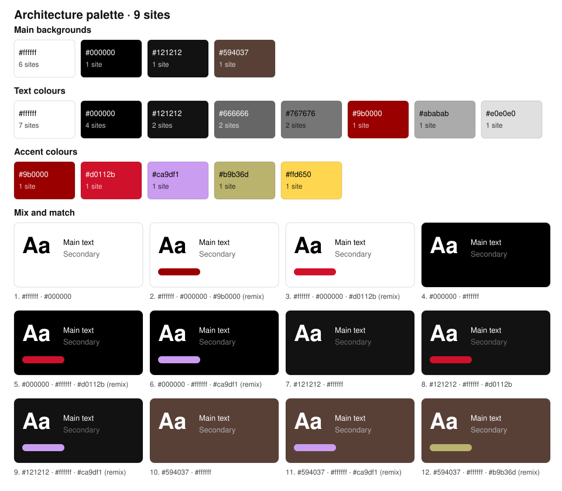

# Architecture palette

9 sites. 1 of them were captured as one screen only, so their colours come from the first screen.

Colours that look alike are merged and named by the most used shade; the counts are sites, not uses. Translucent colours are mixed onto each site's main background first.

## Main backgrounds

| Colour | Sites | Merged shades | Seen on |
| --- | --- | --- | --- |
| `#ffffff` | 6 of 9 | `#f5f5f5`, `#fffbf2` | [AAT Architecten](../../aat-architecten.be/overview.md), [Grounded](../../grounded2026.com/overview.md), [Here & Away](../../here-away.com/overview.md), [UNDPLUS](../../undplus.com/overview.md) and 2 more |
| `#000000` | 1 of 9 | — | [Patmos](../../patmos.studio/overview.md) |
| `#121212` | 1 of 9 | — | [montarville](../../montarville.ca/overview.md) |
| `#594037` | 1 of 9 | — | [dsgn Interior](../../dsgninterior.se/overview.md) |

## Second backgrounds

Section and panel colours that differ from the site's main background.

| Colour | Sites | Merged shades | Seen on |
| --- | --- | --- | --- |
| `#000000` | 3 of 9 | — | [Grounded](../../grounded2026.com/overview.md), [Structure Consulting Engineers](../../structureengineering.com.au/overview.md), [UNDPLUS](../../undplus.com/overview.md) |
| `#252525` | 1 of 9 | — | [montarville](../../montarville.ca/overview.md) |
| `#666666` | 1 of 9 | — | [Grounded](../../grounded2026.com/overview.md) |
| `#b9b36d` | 1 of 9 | — | [Structure Consulting Engineers](../../structureengineering.com.au/overview.md) |
| `#ffd650` | 1 of 9 | — | [UNDPLUS](../../undplus.com/overview.md) |
| `#e5e5e5` | 1 of 9 | `#f0efed` | [Here & Away](../../here-away.com/overview.md) |
| `#f6f5f4` | 1 of 9 | — | [dsgn Interior](../../dsgninterior.se/overview.md) |

## Text colours

| Colour | Sites | Contrast on `#ffffff` | Contrast on `#000000` | Seen on |
| --- | --- | --- | --- | --- |
| `#ffffff` | 7 of 9 | 1.0 | 21.0 | [Grounded](../../grounded2026.com/overview.md), [Here & Away](../../here-away.com/overview.md), [Patmos](../../patmos.studio/overview.md), [Structure Consulting Engineers](../../structureengineering.com.au/overview.md) and 3 more |
| `#000000` | 4 of 9 | 21.0 | 1.0 | [Grounded](../../grounded2026.com/overview.md), [Here & Away](../../here-away.com/overview.md), [Structure Consulting Engineers](../../structureengineering.com.au/overview.md), [UNDPLUS](../../undplus.com/overview.md) |
| `#121212` | 2 of 9 | 18.7 | 1.1 | [montarville](../../montarville.ca/overview.md), [AAT Architecten](../../aat-architecten.be/overview.md) |
| `#666666` | 2 of 9 | 5.7 | 3.7 | [UNDPLUS](../../undplus.com/overview.md), [Grounded](../../grounded2026.com/overview.md) |
| `#767676` | 2 of 9 | 4.5 | 4.6 | [Here & Away](../../here-away.com/overview.md), [Patmos](../../patmos.studio/overview.md) |
| `#9b0000` | 1 of 9 | 8.8 | 2.4 | [Septiembre Arquitectura](../../septiembrearquitectura.com/overview.md) |
| `#ababab` | 1 of 9 | 2.3 | 9.1 | [AAT Architecten](../../aat-architecten.be/overview.md) |
| `#e0e0e0` | 1 of 9 | 1.3 | 15.9 | [Patmos](../../patmos.studio/overview.md) |

## Accent colours

Any colour with real saturation (OKLab chroma 0.06 or more) that is not near-black, wherever the site uses it.

| Colour | Sites | Merged shades | Seen on |
| --- | --- | --- | --- |
| `#9b0000` | 1 of 9 | — | [Septiembre Arquitectura](../../septiembrearquitectura.com/overview.md) |
| `#d0112b` | 1 of 9 | — | [montarville](../../montarville.ca/overview.md) |
| `#ca9df1` | 1 of 9 | — | [UNDPLUS](../../undplus.com/overview.md) |
| `#b9b36d` | 1 of 9 | — | [Structure Consulting Engineers](../../structureengineering.com.au/overview.md) |
| `#ffd650` | 1 of 9 | — | [UNDPLUS](../../undplus.com/overview.md) |

## Mix and match

For each of the most common backgrounds: a main text colour at 7:1 or more where one exists (never below 4.5:1, WCAG AA body text), a muted secondary text between 3:1 and 7:1, and up to two accents at 3:1 or more (large text and UI parts). Colours that appear together on the same site are picked first; a remix borrows colours from different sites in this category.

| # | Background | Text | Secondary | Accent | Contrast text / secondary / accent | Source |
| --- | --- | --- | --- | --- | --- | --- |
| 1 | `#ffffff` | `#000000` | `#666666` | — | 21.0 / 5.7 / — | seen on [Grounded](../../grounded2026.com/overview.md), [Here & Away](../../here-away.com/overview.md) and 2 more |
| 2 | `#ffffff` | `#000000` | `#666666` | `#9b0000` | 21.0 / 5.7 / 8.8 | remix: ground from [AAT Architecten](../../aat-architecten.be/overview.md), text from [Grounded](../../grounded2026.com/overview.md), accent from [Septiembre Arquitectura](../../septiembrearquitectura.com/overview.md) |
| 3 | `#ffffff` | `#000000` | `#666666` | `#d0112b` | 21.0 / 5.7 / 5.5 | remix: ground from [AAT Architecten](../../aat-architecten.be/overview.md), text from [Grounded](../../grounded2026.com/overview.md), accent from [montarville](../../montarville.ca/overview.md) |
| 4 | `#000000` | `#ffffff` | `#767676` | — | 21.0 / 4.6 / — | seen on [Patmos](../../patmos.studio/overview.md) |
| 5 | `#000000` | `#ffffff` | `#767676` | `#d0112b` | 21.0 / 4.6 / 3.8 | remix: ground from [Patmos](../../patmos.studio/overview.md), text from [Grounded](../../grounded2026.com/overview.md), accent from [montarville](../../montarville.ca/overview.md) |
| 6 | `#000000` | `#ffffff` | `#767676` | `#ca9df1` | 21.0 / 4.6 / 9.6 | remix: ground from [Patmos](../../patmos.studio/overview.md), text from [Grounded](../../grounded2026.com/overview.md), accent from [UNDPLUS](../../undplus.com/overview.md) |
| 7 | `#121212` | `#ffffff` | `#666666` | — | 18.7 / 3.3 / — | seen on [montarville](../../montarville.ca/overview.md) |
| 8 | `#121212` | `#ffffff` | `#666666` | `#d0112b` | 18.7 / 3.3 / 3.4 | seen on [montarville](../../montarville.ca/overview.md) |
| 9 | `#121212` | `#ffffff` | `#666666` | `#ca9df1` | 18.7 / 3.3 / 8.6 | remix: ground from [montarville](../../montarville.ca/overview.md), text from [Grounded](../../grounded2026.com/overview.md), accent from [UNDPLUS](../../undplus.com/overview.md) |
| 10 | `#594037` | `#ffffff` | `#ababab` | — | 9.5 / 4.1 / — | seen on [dsgn Interior](../../dsgninterior.se/overview.md) |
| 11 | `#594037` | `#ffffff` | `#ababab` | `#ca9df1` | 9.5 / 4.1 / 4.3 | remix: ground from [dsgn Interior](../../dsgninterior.se/overview.md), text from [Grounded](../../grounded2026.com/overview.md), accent from [UNDPLUS](../../undplus.com/overview.md) |
| 12 | `#594037` | `#ffffff` | `#ababab` | `#b9b36d` | 9.5 / 4.1 / 4.4 | remix: ground from [dsgn Interior](../../dsgninterior.se/overview.md), text from [Grounded](../../grounded2026.com/overview.md), accent from [Structure Consulting Engineers](../../structureengineering.com.au/overview.md) |
