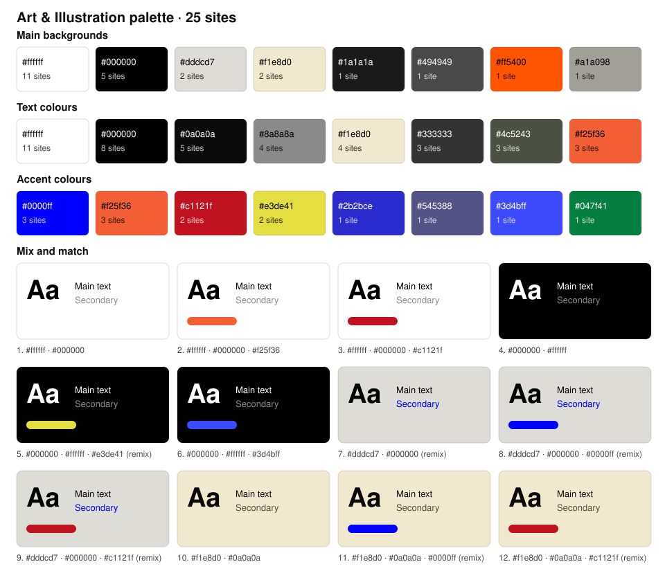

# Art & Illustration palette

25 sites. 10 of them were captured as one screen only, so their colours come from the first screen. Left out as failed captures: [The Future In Black](../../thefutureinblack.com/overview.md).

Colours that look alike are merged and named by the most used shade; the counts are sites, not uses. Translucent colours are mixed onto each site's main background first.

## Main backgrounds

| Colour | Sites | Merged shades | Seen on |
| --- | --- | --- | --- |
| `#ffffff` | 11 of 25 | `#f5f4f0`, `#f6f3ee`, `#faf8f2` | [bleibtgleich'26](../../bleibtgleich.dev/overview.md), [Truth Generation](../../blurthetruth.com/overview.md), [Deep White Gallery](../../deepwhite-gallery.com/overview.md), [Dokmeh Agency](../../hidokmeh.com/overview.md) and 7 more |
| `#000000` | 5 of 25 | `#04040e`, `#080808` | [galekto](../../galekto.com/overview.md), [Huxley Saga](../../huxleysaga.com/overview.md), [Nesil's Lucid Dreams](../../nesilnoble.com/overview.md), [Anthracite Studio](../../anthracitestudio.be/overview.md) and 1 more |
| `#dddcd7` | 2 of 25 | `#e9e9ea` | [Half the Sky](../../halfthesky.app/overview.md), [AI Uis](../../aiu.is/overview.md) |
| `#f1e8d0` | 2 of 25 | `#f3f1ea` | [Nocturnal Dream](../../nocturnaldream.com/overview.md), [Mathis Biabiany](../../mathis-biabiany.fr/overview.md) |
| `#1a1a1a` | 1 of 25 | — | [Flesh and Bones](../../wearefleshandbones.com/overview.md) |
| `#494949` | 1 of 25 | — | [Onseis Studio](../../onseis.com/overview.md) |
| `#ff5400` | 1 of 25 | — | [Two26 Studio](../../two26.studio/overview.md) |
| `#a1a098` | 1 of 25 | — | [Creative Reference Library](../../crl-2026.webflow.io/overview.md) |

## Second backgrounds

Section and panel colours that differ from the site's main background.

| Colour | Sites | Merged shades | Seen on |
| --- | --- | --- | --- |
| `#e2e0d9` | 4 of 25 | `#ede9e5`, `#efece8`, `#fae3e2` | [Mathis Biabiany](../../mathis-biabiany.fr/overview.md), [Truth Generation](../../blurthetruth.com/overview.md), [Kigo Studio](../../kigo.studio/overview.md), [Two26 Studio](../../two26.studio/overview.md) |
| `#000000` | 3 of 25 | `#020203` | [Truth Generation](../../blurthetruth.com/overview.md), [Onseis Studio](../../onseis.com/overview.md), [Nocturnal Dream](../../nocturnaldream.com/overview.md) |
| `#f8eee8` | 3 of 25 | `#faeed9`, `#fbfbfb`, `#fdf8f5` | [Two26 Studio](../../two26.studio/overview.md), [Flesh and Bones](../../wearefleshandbones.com/overview.md), [galekto](../../galekto.com/overview.md) |
| `#0a0908` | 2 of 25 | `#0a0a0a` | [A tribute to Piet Mondrian](../../mondriantribute.com/overview.md), [Vantra (Featured Template)](../../vantra-studio.webflow.io/overview.md) |
| `#c3c5ba` | 2 of 25 | `#cdc4ab` | [Onseis Studio](../../onseis.com/overview.md), [Nocturnal Dream](../../nocturnaldream.com/overview.md) |
| `#1a1a1a` | 1 of 25 | — | [Dokmeh Agency](../../hidokmeh.com/overview.md) |
| `#47331f` | 1 of 25 | — | [Relevo & Vinco](../../relevovinco.com/overview.md) |
| `#2b2bce` | 1 of 25 | — | [The Robot and Me](../../therobotand.me/overview.md) |

## Text colours

| Colour | Sites | Contrast on `#ffffff` | Contrast on `#000000` | Seen on |
| --- | --- | --- | --- | --- |
| `#ffffff` | 11 of 25 | 1.0 | 21.0 | [Anthracite Studio](../../anthracitestudio.be/overview.md), [Truth Generation](../../blurthetruth.com/overview.md), [Creative Reference Library](../../crl-2026.webflow.io/overview.md), [Deep White Gallery](../../deepwhite-gallery.com/overview.md) and 7 more |
| `#000000` | 8 of 25 | 21.0 | 1.0 | [bleibtgleich'26](../../bleibtgleich.dev/overview.md), [Truth Generation](../../blurthetruth.com/overview.md), [Deep White Gallery](../../deepwhite-gallery.com/overview.md), [Nesil's Lucid Dreams](../../nesilnoble.com/overview.md) and 4 more |
| `#0a0a0a` | 5 of 25 | 19.8 | 1.1 | [Vantra (Featured Template)](../../vantra-studio.webflow.io/overview.md), [The Robot and Me](../../therobotand.me/overview.md), [Dokmeh Agency](../../hidokmeh.com/overview.md), [Shelby's Desk](../../shelbykho.com/overview.md) and 1 more |
| `#8a8a8a` | 4 of 25 | 3.5 | 6.1 | [Stash](../../stash.cool/overview.md), [Anthracite Studio](../../anthracitestudio.be/overview.md), [Nocturnal Dream](../../nocturnaldream.com/overview.md), [Mathis Biabiany](../../mathis-biabiany.fr/overview.md) |
| `#f1e8d0` | 4 of 25 | 1.2 | 17.2 | [Nocturnal Dream](../../nocturnaldream.com/overview.md), [Onseis Studio](../../onseis.com/overview.md), [Two26 Studio](../../two26.studio/overview.md), [Flesh and Bones](../../wearefleshandbones.com/overview.md) |
| `#333333` | 3 of 25 | 12.6 | 1.7 | [Dokmeh Agency](../../hidokmeh.com/overview.md), [Two26 Studio](../../two26.studio/overview.md), [Onseis Studio](../../onseis.com/overview.md) |
| `#4c5243` | 3 of 25 | 8.1 | 2.6 | [The boring blog](../../theboringblog.ai/overview.md), [The Robot and Me](../../therobotand.me/overview.md), [Vantra (Featured Template)](../../vantra-studio.webflow.io/overview.md) |
| `#f25f36` | 3 of 25 | 3.2 | 6.5 | [Flesh and Bones](../../wearefleshandbones.com/overview.md), [Two26 Studio](../../two26.studio/overview.md), [The Robot and Me](../../therobotand.me/overview.md) |

## Accent colours

Any colour with real saturation (OKLab chroma 0.06 or more) that is not near-black, wherever the site uses it.

| Colour | Sites | Merged shades | Seen on |
| --- | --- | --- | --- |
| `#0000ff` | 3 of 25 | `#1d00ff` | [AI Uis](../../aiu.is/overview.md), [galekto](../../galekto.com/overview.md), [Shelby's Desk](../../shelbykho.com/overview.md) |
| `#f25f36` | 3 of 25 | `#ff5956`, `#ff633d` | [Flesh and Bones](../../wearefleshandbones.com/overview.md), [The Robot and Me](../../therobotand.me/overview.md), [bleibtgleich'26](../../bleibtgleich.dev/overview.md) |
| `#c1121f` | 2 of 25 | `#c31f26` | [A tribute to Piet Mondrian](../../mondriantribute.com/overview.md), [bleibtgleich'26](../../bleibtgleich.dev/overview.md) |
| `#e3de41` | 2 of 25 | `#facc15`, `#ffc840`, `#ffd060`, `#ffe566` | [Truth Generation](../../blurthetruth.com/overview.md), [galekto](../../galekto.com/overview.md) |
| `#2b2bce` | 1 of 25 | — | [The Robot and Me](../../therobotand.me/overview.md) |
| `#545388` | 1 of 25 | — | [Nesil's Lucid Dreams](../../nesilnoble.com/overview.md) |
| `#3d4bff` | 1 of 25 | — | [Anthracite Studio](../../anthracitestudio.be/overview.md) |
| `#047f41` | 1 of 25 | — | [Truth Generation](../../blurthetruth.com/overview.md) |

## Mix and match

For each of the most common backgrounds: a main text colour at 7:1 or more where one exists (never below 4.5:1, WCAG AA body text), a muted secondary text between 3:1 and 7:1, and up to two accents at 3:1 or more (large text and UI parts). Colours that appear together on the same site are picked first; a remix borrows colours from different sites in this category.

| # | Background | Text | Secondary | Accent | Contrast text / secondary / accent | Source |
| --- | --- | --- | --- | --- | --- | --- |
| 1 | `#ffffff` | `#000000` | `#8a8a8a` | — | 21.0 / 3.5 / — | seen on [bleibtgleich'26](../../bleibtgleich.dev/overview.md), [Truth Generation](../../blurthetruth.com/overview.md) and 2 more |
| 2 | `#ffffff` | `#000000` | `#8a8a8a` | `#f25f36` | 21.0 / 3.5 / 3.2 | seen on [bleibtgleich'26](../../bleibtgleich.dev/overview.md) |
| 3 | `#ffffff` | `#000000` | `#8a8a8a` | `#c1121f` | 21.0 / 3.5 / 6.2 | seen on [bleibtgleich'26](../../bleibtgleich.dev/overview.md) |
| 4 | `#000000` | `#ffffff` | `#8a8a8a` | — | 21.0 / 6.1 / — | seen on [Anthracite Studio](../../anthracitestudio.be/overview.md), [Huxley Saga](../../huxleysaga.com/overview.md) and 2 more |
| 5 | `#000000` | `#ffffff` | `#8a8a8a` | `#e3de41` | 21.0 / 6.1 / 14.8 | remix: ground from [galekto](../../galekto.com/overview.md), text from [Anthracite Studio](../../anthracitestudio.be/overview.md), accent from [Truth Generation](../../blurthetruth.com/overview.md) |
| 6 | `#000000` | `#ffffff` | `#8a8a8a` | `#3d4bff` | 21.0 / 6.1 / 3.6 | seen on [Anthracite Studio](../../anthracitestudio.be/overview.md) |
| 7 | `#dddcd7` | `#000000` | `#0000ff` | — | 15.3 / 6.3 / — | remix: ground from [Half the Sky](../../halfthesky.app/overview.md), text from [bleibtgleich'26](../../bleibtgleich.dev/overview.md) |
| 8 | `#dddcd7` | `#000000` | `#0000ff` | `#0000ff` | 15.3 / 6.3 / 6.3 | remix: ground from [Half the Sky](../../halfthesky.app/overview.md), text from [bleibtgleich'26](../../bleibtgleich.dev/overview.md), accent from [AI Uis](../../aiu.is/overview.md) |
| 9 | `#dddcd7` | `#000000` | `#0000ff` | `#c1121f` | 15.3 / 6.3 / 4.5 | remix: ground from [Half the Sky](../../halfthesky.app/overview.md), text from [bleibtgleich'26](../../bleibtgleich.dev/overview.md), accent from [A tribute to Piet Mondrian](../../mondriantribute.com/overview.md) |
| 10 | `#f1e8d0` | `#0a0a0a` | `#4c5243` | — | 16.2 / 6.6 / — | seen on [Mathis Biabiany](../../mathis-biabiany.fr/overview.md) |
| 11 | `#f1e8d0` | `#0a0a0a` | `#4c5243` | `#0000ff` | 16.2 / 6.6 / 7.0 | remix: ground from [Nocturnal Dream](../../nocturnaldream.com/overview.md), text from [Vantra (Featured Template)](../../vantra-studio.webflow.io/overview.md), accent from [AI Uis](../../aiu.is/overview.md) |
| 12 | `#f1e8d0` | `#0a0a0a` | `#4c5243` | `#c1121f` | 16.2 / 6.6 / 5.1 | remix: ground from [Nocturnal Dream](../../nocturnaldream.com/overview.md), text from [Vantra (Featured Template)](../../vantra-studio.webflow.io/overview.md), accent from [A tribute to Piet Mondrian](../../mondriantribute.com/overview.md) |
