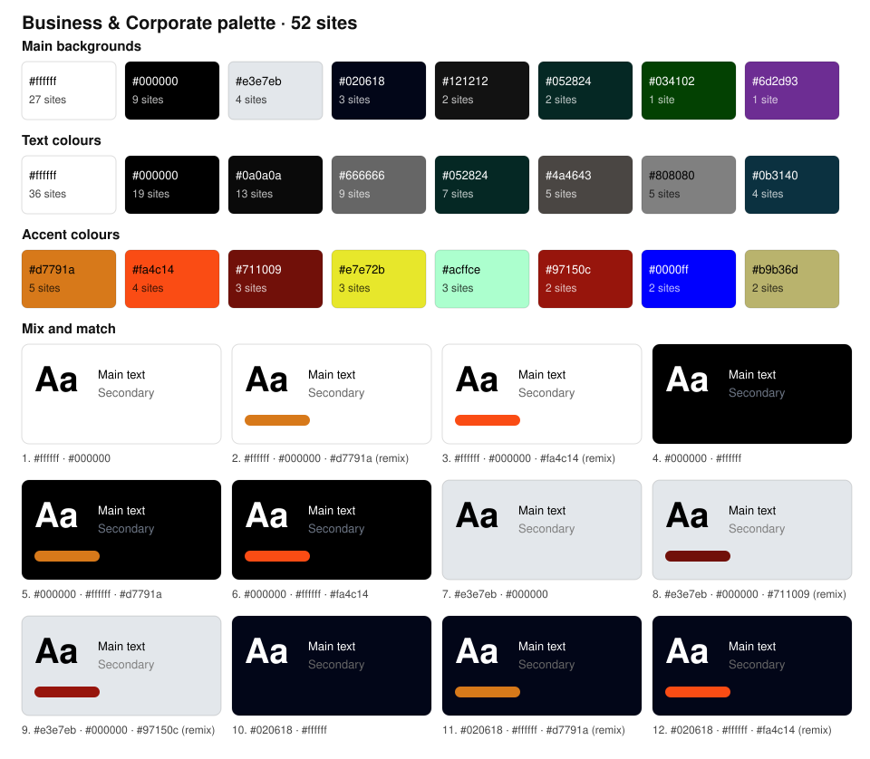

# Business & Corporate palette

52 sites. 6 of them were captured as one screen only, so their colours come from the first screen.

Colours that look alike are merged and named by the most used shade; the counts are sites, not uses. Translucent colours are mixed onto each site's main background first.

## Main backgrounds

| Colour | Sites | Merged shades | Seen on |
| --- | --- | --- | --- |
| `#ffffff` | 27 of 52 | `#f1f1f1`, `#f2f2f6`, `#f4f4f2`, `#f5f4f0` | [blue2purple](../../blue2purple.com/overview.md), [.txt](../../dottxt.ai/overview.md), [ESR Bespoke](../../esrbespoke.au/overview.md), [Garvin Promotion Group](../../gpg.dops.agency/overview.md) and 23 more |
| `#000000` | 9 of 52 | `#010101` | [Camper & Nicholsons](../../camperandnicholsons.com/overview.md), [DeepBook](../../deepbook-v2-wip.webflow.io/overview.md), [Dragonfly Redux](../../dragonfly2.studiofreight.dev/overview.md), [Endurosat Space Service](../../endurosat.com-space-service/overview.md) and 5 more |
| `#e3e7eb` | 4 of 52 | `#e4e4e4`, `#edeee5`, `#f4f0ea` | [CROX](../../crox.framer.website/overview.md), [Lesse Studio](../../lessestudio.com/overview.md), [AUGE Experience](../../auge-xp.com/overview.md), [Auremin](../../auremin.com/overview.md) |
| `#020618` | 3 of 52 | `#0c0c0c`, `#0f0723` | [Redesigning Trust: Level2](../../trylevel2.com/overview.md), [Forge Automotive](../../forgeautomotive.co.uk/overview.md), [Imogen: Agentic AI](../../vsproject-imogen.vendredi-society.com/overview.md) |
| `#121212` | 2 of 52 | `#191a1e` | [montarville](../../montarville.ca/overview.md), [Byotōne](../../byotone.com/overview.md) |
| `#052824` | 2 of 52 | `#212121` | [Leome and Partners](../../leome-and-partners.com/overview.md), [Pilato](../../pilato.it/overview.md) |
| `#034102` | 1 of 52 | — | [Sweet Tape](../../sweet-tape.com/overview.md) |
| `#6d2d93` | 1 of 52 | — | [Cyera AI Guardian](../../secure-the-unknown.cyera.com/overview.md) |

## Second backgrounds

Section and panel colours that differ from the site's main background.

| Colour | Sites | Merged shades | Seen on |
| --- | --- | --- | --- |
| `#000000` | 16 of 52 | `#050505`, `#080808` | [AUGE Experience](../../auge-xp.com/overview.md), [.txt](../../dottxt.ai/overview.md), [ESR Bespoke](../../esrbespoke.au/overview.md), [Forge Automotive](../../forgeautomotive.co.uk/overview.md) and 12 more |
| `#ffffff` | 9 of 52 | `#f0f2f4`, `#f4f5f7`, `#f8fafc` | [Auremin](../../auremin.com/overview.md), [Camper & Nicholsons](../../camperandnicholsons.com/overview.md), [CROX](../../crox.framer.website/overview.md), [DeepBook](../../deepbook-v2-wip.webflow.io/overview.md) and 5 more |
| `#0a0a0a` | 5 of 52 | `#101010`, `#131313`, `#131419`, `#181713` | [Vantra (Featured Template)](../../vantra-studio.webflow.io/overview.md), [Lesse Studio](../../lessestudio.com/overview.md), [Imperiale Bolgheri](../../imperialebolgheri.com-en/overview.md), [Room and Pillar](../../roomandpillar.com/overview.md) and 1 more |
| `#1a1b1c` | 4 of 52 | `#1d1d1d`, `#252324`, `#252525` | [CROX](../../crox.framer.website/overview.md), [Imperiale Bolgheri](../../imperialebolgheri.com-en/overview.md), [Podium](../../podiumautomation.com/overview.md), [montarville](../../montarville.ca/overview.md) |
| `#c3c0bb` | 3 of 52 | `#c4c6ca`, `#cdcdcd` | [Auremin](../../auremin.com/overview.md), [Nova Dental](../../nova-dental-dev.webflow.io/overview.md), [Lesse Studio](../../lessestudio.com/overview.md) |
| `#e8e4e0` | 3 of 52 | `#ede8e4`, `#efefef` | [Reckon House Staples](../../reckon.house/overview.md), [Podium](../../podiumautomation.com/overview.md), [.txt](../../dottxt.ai/overview.md) |
| `#031b36` | 2 of 52 | `#13193b` | [Think Company](../../thinkcompany.com/overview.md), [8am Showcase '26 Fall Release](../../showcase.8am.com/overview.md) |
| `#762a27` | 2 of 52 | `#79311b` | [https://www.terrenohotel.com/](../../terrenohotel.com-en/overview.md), [.txt](../../dottxt.ai/overview.md) |

## Text colours

| Colour | Sites | Contrast on `#ffffff` | Contrast on `#000000` | Seen on |
| --- | --- | --- | --- | --- |
| `#ffffff` | 36 of 52 | 1.0 | 21.0 | [AUGE Experience](../../auge-xp.com/overview.md), [Auremin](../../auremin.com/overview.md), [blue2purple](../../blue2purple.com/overview.md), [Byotōne](../../byotone.com/overview.md) and 32 more |
| `#000000` | 19 of 52 | 21.0 | 1.0 | [Camper & Nicholsons](../../camperandnicholsons.com/overview.md), [DeepBook](../../deepbook-v2-wip.webflow.io/overview.md), [.txt](../../dottxt.ai/overview.md), [Endurosat Space Service](../../endurosat.com-space-service/overview.md) and 15 more |
| `#0a0a0a` | 13 of 52 | 19.8 | 1.1 | [blue2purple](../../blue2purple.com/overview.md), [Vantra (Featured Template)](../../vantra-studio.webflow.io/overview.md), [Redesigning Trust: Level2](../../trylevel2.com/overview.md), [Butter](../../butter.video/overview.md) and 9 more |
| `#666666` | 9 of 52 | 5.7 | 3.7 | [Junca Studio](../../juncastudio.com/overview.md), [UNDPLUS](../../undplus.com/overview.md), [metic. – Take a closer look](../../metic.studio-en/overview.md), [Orionix - Creative Agency](../../orionix.framer.website/overview.md) and 5 more |
| `#052824` | 7 of 52 | 15.7 | 1.3 | [Leome and Partners](../../leome-and-partners.com/overview.md), [CROX](../../crox.framer.website/overview.md), [Lumena](../../lumena-partners.com/overview.md), [Butter](../../butter.video/overview.md) and 3 more |
| `#4a4643` | 5 of 52 | 9.3 | 2.2 | [Auremin](../../auremin.com/overview.md), [metic. – Take a closer look](../../metic.studio-en/overview.md), [Vantra (Featured Template)](../../vantra-studio.webflow.io/overview.md), [Junca Studio](../../juncastudio.com/overview.md) and 1 more |
| `#808080` | 5 of 52 | 3.9 | 5.3 | [DeepBook](../../deepbook-v2-wip.webflow.io/overview.md), [blue2purple](../../blue2purple.com/overview.md), [Garvin Promotion Group](../../gpg.dops.agency/overview.md), [Zenarate](../../zenarate.com/overview.md) and 1 more |
| `#0b3140` | 4 of 52 | 13.7 | 1.5 | [8am Showcase '26 Fall Release](../../showcase.8am.com/overview.md), [MECHA](../../mecha-xyz.webflow.io/overview.md), [Auremin](../../auremin.com/overview.md), [Think Company](../../thinkcompany.com/overview.md) |

## Accent colours

Any colour with real saturation (OKLab chroma 0.06 or more) that is not near-black, wherever the site uses it.

| Colour | Sites | Merged shades | Seen on |
| --- | --- | --- | --- |
| `#d7791a` | 5 of 52 | `#f05722`, `#f15928`, `#f38422`, `#fa8005` | [Sweet Tape](../../sweet-tape.com/overview.md), [8am Showcase '26 Fall Release](../../showcase.8am.com/overview.md), [Garvin Promotion Group](../../gpg.dops.agency/overview.md), [Strawberry Group](../../strawberrygroup.no/overview.md) and 1 more |
| `#fa4c14` | 4 of 52 | `#ff2c17`, `#ff3701`, `#ff3e3e` | [Dragonfly Redux](../../dragonfly2.studiofreight.dev/overview.md), [Think Company](../../thinkcompany.com/overview.md), [ZEGGO](../../zeggo.com.sg/overview.md), [metic. – Take a closer look](../../metic.studio-en/overview.md) |
| `#711009` | 3 of 52 | `#762a27`, `#79311b` | [Junca Studio](../../juncastudio.com/overview.md), [https://www.terrenohotel.com/](../../terrenohotel.com-en/overview.md), [.txt](../../dottxt.ai/overview.md) |
| `#e7e72b` | 3 of 52 | `#ffd650`, `#ffdc13` | [Where Opportunity Takes Root](../../opportunity.waltonfamilyfoundation.org/overview.md), [UNDPLUS](../../undplus.com/overview.md), [Sweet Tape](../../sweet-tape.com/overview.md) |
| `#acffce` | 3 of 52 | `#b1f9e1`, `#e3f0a9`, `#ecffb2`, `#ecffb3` | [Byotōne](../../byotone.com/overview.md), [Leome and Partners](../../leome-and-partners.com/overview.md), [https://www.terrenohotel.com/](../../terrenohotel.com-en/overview.md) |
| `#97150c` | 2 of 52 | `#a3003f` | [Junca Studio](../../juncastudio.com/overview.md), [PSP Production](../../productionportugal.com/overview.md) |
| `#0000ff` | 2 of 52 | `#0c00ff` | [MECHA](../../mecha-xyz.webflow.io/overview.md), [blue2purple](../../blue2purple.com/overview.md) |
| `#b9b36d` | 2 of 52 | `#d79e64` | [Structure Consulting Engineers](../../structureengineering.com.au/overview.md), [Strawberry Group](../../strawberrygroup.no/overview.md) |

## Mix and match

For each of the most common backgrounds: a main text colour at 7:1 or more where one exists (never below 4.5:1, WCAG AA body text), a muted secondary text between 3:1 and 7:1, and up to two accents at 3:1 or more (large text and UI parts). Colours that appear together on the same site are picked first; a remix borrows colours from different sites in this category.

| # | Background | Text | Secondary | Accent | Contrast text / secondary / accent | Source |
| --- | --- | --- | --- | --- | --- | --- |
| 1 | `#ffffff` | `#000000` | `#666666` | — | 21.0 / 5.7 / — | seen on [.txt](../../dottxt.ai/overview.md), [ESR Bespoke](../../esrbespoke.au/overview.md) and 9 more |
| 2 | `#ffffff` | `#000000` | `#666666` | `#d7791a` | 21.0 / 5.7 / 3.2 | remix: ground from [blue2purple](../../blue2purple.com/overview.md), text from [Camper & Nicholsons](../../camperandnicholsons.com/overview.md), accent from [Sweet Tape](../../sweet-tape.com/overview.md) |
| 3 | `#ffffff` | `#000000` | `#666666` | `#fa4c14` | 21.0 / 5.7 / 3.4 | remix: ground from [blue2purple](../../blue2purple.com/overview.md), text from [Camper & Nicholsons](../../camperandnicholsons.com/overview.md), accent from [Dragonfly Redux](../../dragonfly2.studiofreight.dev/overview.md) |
| 4 | `#000000` | `#ffffff` | `#6c7584` | — | 21.0 / 4.5 / — | seen on [Camper & Nicholsons](../../camperandnicholsons.com/overview.md), [DeepBook](../../deepbook-v2-wip.webflow.io/overview.md) and 5 more |
| 5 | `#000000` | `#ffffff` | `#6c7584` | `#d7791a` | 21.0 / 4.5 / 6.6 | seen on [Endurosat Space Service](../../endurosat.com-space-service/overview.md) |
| 6 | `#000000` | `#ffffff` | `#6c7584` | `#fa4c14` | 21.0 / 4.5 / 6.1 | seen on [Dragonfly Redux](../../dragonfly2.studiofreight.dev/overview.md), [ZEGGO](../../zeggo.com.sg/overview.md) |
| 7 | `#e3e7eb` | `#000000` | `#808080` | — | 16.9 / 3.2 / — | seen on [Lesse Studio](../../lessestudio.com/overview.md) |
| 8 | `#e3e7eb` | `#000000` | `#808080` | `#711009` | 16.9 / 3.2 / 9.5 | remix: ground from [CROX](../../crox.framer.website/overview.md), text from [Camper & Nicholsons](../../camperandnicholsons.com/overview.md), accent from [Junca Studio](../../juncastudio.com/overview.md) |
| 9 | `#e3e7eb` | `#000000` | `#808080` | `#97150c` | 16.9 / 3.2 / 7.0 | remix: ground from [CROX](../../crox.framer.website/overview.md), text from [Camper & Nicholsons](../../camperandnicholsons.com/overview.md), accent from [Junca Studio](../../juncastudio.com/overview.md) |
| 10 | `#020618` | `#ffffff` | `#666666` | — | 20.2 / 3.5 / — | seen on [Forge Automotive](../../forgeautomotive.co.uk/overview.md), [Redesigning Trust: Level2](../../trylevel2.com/overview.md) and 1 more |
| 11 | `#020618` | `#ffffff` | `#666666` | `#d7791a` | 20.2 / 3.5 / 6.4 | remix: ground from [Redesigning Trust: Level2](../../trylevel2.com/overview.md), text from [AUGE Experience](../../auge-xp.com/overview.md), accent from [Sweet Tape](../../sweet-tape.com/overview.md) |
| 12 | `#020618` | `#ffffff` | `#666666` | `#fa4c14` | 20.2 / 3.5 / 5.9 | remix: ground from [Redesigning Trust: Level2](../../trylevel2.com/overview.md), text from [AUGE Experience](../../auge-xp.com/overview.md), accent from [Dragonfly Redux](../../dragonfly2.studiofreight.dev/overview.md) |
