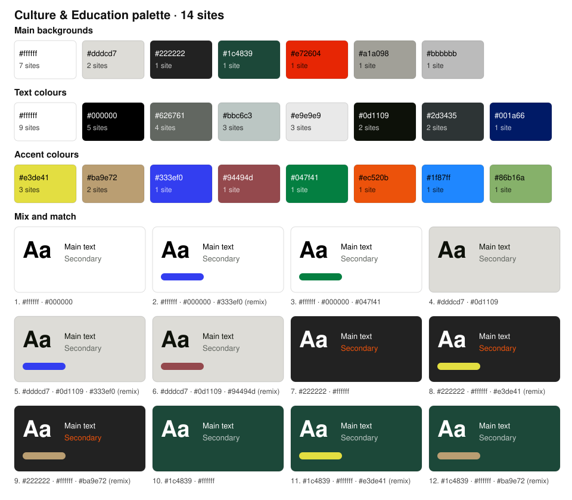

# Culture & Education palette

14 sites. 7 of them were captured as one screen only, so their colours come from the first screen. Left out as failed captures: [The Future In Black](../../thefutureinblack.com/overview.md).

Colours that look alike are merged and named by the most used shade; the counts are sites, not uses. Translucent colours are mixed onto each site's main background first.

## Main backgrounds

| Colour | Sites | Merged shades | Seen on |
| --- | --- | --- | --- |
| `#ffffff` | 7 of 14 | `#f4f4f4`, `#f8f2ea`, `#f9f7f2` | [Truth Generation](../../blurthetruth.com/overview.md), [Grids](../../grids03.obys.agency/overview.md), [Where Opportunity Takes Root](../../opportunity.waltonfamilyfoundation.org/overview.md), [Readymag Madrid Meetup](../../readymag.com-madrid-meetup/overview.md) and 3 more |
| `#dddcd7` | 2 of 14 | `#e5e5e5` | [Half the Sky](../../halfthesky.app/overview.md), [Xiloteca Trevigiana](../../xiloteca.it-en/overview.md) |
| `#222222` | 1 of 14 | — | [FORMAT](../../format.obys.agency/overview.md) |
| `#1c4839` | 1 of 14 | — | [Why Zero](../../why.zero.university/overview.md) |
| `#e72604` | 1 of 14 | — | [Love and Money](../../loveandmoney.com/overview.md) |
| `#a1a098` | 1 of 14 | — | [Creative Reference Library](../../crl-2026.webflow.io/overview.md) |
| `#bbbbbb` | 1 of 14 | — | [John and Patricia's Space](../../john-and-patricias-comfort-site-about-attachment-styles.com/overview.md) |

## Second backgrounds

Section and panel colours that differ from the site's main background.

| Colour | Sites | Merged shades | Seen on |
| --- | --- | --- | --- |
| `#ede9e5` | 3 of 14 | `#eee7d4`, `#eee9da`, `#eee9dc`, `#f5ecd7` | [Truth Generation](../../blurthetruth.com/overview.md), [GoShuin — Every stamp, a memory.](../../aestudio.studio-goshuin-en/overview.md), [John and Patricia's Space](../../john-and-patricias-comfort-site-about-attachment-styles.com/overview.md) |
| `#000000` | 2 of 14 | — | [Truth Generation](../../blurthetruth.com/overview.md), [Where Opportunity Takes Root](../../opportunity.waltonfamilyfoundation.org/overview.md) |
| `#212a15` | 2 of 14 | `#282828` | [Xiloteca Trevigiana](../../xiloteca.it-en/overview.md), [Readymag Madrid Meetup](../../readymag.com-madrid-meetup/overview.md) |
| `#d9d9d9` | 2 of 14 | `#e7e5df` | [Grids](../../grids03.obys.agency/overview.md), [GoShuin — Every stamp, a memory.](../../aestudio.studio-goshuin-en/overview.md) |
| `#1c1c1c` | 1 of 14 | — | [Readymag Madrid Meetup](../../readymag.com-madrid-meetup/overview.md) |
| `#5c5c5c` | 1 of 14 | — | [Xiloteca Trevigiana](../../xiloteca.it-en/overview.md) |
| `#1f87ff` | 1 of 14 | — | [Montreal Canadiens Foundation](../../fondation.canadiens.com/overview.md) |
| `#ffffff` | 1 of 14 | — | [FORMAT](../../format.obys.agency/overview.md) |

## Text colours

| Colour | Sites | Contrast on `#ffffff` | Contrast on `#dddcd7` | Seen on |
| --- | --- | --- | --- | --- |
| `#ffffff` | 9 of 14 | 1.0 | 1.4 | [Truth Generation](../../blurthetruth.com/overview.md), [Creative Reference Library](../../crl-2026.webflow.io/overview.md), [Montreal Canadiens Foundation](../../fondation.canadiens.com/overview.md), [FORMAT](../../format.obys.agency/overview.md) and 5 more |
| `#000000` | 5 of 14 | 21.0 | 15.3 | [Truth Generation](../../blurthetruth.com/overview.md), [FORMAT](../../format.obys.agency/overview.md), [Grids](../../grids03.obys.agency/overview.md), [Later's Made You Look](../../later.com-made-you-look/overview.md) and 1 more |
| `#626761` | 4 of 14 | 5.8 | 4.2 | [GoShuin — Every stamp, a memory.](../../aestudio.studio-goshuin-en/overview.md), [Xiloteca Trevigiana](../../xiloteca.it-en/overview.md), [Half the Sky](../../halfthesky.app/overview.md), [John and Patricia's Space](../../john-and-patricias-comfort-site-about-attachment-styles.com/overview.md) |
| `#bbc6c3` | 3 of 14 | 1.8 | 1.3 | [GoShuin — Every stamp, a memory.](../../aestudio.studio-goshuin-en/overview.md), [Why Zero](../../why.zero.university/overview.md), [FORMAT](../../format.obys.agency/overview.md) |
| `#e9e9e9` | 3 of 14 | 1.2 | 1.1 | [Readymag Madrid Meetup](../../readymag.com-madrid-meetup/overview.md), [Why Zero](../../why.zero.university/overview.md), [John and Patricia's Space](../../john-and-patricias-comfort-site-about-attachment-styles.com/overview.md) |
| `#0d1109` | 2 of 14 | 19.1 | 13.9 | [Xiloteca Trevigiana](../../xiloteca.it-en/overview.md), [Where Opportunity Takes Root](../../opportunity.waltonfamilyfoundation.org/overview.md) |
| `#2d3435` | 2 of 14 | 12.7 | 9.2 | [GoShuin — Every stamp, a memory.](../../aestudio.studio-goshuin-en/overview.md), [Xiloteca Trevigiana](../../xiloteca.it-en/overview.md) |
| `#001a66` | 1 of 14 | 15.7 | 11.4 | [Montreal Canadiens Foundation](../../fondation.canadiens.com/overview.md) |

## Accent colours

Any colour with real saturation (OKLab chroma 0.06 or more) that is not near-black, wherever the site uses it.

| Colour | Sites | Merged shades | Seen on |
| --- | --- | --- | --- |
| `#e3de41` | 3 of 14 | `#e7e72b`, `#ffcb00` | [Truth Generation](../../blurthetruth.com/overview.md), [Where Opportunity Takes Root](../../opportunity.waltonfamilyfoundation.org/overview.md), [Readymag Madrid Meetup](../../readymag.com-madrid-meetup/overview.md) |
| `#ba9e72` | 2 of 14 | `#c4a882` | [Love and Money](../../loveandmoney.com/overview.md), [John and Patricia's Space](../../john-and-patricias-comfort-site-about-attachment-styles.com/overview.md) |
| `#333ef0` | 1 of 14 | — | [Montreal Canadiens Foundation](../../fondation.canadiens.com/overview.md) |
| `#94494d` | 1 of 14 | — | [Love and Money](../../loveandmoney.com/overview.md) |
| `#047f41` | 1 of 14 | — | [Truth Generation](../../blurthetruth.com/overview.md) |
| `#ec520b` | 1 of 14 | — | [Readymag Madrid Meetup](../../readymag.com-madrid-meetup/overview.md) |
| `#1f87ff` | 1 of 14 | — | [Montreal Canadiens Foundation](../../fondation.canadiens.com/overview.md) |
| `#86b16a` | 1 of 14 | — | [Love and Money](../../loveandmoney.com/overview.md) |

## Mix and match

For each of the most common backgrounds: a main text colour at 7:1 or more where one exists (never below 4.5:1, WCAG AA body text), a muted secondary text between 3:1 and 7:1, and up to two accents at 3:1 or more (large text and UI parts). Colours that appear together on the same site are picked first; a remix borrows colours from different sites in this category.

| # | Background | Text | Secondary | Accent | Contrast text / secondary / accent | Source |
| --- | --- | --- | --- | --- | --- | --- |
| 1 | `#ffffff` | `#000000` | `#626761` | — | 21.0 / 5.8 / — | seen on [Truth Generation](../../blurthetruth.com/overview.md), [Grids](../../grids03.obys.agency/overview.md) and 1 more |
| 2 | `#ffffff` | `#000000` | `#626761` | `#333ef0` | 21.0 / 5.8 / 6.8 | remix: ground from [Truth Generation](../../blurthetruth.com/overview.md), text from [Truth Generation](../../blurthetruth.com/overview.md), accent from [Montreal Canadiens Foundation](../../fondation.canadiens.com/overview.md) |
| 3 | `#ffffff` | `#000000` | `#626761` | `#047f41` | 21.0 / 5.8 / 5.1 | seen on [Truth Generation](../../blurthetruth.com/overview.md) |
| 4 | `#dddcd7` | `#0d1109` | `#626761` | — | 13.9 / 4.2 / — | seen on [Xiloteca Trevigiana](../../xiloteca.it-en/overview.md) |
| 5 | `#dddcd7` | `#0d1109` | `#626761` | `#333ef0` | 13.9 / 4.2 / 5.0 | remix: ground from [Half the Sky](../../halfthesky.app/overview.md), text from [Xiloteca Trevigiana](../../xiloteca.it-en/overview.md), accent from [Montreal Canadiens Foundation](../../fondation.canadiens.com/overview.md) |
| 6 | `#dddcd7` | `#0d1109` | `#626761` | `#94494d` | 13.9 / 4.2 / 4.6 | remix: ground from [Half the Sky](../../halfthesky.app/overview.md), text from [Xiloteca Trevigiana](../../xiloteca.it-en/overview.md), accent from [Love and Money](../../loveandmoney.com/overview.md) |
| 7 | `#222222` | `#ffffff` | `#ec520b` | — | 15.9 / 4.4 / — | seen on [FORMAT](../../format.obys.agency/overview.md) |
| 8 | `#222222` | `#ffffff` | `#ec520b` | `#e3de41` | 15.9 / 4.4 / 11.2 | remix: ground from [FORMAT](../../format.obys.agency/overview.md), text from [Truth Generation](../../blurthetruth.com/overview.md), accent from [Truth Generation](../../blurthetruth.com/overview.md) |
| 9 | `#222222` | `#ffffff` | `#ec520b` | `#ba9e72` | 15.9 / 4.4 / 6.2 | remix: ground from [FORMAT](../../format.obys.agency/overview.md), text from [Truth Generation](../../blurthetruth.com/overview.md), accent from [Love and Money](../../loveandmoney.com/overview.md) |
| 10 | `#1c4839` | `#ffffff` | `#bbc6c3` | — | 10.3 / 5.9 / — | seen on [Why Zero](../../why.zero.university/overview.md) |
| 11 | `#1c4839` | `#ffffff` | `#bbc6c3` | `#e3de41` | 10.3 / 5.9 / 7.3 | remix: ground from [Why Zero](../../why.zero.university/overview.md), text from [Truth Generation](../../blurthetruth.com/overview.md), accent from [Truth Generation](../../blurthetruth.com/overview.md) |
| 12 | `#1c4839` | `#ffffff` | `#bbc6c3` | `#ba9e72` | 10.3 / 5.9 / 4.0 | remix: ground from [Why Zero](../../why.zero.university/overview.md), text from [Truth Generation](../../blurthetruth.com/overview.md), accent from [Love and Money](../../loveandmoney.com/overview.md) |
