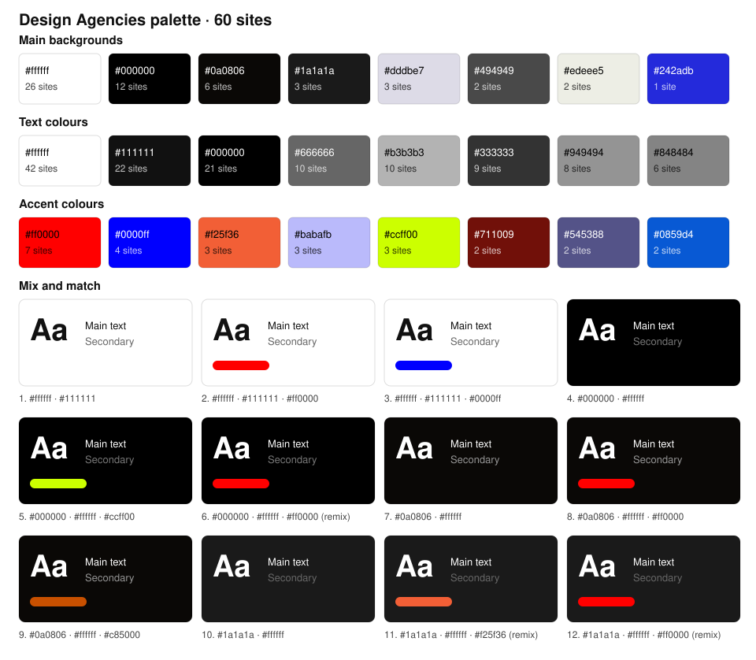

# Design Agencies palette

60 sites. 18 of them were captured as one screen only, so their colours come from the first screen.

Colours that look alike are merged and named by the most used shade; the counts are sites, not uses. Translucent colours are mixed onto each site's main background first.

## Main backgrounds

| Colour | Sites | Merged shades | Seen on |
| --- | --- | --- | --- |
| `#ffffff` | 26 of 60 | `#f1f1f1`, `#f1f3f5`, `#f4f2f0`, `#f4f4f2` | [AVEA](../../avea.studio/overview.md), [Awake Agency](../../awakeagency.dev/overview.md), [blue2purple](../../blue2purple.com/overview.md), [Design by Ency](../../designbyency.com/overview.md) and 22 more |
| `#000000` | 12 of 60 | `#04040e`, `#050505`, `#06070a` | [Clevermellow](../../clevermellow.co/overview.md), [Dash Creative](../../dashcreative.co/overview.md), [Dopamine Studio](../../dopaminestudio.io/overview.md), [GOBOLD™ Agency](../../gobold.live/overview.md) and 8 more |
| `#0a0806` | 6 of 60 | `#0e0e0e`, `#111111`, `#121212`, `#131313` | [David Estrada](../../david-estrada.dev/overview.md), [Produx Design](../../produx.design/overview.md), [Boldium](../../boldium.com/overview.md), [Share Bien](../../sharebien.com/overview.md) and 2 more |
| `#1a1a1a` | 3 of 60 | `#1e1e1e`, `#222124` | [Flesh and Bones](../../wearefleshandbones.com/overview.md), [Carter Ogunsola](../../carterogunsola.com/overview.md), [Ingrassia Daniel - Portfolio](../../ingrassiadaniel.it/overview.md) |
| `#dddbe7` | 3 of 60 | `#e4e3da`, `#e4e4e4` | [Made in May](../../madeinmay.studio/overview.md), [tricks GmbH](../../tricks.de/overview.md), [Lesse Studio](../../lessestudio.com/overview.md) |
| `#494949` | 2 of 60 | `#594037` | [Onseis Studio](../../onseis.com/overview.md), [dsgn Interior](../../dsgninterior.se/overview.md) |
| `#edeee5` | 2 of 60 | `#f5efff` | [AUGE Experience](../../auge-xp.com/overview.md), [Emotion Agency](../../emotion-agency.com/overview.md) |
| `#242adb` | 1 of 60 | — | [Pixelismo Studio](../../pixelismo.it/overview.md) |

## Second backgrounds

Section and panel colours that differ from the site's main background.

| Colour | Sites | Merged shades | Seen on |
| --- | --- | --- | --- |
| `#000000` | 12 of 60 | `#050505`, `#070506`, `#080808` | [AUGE Experience](../../auge-xp.com/overview.md), [Carter Ogunsola](../../carterogunsola.com/overview.md), [Lesse Studio](../../lessestudio.com/overview.md), [Onseis Studio](../../onseis.com/overview.md) and 8 more |
| `#101010` | 9 of 60 | `#070b00`, `#0a0a0a`, `#0d0c0b`, `#13151a` | [Extrafazant](../../extrafazant.nl/overview.md), [Lesse Studio](../../lessestudio.com/overview.md), [Made in May](../../madeinmay.studio/overview.md), [Vantra (Featured Template)](../../vantra-studio.webflow.io/overview.md) and 5 more |
| `#ffffff` | 9 of 60 | `#f6f5f4`, `#fdf8f5`, `#fffeea` | [Boldium](../../boldium.com/overview.md), [David Estrada](../../david-estrada.dev/overview.md), [La boite à slides](../../laboiteaslides.fr/overview.md), [Lesse Studio](../../lessestudio.com/overview.md) and 5 more |
| `#e8e4e0` | 5 of 60 | `#ecebe7`, `#efece8`, `#f8eee8`, `#fae3e2` | [Reckon House Staples](../../reckon.house/overview.md), [Hello Party](../../thisishelloparty.com/overview.md), [Kigo Studio](../../kigo.studio/overview.md), [Two26 Studio](../../two26.studio/overview.md) and 1 more |
| `#0000ff` | 3 of 60 | `#0625ee`, `#0c00ff` | [Design by Ency](../../designbyency.com/overview.md), [Lydia Leiwang's Portfolio](../../lydialeiwang.com/overview.md), [blue2purple](../../blue2purple.com/overview.md) |
| `#031b36` | 2 of 60 | `#161d25` | [Think Company](../../thinkcompany.com/overview.md), [Awake Agency](../../awakeagency.dev/overview.md) |
| `#ff0000` | 2 of 60 | `#ff003d` | [Elva](../../elva-labs.com/overview.md), [Awake Agency](../../awakeagency.dev/overview.md) |
| `#a7a595` | 2 of 60 | `#b3aca1` | [Onseis Studio](../../onseis.com/overview.md), [Nicolás Zarcero — Box Office](../../zarcerog.com/overview.md) |

## Text colours

| Colour | Sites | Contrast on `#ffffff` | Contrast on `#000000` | Seen on |
| --- | --- | --- | --- | --- |
| `#ffffff` | 42 of 60 | 1.0 | 21.0 | [Anthracite Studio](../../anthracitestudio.be/overview.md), [AUGE Experience](../../auge-xp.com/overview.md), [Awake Agency](../../awakeagency.dev/overview.md), [blue2purple](../../blue2purple.com/overview.md) and 38 more |
| `#111111` | 22 of 60 | 18.9 | 1.1 | [Boldium](../../boldium.com/overview.md), [Brandon Yasin](../../brandonyasin.com/overview.md), [Pixelismo Studio](../../pixelismo.it/overview.md), [SYBIOSME](../../sybiosme.com-en/overview.md) and 18 more |
| `#000000` | 21 of 60 | 21.0 | 1.0 | [AVEA](../../avea.studio/overview.md), [Dopamine Studio](../../dopaminestudio.io/overview.md), [Elva](../../elva-labs.com/overview.md), [Lesse Studio](../../lessestudio.com/overview.md) and 17 more |
| `#666666` | 10 of 60 | 5.7 | 3.7 | [Junca Studio](../../juncastudio.com/overview.md), [UNDPLUS](../../undplus.com/overview.md), [Awake Agency](../../awakeagency.dev/overview.md), [Nod Marketing](../../nodmarketing.se/overview.md) and 6 more |
| `#b3b3b3` | 10 of 60 | 2.1 | 10.0 | [Elva](../../elva-labs.com/overview.md), [Onlines](../../onlines.com.ar/overview.md), [Produx Design](../../produx.design/overview.md), [SYBIOSME](../../sybiosme.com-en/overview.md) and 6 more |
| `#333333` | 9 of 60 | 12.6 | 1.7 | [Dokmeh Agency](../../hidokmeh.com/overview.md), [Junca Studio](../../juncastudio.com/overview.md), [Two26 Studio](../../two26.studio/overview.md), [Made in May](../../madeinmay.studio/overview.md) and 5 more |
| `#949494` | 8 of 60 | 3.0 | 6.9 | [Reckon House Staples](../../reckon.house/overview.md), [Stéfano Girardelli — Designer](../../stefanobg.com/overview.md), [Onlines](../../onlines.com.ar/overview.md), [AVEA](../../avea.studio/overview.md) and 4 more |
| `#848484` | 6 of 60 | 3.7 | 5.6 | [blue2purple](../../blue2purple.com/overview.md), [Hamza's Desk](../../raomuhammadhamza.tech/overview.md), [Carter Ogunsola](../../carterogunsola.com/overview.md), [Anthracite Studio](../../anthracitestudio.be/overview.md) and 2 more |

## Accent colours

Any colour with real saturation (OKLab chroma 0.06 or more) that is not near-black, wherever the site uses it.

| Colour | Sites | Merged shades | Seen on |
| --- | --- | --- | --- |
| `#ff0000` | 7 of 60 | `#f44a32`, `#fe4701`, `#ff003d`, `#ff2b2b` | [Elva](../../elva-labs.com/overview.md), [GOBOLD™ Agency](../../gobold.live/overview.md), [Extrafazant](../../extrafazant.nl/overview.md), [SYBIOSME](../../sybiosme.com-en/overview.md) and 3 more |
| `#0000ff` | 4 of 60 | `#0038ff`, `#0625ee`, `#0c00ff` | [Design by Ency](../../designbyency.com/overview.md), [Extrafazant](../../extrafazant.nl/overview.md), [Lydia Leiwang's Portfolio](../../lydialeiwang.com/overview.md), [blue2purple](../../blue2purple.com/overview.md) |
| `#f25f36` | 3 of 60 | `#fa6b2a`, `#ff7136` | [Flesh and Bones](../../wearefleshandbones.com/overview.md), [SYBIOSME](../../sybiosme.com-en/overview.md), [Right Hemisphere](../../righthemisphere.studio/overview.md) |
| `#babafb` | 3 of 60 | `#ca9df1`, `#cfd0ff` | [Nesil's Lucid Dreams](../../nesilnoble.com/overview.md), [UNDPLUS](../../undplus.com/overview.md), [Design by Ency](../../designbyency.com/overview.md) |
| `#ccff00` | 3 of 60 | `#d9ff81`, `#f9fb00` | [Dopamine Studio](../../dopaminestudio.io/overview.md), [tricks GmbH](../../tricks.de/overview.md), [Hello Party](../../thisishelloparty.com/overview.md) |
| `#711009` | 2 of 60 | `#86192a` | [Junca Studio](../../juncastudio.com/overview.md), [Nicolás Zarcero — Box Office](../../zarcerog.com/overview.md) |
| `#545388` | 2 of 60 | `#565a92` | [Nesil's Lucid Dreams](../../nesilnoble.com/overview.md), [Design by Ency](../../designbyency.com/overview.md) |
| `#0859d4` | 2 of 60 | `#3d4bff` | [Onlines](../../onlines.com.ar/overview.md), [Anthracite Studio](../../anthracitestudio.be/overview.md) |

## Mix and match

For each of the most common backgrounds: a main text colour at 7:1 or more where one exists (never below 4.5:1, WCAG AA body text), a muted secondary text between 3:1 and 7:1, and up to two accents at 3:1 or more (large text and UI parts). Colours that appear together on the same site are picked first; a remix borrows colours from different sites in this category.

| # | Background | Text | Secondary | Accent | Contrast text / secondary / accent | Source |
| --- | --- | --- | --- | --- | --- | --- |
| 1 | `#ffffff` | `#111111` | `#666666` | — | 18.9 / 5.7 / — | seen on [Awake Agency](../../awakeagency.dev/overview.md), [blue2purple](../../blue2purple.com/overview.md) and 12 more |
| 2 | `#ffffff` | `#111111` | `#666666` | `#ff0000` | 18.9 / 5.7 / 4.0 | seen on [Awake Agency](../../awakeagency.dev/overview.md), [Extrafazant](../../extrafazant.nl/overview.md) and 2 more |
| 3 | `#ffffff` | `#111111` | `#666666` | `#0000ff` | 18.9 / 5.7 / 8.6 | seen on [blue2purple](../../blue2purple.com/overview.md), [Extrafazant](../../extrafazant.nl/overview.md) |
| 4 | `#000000` | `#ffffff` | `#777777` | — | 21.0 / 4.7 / — | seen on [Anthracite Studio](../../anthracitestudio.be/overview.md), [Clevermellow](../../clevermellow.co/overview.md) and 7 more |
| 5 | `#000000` | `#ffffff` | `#777777` | `#ccff00` | 21.0 / 4.7 / 17.9 | seen on [Dopamine Studio](../../dopaminestudio.io/overview.md) |
| 6 | `#000000` | `#ffffff` | `#777777` | `#ff0000` | 21.0 / 4.7 / 5.3 | remix: ground from [Clevermellow](../../clevermellow.co/overview.md), text from [Anthracite Studio](../../anthracitestudio.be/overview.md), accent from [Elva](../../elva-labs.com/overview.md) |
| 7 | `#0a0806` | `#ffffff` | `#949494` | — | 20.0 / 6.6 / — | seen on [Boldium](../../boldium.com/overview.md), [David Estrada](../../david-estrada.dev/overview.md) and 4 more |
| 8 | `#0a0806` | `#ffffff` | `#949494` | `#ff0000` | 20.0 / 6.6 / 5.0 | seen on [Elva](../../elva-labs.com/overview.md) |
| 9 | `#0a0806` | `#ffffff` | `#949494` | `#c85000` | 20.0 / 6.6 / 4.4 | seen on [David Estrada](../../david-estrada.dev/overview.md) |
| 10 | `#1a1a1a` | `#ffffff` | `#666666` | — | 17.4 / 3.0 / — | seen on [Carter Ogunsola](../../carterogunsola.com/overview.md), [Ingrassia Daniel - Portfolio](../../ingrassiadaniel.it/overview.md) |
| 11 | `#1a1a1a` | `#ffffff` | `#666666` | `#f25f36` | 17.4 / 3.0 / 5.4 | remix: ground from [Flesh and Bones](../../wearefleshandbones.com/overview.md), text from [Anthracite Studio](../../anthracitestudio.be/overview.md), accent from [Flesh and Bones](../../wearefleshandbones.com/overview.md) |
| 12 | `#1a1a1a` | `#ffffff` | `#666666` | `#ff0000` | 17.4 / 3.0 / 4.4 | remix: ground from [Flesh and Bones](../../wearefleshandbones.com/overview.md), text from [Anthracite Studio](../../anthracitestudio.be/overview.md), accent from [Elva](../../elva-labs.com/overview.md) |
