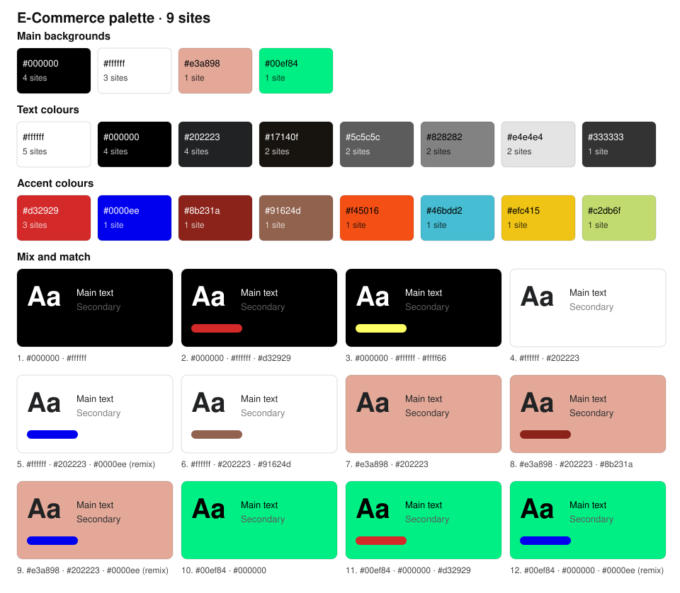

# E-Commerce palette

9 sites. 3 of them were captured as one screen only, so their colours come from the first screen.

Colours that look alike are merged and named by the most used shade; the counts are sites, not uses. Translucent colours are mixed onto each site's main background first.

## Main backgrounds

| Colour | Sites | Merged shades | Seen on |
| --- | --- | --- | --- |
| `#000000` | 4 of 9 | `#050505` | [Dash Creative](../../dashcreative.co/overview.md), [Palace Skateboards](../../palaceskateboards.com/overview.md), [YLEM](../../ylem.watch/overview.md), [Second Ride](../../second-ride.de-en/overview.md) |
| `#ffffff` | 3 of 9 | `#fff4e3` | [Achilles Heel](../../achillesheel.co.uk/overview.md), [Almada Label](../../almadalabel.com/overview.md), [Theobroma](../../theobromachocolat.com/overview.md) |
| `#e3a898` | 1 of 9 | — | [Henrietta Said](../../henrietta.wearetattoodigital.com/overview.md) |
| `#00ef84` | 1 of 9 | — | [Lajoya](../../lajoya-foods.com-en/overview.md) |

## Second backgrounds

Section and panel colours that differ from the site's main background.

| Colour | Sites | Merged shades | Seen on |
| --- | --- | --- | --- |
| `#282828` | 2 of 9 | `#2f1b12` | [Second Ride](../../second-ride.de-en/overview.md), [Theobroma](../../theobromachocolat.com/overview.md) |
| `#d32929` | 2 of 9 | `#e12431` | [Henrietta Said](../../henrietta.wearetattoodigital.com/overview.md), [YLEM](../../ylem.watch/overview.md) |
| `#e4e4e4` | 2 of 9 | `#eae6e3` | [Palace Skateboards](../../palaceskateboards.com/overview.md), [Henrietta Said](../../henrietta.wearetattoodigital.com/overview.md) |
| `#ffffff` | 2 of 9 | — | [Lajoya](../../lajoya-foods.com-en/overview.md), [YLEM](../../ylem.watch/overview.md) |
| `#141414` | 1 of 9 | — | [Dash Creative](../../dashcreative.co/overview.md) |
| `#46bdd2` | 1 of 9 | — | [Theobroma](../../theobromachocolat.com/overview.md) |
| `#c2db6f` | 1 of 9 | — | [Theobroma](../../theobromachocolat.com/overview.md) |
| `#bfded0` | 1 of 9 | — | [Lajoya](../../lajoya-foods.com-en/overview.md) |

## Text colours

| Colour | Sites | Contrast on `#000000` | Contrast on `#ffffff` | Seen on |
| --- | --- | --- | --- | --- |
| `#ffffff` | 5 of 9 | 21.0 | 1.0 | [Almada Label](../../almadalabel.com/overview.md), [Dash Creative](../../dashcreative.co/overview.md), [Palace Skateboards](../../palaceskateboards.com/overview.md), [YLEM](../../ylem.watch/overview.md) and 1 more |
| `#000000` | 4 of 9 | 1.0 | 21.0 | [Achilles Heel](../../achillesheel.co.uk/overview.md), [Lajoya](../../lajoya-foods.com-en/overview.md), [Palace Skateboards](../../palaceskateboards.com/overview.md), [Second Ride](../../second-ride.de-en/overview.md) |
| `#202223` | 4 of 9 | 1.3 | 16.0 | [Achilles Heel](../../achillesheel.co.uk/overview.md), [YLEM](../../ylem.watch/overview.md), [Henrietta Said](../../henrietta.wearetattoodigital.com/overview.md), [Theobroma](../../theobromachocolat.com/overview.md) |
| `#17140f` | 2 of 9 | 1.1 | 18.4 | [Almada Label](../../almadalabel.com/overview.md), [Second Ride](../../second-ride.de-en/overview.md) |
| `#5c5c5c` | 2 of 9 | 3.1 | 6.7 | [Second Ride](../../second-ride.de-en/overview.md), [Palace Skateboards](../../palaceskateboards.com/overview.md) |
| `#828282` | 2 of 9 | 5.5 | 3.8 | [Second Ride](../../second-ride.de-en/overview.md), [Almada Label](../../almadalabel.com/overview.md) |
| `#e4e4e4` | 2 of 9 | 16.5 | 1.3 | [Second Ride](../../second-ride.de-en/overview.md), [Henrietta Said](../../henrietta.wearetattoodigital.com/overview.md) |
| `#333333` | 1 of 9 | 1.7 | 12.6 | [Henrietta Said](../../henrietta.wearetattoodigital.com/overview.md) |

## Accent colours

Any colour with real saturation (OKLab chroma 0.06 or more) that is not near-black, wherever the site uses it.

| Colour | Sites | Merged shades | Seen on |
| --- | --- | --- | --- |
| `#d32929` | 3 of 9 | `#e12431`, `#ea3323` | [Henrietta Said](../../henrietta.wearetattoodigital.com/overview.md), [YLEM](../../ylem.watch/overview.md), [Lajoya](../../lajoya-foods.com-en/overview.md) |
| `#0000ee` | 1 of 9 | — | [Almada Label](../../almadalabel.com/overview.md) |
| `#8b231a` | 1 of 9 | — | [Henrietta Said](../../henrietta.wearetattoodigital.com/overview.md) |
| `#91624d` | 1 of 9 | — | [Theobroma](../../theobromachocolat.com/overview.md) |
| `#f45016` | 1 of 9 | — | [Henrietta Said](../../henrietta.wearetattoodigital.com/overview.md) |
| `#46bdd2` | 1 of 9 | — | [Theobroma](../../theobromachocolat.com/overview.md) |
| `#efc415` | 1 of 9 | — | [Henrietta Said](../../henrietta.wearetattoodigital.com/overview.md) |
| `#c2db6f` | 1 of 9 | — | [Theobroma](../../theobromachocolat.com/overview.md) |

## Mix and match

For each of the most common backgrounds: a main text colour at 7:1 or more where one exists (never below 4.5:1, WCAG AA body text), a muted secondary text between 3:1 and 7:1, and up to two accents at 3:1 or more (large text and UI parts). Colours that appear together on the same site are picked first; a remix borrows colours from different sites in this category.

| # | Background | Text | Secondary | Accent | Contrast text / secondary / accent | Source |
| --- | --- | --- | --- | --- | --- | --- |
| 1 | `#000000` | `#ffffff` | `#5c5c5c` | — | 21.0 / 3.1 / — | seen on [Dash Creative](../../dashcreative.co/overview.md), [Palace Skateboards](../../palaceskateboards.com/overview.md) and 1 more |
| 2 | `#000000` | `#ffffff` | `#5c5c5c` | `#d32929` | 21.0 / 3.1 / 4.1 | seen on [YLEM](../../ylem.watch/overview.md) |
| 3 | `#000000` | `#ffffff` | `#5c5c5c` | `#ffff66` | 21.0 / 3.1 / 19.7 | seen on [Palace Skateboards](../../palaceskateboards.com/overview.md) |
| 4 | `#ffffff` | `#202223` | `#828282` | — | 16.0 / 3.8 / — | seen on [Achilles Heel](../../achillesheel.co.uk/overview.md), [Theobroma](../../theobromachocolat.com/overview.md) |
| 5 | `#ffffff` | `#202223` | `#828282` | `#0000ee` | 16.0 / 3.8 / 9.4 | remix: ground from [Achilles Heel](../../achillesheel.co.uk/overview.md), text from [Achilles Heel](../../achillesheel.co.uk/overview.md), accent from [Almada Label](../../almadalabel.com/overview.md) |
| 6 | `#ffffff` | `#202223` | `#828282` | `#91624d` | 16.0 / 3.8 / 5.2 | seen on [Theobroma](../../theobromachocolat.com/overview.md) |
| 7 | `#e3a898` | `#202223` | `#333333` | — | 7.9 / 6.2 / — | seen on [Henrietta Said](../../henrietta.wearetattoodigital.com/overview.md) |
| 8 | `#e3a898` | `#202223` | `#333333` | `#8b231a` | 7.9 / 6.2 / 4.4 | seen on [Henrietta Said](../../henrietta.wearetattoodigital.com/overview.md) |
| 9 | `#e3a898` | `#202223` | `#333333` | `#0000ee` | 7.9 / 6.2 / 4.6 | remix: ground from [Henrietta Said](../../henrietta.wearetattoodigital.com/overview.md), text from [Achilles Heel](../../achillesheel.co.uk/overview.md), accent from [Almada Label](../../almadalabel.com/overview.md) |
| 10 | `#00ef84` | `#000000` | `#5c5c5c` | — | 13.7 / 4.4 / — | seen on [Lajoya](../../lajoya-foods.com-en/overview.md) |
| 11 | `#00ef84` | `#000000` | `#5c5c5c` | `#d32929` | 13.7 / 4.4 / 3.3 | seen on [Lajoya](../../lajoya-foods.com-en/overview.md) |
| 12 | `#00ef84` | `#000000` | `#5c5c5c` | `#0000ee` | 13.7 / 4.4 / 6.1 | remix: ground from [Lajoya](../../lajoya-foods.com-en/overview.md), text from [Achilles Heel](../../achillesheel.co.uk/overview.md), accent from [Almada Label](../../almadalabel.com/overview.md) |
