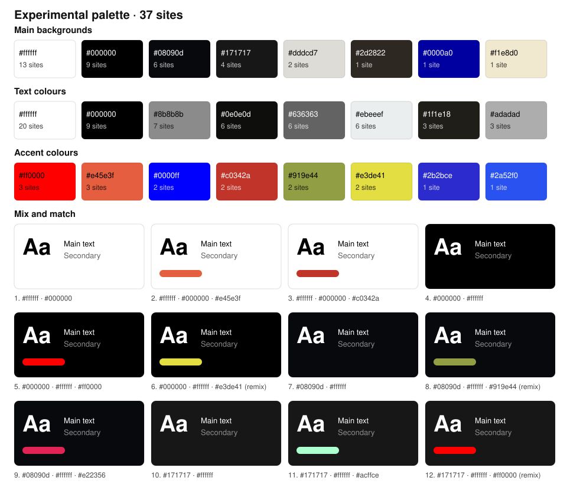

# Experimental palette

37 sites. 26 of them were captured as one screen only, so their colours come from the first screen. Left out as failed captures: [The Future In Black](../../thefutureinblack.com/overview.md).

Colours that look alike are merged and named by the most used shade; the counts are sites, not uses. Translucent colours are mixed onto each site's main background first.

## Main backgrounds

| Colour | Sites | Merged shades | Seen on |
| --- | --- | --- | --- |
| `#ffffff` | 13 of 37 | `#f2f2f2`, `#f4f3ef`, `#f4f4f0`, `#f5f5f5` | [ATO 痕時の器](../../atotimecapsule.com/overview.md), [bleibtgleich'26](../../bleibtgleich.dev/overview.md), [Truth Generation](../../blurthetruth.com/overview.md), [Grids](../../grids03.obys.agency/overview.md) and 9 more |
| `#000000` | 9 of 37 | `#080808` | [Allan Leone - Product Designer](../../allanleone.com/overview.md), [aorum](../../aorum.io/overview.md), [Awards Racing](../../awards.racing/overview.md), [Save for later](../../clicktokeep.com/overview.md) and 5 more |
| `#08090d` | 6 of 37 | `#0b0b0a`, `#0b0b0d`, `#101012`, `#111111` | [The state of the gallery](../../mesh3d.gallery-the-state-of-the-gallery/overview.md), [Yuya Film Studio](../../yuyafilmstudio.dev/overview.md), [Still Night](../../stillnight.joshua-garcia.com/overview.md), [Nahiyan Khan - Personal Site](../../nahiyan.codes/overview.md) and 2 more |
| `#171717` | 4 of 37 | `#191a1e`, `#1e1e1e`, `#222222` | [Giordano Betti](../../giordanobetti.com/overview.md), [Byotōne](../../byotone.com/overview.md), [Carter Ogunsola](../../carterogunsola.com/overview.md), [FORMAT](../../format.obys.agency/overview.md) |
| `#dddcd7` | 2 of 37 | `#e9e9ea` | [Half the Sky](../../halfthesky.app/overview.md), [AI Uis](../../aiu.is/overview.md) |
| `#2d2822` | 1 of 37 | — | [Houmahani Kane](../../houmahani.com/overview.md) |
| `#0000a0` | 1 of 37 | — | [TREY HOLLINGER](../../treyhollinger.com/overview.md) |
| `#f1e8d0` | 1 of 37 | — | [Nocturnal Dream](../../nocturnaldream.com/overview.md) |

## Second backgrounds

Section and panel colours that differ from the site's main background.

| Colour | Sites | Merged shades | Seen on |
| --- | --- | --- | --- |
| `#000000` | 7 of 37 | `#020203` | [A24](../../a24.raviklaassens.com/overview.md), [Truth Generation](../../blurthetruth.com/overview.md), [Carter Ogunsola](../../carterogunsola.com/overview.md), [Rubens Cantuni](../../rubens.design/overview.md) and 3 more |
| `#ffffff` | 4 of 37 | `#fbfbfb` | [FORMAT](../../format.obys.agency/overview.md), [Giordano Betti](../../giordanobetti.com/overview.md), [Stéfano Girardelli — Designer](../../stefanobg.com/overview.md), [galekto](../../galekto.com/overview.md) |
| `#ede9e5` | 2 of 37 | `#efefef`, `#f0f0f0` | [Truth Generation](../../blurthetruth.com/overview.md), [Save for later](../../clicktokeep.com/overview.md) |
| `#0a1030` | 1 of 37 | — | [Tommy Biglow](../../tommybiglow.com/overview.md) |
| `#212121` | 1 of 37 | — | [ATO 痕時の器](../../atotimecapsule.com/overview.md) |
| `#001d82` | 1 of 37 | — | [Houmahani Kane](../../houmahani.com/overview.md) |
| `#393939` | 1 of 37 | — | [Unbelievably Crap](../../unbelievablycrap.com/overview.md) |
| `#2b2bce` | 1 of 37 | — | [The Robot and Me](../../therobotand.me/overview.md) |

## Text colours

| Colour | Sites | Contrast on `#ffffff` | Contrast on `#000000` | Seen on |
| --- | --- | --- | --- | --- |
| `#ffffff` | 20 of 37 | 1.0 | 21.0 | [Allan Leone - Product Designer](../../allanleone.com/overview.md), [Arc's Portfolio](../../arcmarumo.com/overview.md), [ATO 痕時の器](../../atotimecapsule.com/overview.md), [Awards Racing](../../awards.racing/overview.md) and 16 more |
| `#000000` | 9 of 37 | 21.0 | 1.0 | [A24](../../a24.raviklaassens.com/overview.md), [ATO 痕時の器](../../atotimecapsule.com/overview.md), [bleibtgleich'26](../../bleibtgleich.dev/overview.md), [Truth Generation](../../blurthetruth.com/overview.md) and 5 more |
| `#8b8b8b` | 7 of 37 | 3.4 | 6.2 | [Carter Ogunsola](../../carterogunsola.com/overview.md), [Unbelievably Crap](../../unbelievablycrap.com/overview.md), [Rubens Cantuni](../../rubens.design/overview.md), [Nocturnal Dream](../../nocturnaldream.com/overview.md) and 3 more |
| `#0e0e0d` | 6 of 37 | 19.3 | 1.1 | [Pier Gorelli](../../piergorelli.com/overview.md), [The Robot and Me](../../therobotand.me/overview.md), [Dont Look up game](../../dontlookup.app/overview.md), [Stéfano Girardelli — Designer](../../stefanobg.com/overview.md) and 2 more |
| `#636363` | 6 of 37 | 6.0 | 3.5 | [Carter Ogunsola](../../carterogunsola.com/overview.md), [Pier Gorelli](../../piergorelli.com/overview.md), [Half the Sky](../../halfthesky.app/overview.md), [Yuya Film Studio](../../yuyafilmstudio.dev/overview.md) and 2 more |
| `#ebeeef` | 6 of 37 | 1.2 | 18.0 | [Nahiyan Khan - Personal Site](../../nahiyan.codes/overview.md), [TREY HOLLINGER](../../treyhollinger.com/overview.md), [Nocturnal Dream](../../nocturnaldream.com/overview.md), [Yuya Film Studio](../../yuyafilmstudio.dev/overview.md) and 2 more |
| `#1f1e18` | 3 of 37 | 16.7 | 1.3 | [The boring blog](../../theboringblog.ai/overview.md), [ATO 痕時の器](../../atotimecapsule.com/overview.md), [Houmahani Kane](../../houmahani.com/overview.md) |
| `#adadad` | 3 of 37 | 2.2 | 9.4 | [Carter Ogunsola](../../carterogunsola.com/overview.md), [Tommy Biglow](../../tommybiglow.com/overview.md), [The state of the gallery](../../mesh3d.gallery-the-state-of-the-gallery/overview.md) |

## Accent colours

Any colour with real saturation (OKLab chroma 0.06 or more) that is not near-black, wherever the site uses it.

| Colour | Sites | Merged shades | Seen on |
| --- | --- | --- | --- |
| `#ff0000` | 3 of 37 | `#e8271c`, `#fb3d3a` | [galekto](../../galekto.com/overview.md), [Unbelievably Crap](../../unbelievablycrap.com/overview.md), [Save for later](../../clicktokeep.com/overview.md) |
| `#e45e3f` | 3 of 37 | `#ff5956`, `#ff633d` | [ATO 痕時の器](../../atotimecapsule.com/overview.md), [The Robot and Me](../../therobotand.me/overview.md), [bleibtgleich'26](../../bleibtgleich.dev/overview.md) |
| `#0000ff` | 2 of 37 | — | [AI Uis](../../aiu.is/overview.md), [galekto](../../galekto.com/overview.md) |
| `#c0342a` | 2 of 37 | `#c31f26` | [Dont Look up game](../../dontlookup.app/overview.md), [bleibtgleich'26](../../bleibtgleich.dev/overview.md) |
| `#919e44` | 2 of 37 | `#b69a64` | [bleibtgleich'26](../../bleibtgleich.dev/overview.md), [Yuya Film Studio](../../yuyafilmstudio.dev/overview.md) |
| `#e3de41` | 2 of 37 | `#facc15`, `#ffc840`, `#ffd060`, `#ffe566` | [Truth Generation](../../blurthetruth.com/overview.md), [galekto](../../galekto.com/overview.md) |
| `#2b2bce` | 1 of 37 | — | [The Robot and Me](../../therobotand.me/overview.md) |
| `#2a52f0` | 1 of 37 | — | [Pier Gorelli](../../piergorelli.com/overview.md) |

## Mix and match

For each of the most common backgrounds: a main text colour at 7:1 or more where one exists (never below 4.5:1, WCAG AA body text), a muted secondary text between 3:1 and 7:1, and up to two accents at 3:1 or more (large text and UI parts). Colours that appear together on the same site are picked first; a remix borrows colours from different sites in this category.

| # | Background | Text | Secondary | Accent | Contrast text / secondary / accent | Source |
| --- | --- | --- | --- | --- | --- | --- |
| 1 | `#ffffff` | `#000000` | `#636363` | — | 21.0 / 6.0 / — | seen on [A24](../../a24.raviklaassens.com/overview.md), [ATO 痕時の器](../../atotimecapsule.com/overview.md) and 5 more |
| 2 | `#ffffff` | `#000000` | `#636363` | `#e45e3f` | 21.0 / 6.0 / 3.5 | seen on [ATO 痕時の器](../../atotimecapsule.com/overview.md), [bleibtgleich'26](../../bleibtgleich.dev/overview.md) |
| 3 | `#ffffff` | `#000000` | `#636363` | `#c0342a` | 21.0 / 6.0 / 5.6 | seen on [bleibtgleich'26](../../bleibtgleich.dev/overview.md) |
| 4 | `#000000` | `#ffffff` | `#8b8b8b` | — | 21.0 / 6.2 / — | seen on [Allan Leone - Product Designer](../../allanleone.com/overview.md), [ASTRODITHER](../../astrodither.robertborghesi.is/overview.md) and 4 more |
| 5 | `#000000` | `#ffffff` | `#8b8b8b` | `#ff0000` | 21.0 / 6.2 / 5.3 | seen on [Save for later](../../clicktokeep.com/overview.md), [Unbelievably Crap](../../unbelievablycrap.com/overview.md) |
| 6 | `#000000` | `#ffffff` | `#8b8b8b` | `#e3de41` | 21.0 / 6.2 / 14.8 | remix: ground from [Allan Leone - Product Designer](../../allanleone.com/overview.md), text from [Allan Leone - Product Designer](../../allanleone.com/overview.md), accent from [Truth Generation](../../blurthetruth.com/overview.md) |
| 7 | `#08090d` | `#ffffff` | `#8b8b8b` | — | 19.9 / 5.8 / — | seen on [Arc's Portfolio](../../arcmarumo.com/overview.md), [The state of the gallery](../../mesh3d.gallery-the-state-of-the-gallery/overview.md) and 2 more |
| 8 | `#08090d` | `#ffffff` | `#8b8b8b` | `#919e44` | 19.9 / 5.8 / 6.8 | remix: ground from [The state of the gallery](../../mesh3d.gallery-the-state-of-the-gallery/overview.md), text from [Allan Leone - Product Designer](../../allanleone.com/overview.md), accent from [bleibtgleich'26](../../bleibtgleich.dev/overview.md) |
| 9 | `#08090d` | `#ffffff` | `#8b8b8b` | `#e22356` | 19.9 / 5.8 / 4.4 | seen on [Stéfano Girardelli — Designer](../../stefanobg.com/overview.md) |
| 10 | `#171717` | `#ffffff` | `#8b8b8b` | — | 17.9 / 5.3 / — | seen on [Byotōne](../../byotone.com/overview.md), [Carter Ogunsola](../../carterogunsola.com/overview.md) and 2 more |
| 11 | `#171717` | `#ffffff` | `#8b8b8b` | `#acffce` | 17.9 / 5.3 / 15.3 | seen on [Byotōne](../../byotone.com/overview.md) |
| 12 | `#171717` | `#ffffff` | `#8b8b8b` | `#ff0000` | 17.9 / 5.3 / 4.5 | remix: ground from [Giordano Betti](../../giordanobetti.com/overview.md), text from [Allan Leone - Product Designer](../../allanleone.com/overview.md), accent from [galekto](../../galekto.com/overview.md) |
