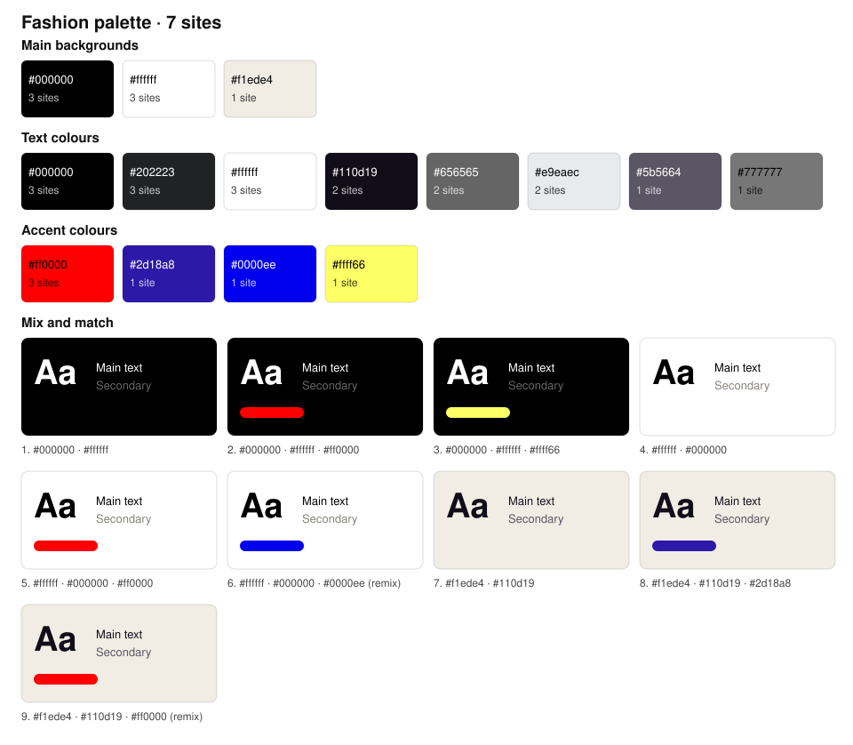

# Fashion palette

7 sites. 1 of them were captured as one screen only, so their colours come from the first screen.

Colours that look alike are merged and named by the most used shade; the counts are sites, not uses. Translucent colours are mixed onto each site's main background first.

## Main backgrounds

| Colour | Sites | Merged shades | Seen on |
| --- | --- | --- | --- |
| `#000000` | 3 of 7 | — | [GOBOLD™ Agency](../../gobold.live/overview.md), [Palace Skateboards](../../palaceskateboards.com/overview.md), [YLEM](../../ylem.watch/overview.md) |
| `#ffffff` | 3 of 7 | — | [Achilles Heel](../../achillesheel.co.uk/overview.md), [Almada Label](../../almadalabel.com/overview.md), [David Spaeth](../../davidspaeth.com/overview.md) |
| `#f1ede4` | 1 of 7 | — | [Kelvin Music Festival 2027](../../kelvin.8b.com/overview.md) |

## Second backgrounds

Section and panel colours that differ from the site's main background.

| Colour | Sites | Merged shades | Seen on |
| --- | --- | --- | --- |
| `#110d19` | 1 of 7 | — | [Kelvin Music Festival 2027](../../kelvin.8b.com/overview.md) |
| `#2d18a8` | 1 of 7 | — | [Kelvin Music Festival 2027](../../kelvin.8b.com/overview.md) |
| `#e12431` | 1 of 7 | — | [YLEM](../../ylem.watch/overview.md) |
| `#e4e4e4` | 1 of 7 | — | [Palace Skateboards](../../palaceskateboards.com/overview.md) |
| `#ffff66` | 1 of 7 | — | [Palace Skateboards](../../palaceskateboards.com/overview.md) |
| `#ffffff` | 1 of 7 | — | [YLEM](../../ylem.watch/overview.md) |

## Text colours

| Colour | Sites | Contrast on `#000000` | Contrast on `#ffffff` | Seen on |
| --- | --- | --- | --- | --- |
| `#000000` | 3 of 7 | 1.0 | 21.0 | [Achilles Heel](../../achillesheel.co.uk/overview.md), [David Spaeth](../../davidspaeth.com/overview.md), [Palace Skateboards](../../palaceskateboards.com/overview.md) |
| `#202223` | 3 of 7 | 1.3 | 16.0 | [Achilles Heel](../../achillesheel.co.uk/overview.md), [YLEM](../../ylem.watch/overview.md), [GOBOLD™ Agency](../../gobold.live/overview.md) |
| `#ffffff` | 3 of 7 | 21.0 | 1.0 | [Almada Label](../../almadalabel.com/overview.md), [Palace Skateboards](../../palaceskateboards.com/overview.md), [YLEM](../../ylem.watch/overview.md) |
| `#110d19` | 2 of 7 | 1.1 | 19.2 | [Kelvin Music Festival 2027](../../kelvin.8b.com/overview.md), [Almada Label](../../almadalabel.com/overview.md) |
| `#656565` | 2 of 7 | 3.6 | 5.8 | [Palace Skateboards](../../palaceskateboards.com/overview.md), [GOBOLD™ Agency](../../gobold.live/overview.md) |
| `#e9eaec` | 2 of 7 | 17.4 | 1.2 | [GOBOLD™ Agency](../../gobold.live/overview.md), [Kelvin Music Festival 2027](../../kelvin.8b.com/overview.md) |
| `#5b5664` | 1 of 7 | 3.0 | 7.1 | [Kelvin Music Festival 2027](../../kelvin.8b.com/overview.md) |
| `#777777` | 1 of 7 | 4.7 | 4.5 | [GOBOLD™ Agency](../../gobold.live/overview.md) |

## Accent colours

Any colour with real saturation (OKLab chroma 0.06 or more) that is not near-black, wherever the site uses it.

| Colour | Sites | Merged shades | Seen on |
| --- | --- | --- | --- |
| `#ff0000` | 3 of 7 | `#e12431`, `#ff2b2b` | [David Spaeth](../../davidspaeth.com/overview.md), [GOBOLD™ Agency](../../gobold.live/overview.md), [YLEM](../../ylem.watch/overview.md) |
| `#2d18a8` | 1 of 7 | — | [Kelvin Music Festival 2027](../../kelvin.8b.com/overview.md) |
| `#0000ee` | 1 of 7 | — | [Almada Label](../../almadalabel.com/overview.md) |
| `#ffff66` | 1 of 7 | — | [Palace Skateboards](../../palaceskateboards.com/overview.md) |

## Mix and match

For each of the most common backgrounds: a main text colour at 7:1 or more where one exists (never below 4.5:1, WCAG AA body text), a muted secondary text between 3:1 and 7:1, and up to two accents at 3:1 or more (large text and UI parts). Colours that appear together on the same site are picked first; a remix borrows colours from different sites in this category.

| # | Background | Text | Secondary | Accent | Contrast text / secondary / accent | Source |
| --- | --- | --- | --- | --- | --- | --- |
| 1 | `#000000` | `#ffffff` | `#656565` | — | 21.0 / 3.6 / — | seen on [Palace Skateboards](../../palaceskateboards.com/overview.md), [YLEM](../../ylem.watch/overview.md) |
| 2 | `#000000` | `#ffffff` | `#656565` | `#ff0000` | 21.0 / 3.6 / 5.3 | seen on [YLEM](../../ylem.watch/overview.md) |
| 3 | `#000000` | `#ffffff` | `#656565` | `#ffff66` | 21.0 / 3.6 / 19.7 | seen on [Palace Skateboards](../../palaceskateboards.com/overview.md) |
| 4 | `#ffffff` | `#000000` | `#88847c` | — | 21.0 / 3.7 / — | seen on [Achilles Heel](../../achillesheel.co.uk/overview.md), [David Spaeth](../../davidspaeth.com/overview.md) |
| 5 | `#ffffff` | `#000000` | `#88847c` | `#ff0000` | 21.0 / 3.7 / 4.0 | seen on [David Spaeth](../../davidspaeth.com/overview.md) |
| 6 | `#ffffff` | `#000000` | `#88847c` | `#0000ee` | 21.0 / 3.7 / 9.4 | remix: ground from [Achilles Heel](../../achillesheel.co.uk/overview.md), text from [Achilles Heel](../../achillesheel.co.uk/overview.md), accent from [Almada Label](../../almadalabel.com/overview.md) |
| 7 | `#f1ede4` | `#110d19` | `#5b5664` | — | 16.4 / 6.1 / — | seen on [Kelvin Music Festival 2027](../../kelvin.8b.com/overview.md) |
| 8 | `#f1ede4` | `#110d19` | `#5b5664` | `#2d18a8` | 16.4 / 6.1 / 9.9 | seen on [Kelvin Music Festival 2027](../../kelvin.8b.com/overview.md) |
| 9 | `#f1ede4` | `#110d19` | `#5b5664` | `#ff0000` | 16.4 / 6.1 / 3.4 | remix: ground from [Kelvin Music Festival 2027](../../kelvin.8b.com/overview.md), text from [Kelvin Music Festival 2027](../../kelvin.8b.com/overview.md), accent from [David Spaeth](../../davidspaeth.com/overview.md) |
