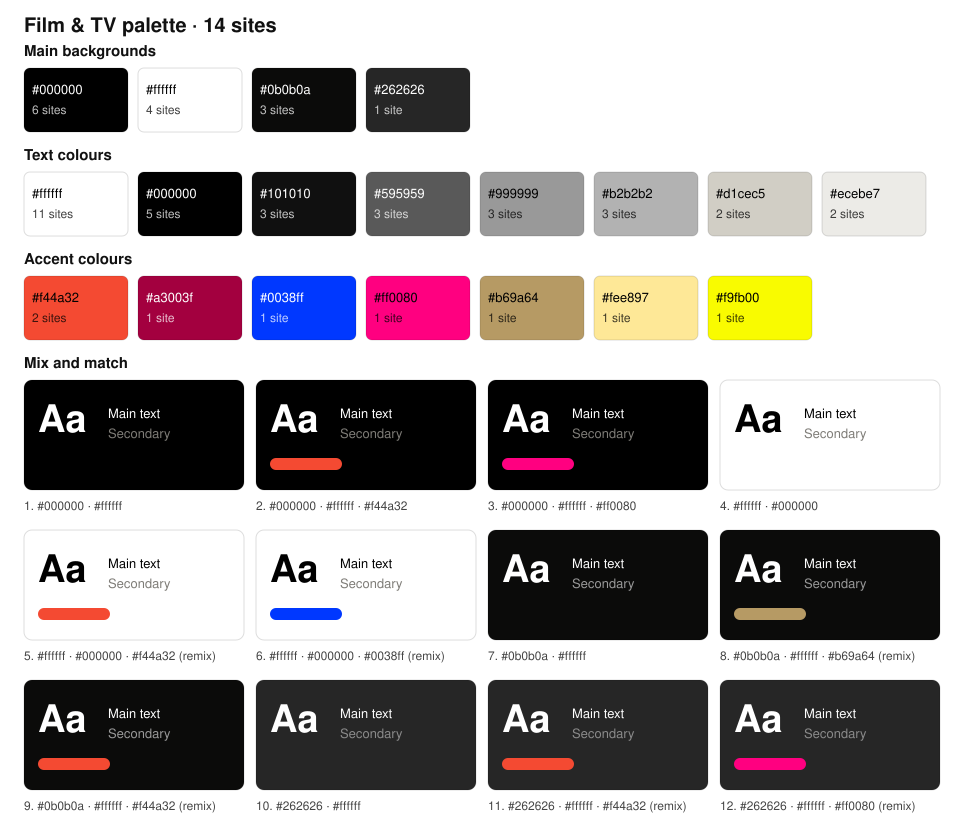

# Film & TV palette

14 sites. 6 of them were captured as one screen only, so their colours come from the first screen.

Colours that look alike are merged and named by the most used shade; the counts are sites, not uses. Translucent colours are mixed onto each site's main background first.

## Main backgrounds

| Colour | Sites | Merged shades | Seen on |
| --- | --- | --- | --- |
| `#000000` | 6 of 14 | `#080808` | [Huxley Saga](../../huxleysaga.com/overview.md), [Partizan](../../partizan.com/overview.md), [PSP Production](../../productionportugal.com/overview.md), [RISK](../../risk.film/overview.md) and 2 more |
| `#ffffff` | 4 of 14 | `#f1f3f5`, `#f4f4f4` | [Brady Perron](../../bradyperron.com/overview.md), [TBWA\HAKUHODO Corporate Site](../../tbwahakuhodo.co.jp/overview.md), [Preymaker](../../preymaker.com/overview.md), [Extrafazant](../../extrafazant.nl/overview.md) |
| `#0b0b0a` | 3 of 14 | `#121212`, `#171717` | [Yuya Film Studio](../../yuyafilmstudio.dev/overview.md), [Share Bien](../../sharebien.com/overview.md), [Giordano Betti](../../giordanobetti.com/overview.md) |
| `#262626` | 1 of 14 | — | [Josh Goldsmith - Director & EP](../../josh-goldsmith.com/overview.md) |

## Second backgrounds

Section and panel colours that differ from the site's main background.

| Colour | Sites | Merged shades | Seen on |
| --- | --- | --- | --- |
| `#000000` | 3 of 14 | — | [Josh Goldsmith - Director & EP](../../josh-goldsmith.com/overview.md), [Share Bien](../../sharebien.com/overview.md), [TBWA\HAKUHODO Corporate Site](../../tbwahakuhodo.co.jp/overview.md) |
| `#ffffff` | 2 of 14 | — | [Giordano Betti](../../giordanobetti.com/overview.md), [Partizan](../../partizan.com/overview.md) |
| `#101010` | 1 of 14 | — | [Extrafazant](../../extrafazant.nl/overview.md) |
| `#606162` | 1 of 14 | — | [Preymaker](../../preymaker.com/overview.md) |
| `#ff0080` | 1 of 14 | `#ff126f` | [PSP Production](../../productionportugal.com/overview.md) |
| `#ecebe7` | 1 of 14 | — | [Hello Party](../../thisishelloparty.com/overview.md) |

## Text colours

| Colour | Sites | Contrast on `#000000` | Contrast on `#ffffff` | Seen on |
| --- | --- | --- | --- | --- |
| `#ffffff` | 11 of 14 | 21.0 | 1.0 | [Brady Perron](../../bradyperron.com/overview.md), [Extrafazant](../../extrafazant.nl/overview.md), [Giordano Betti](../../giordanobetti.com/overview.md), [Huxley Saga](../../huxleysaga.com/overview.md) and 7 more |
| `#000000` | 5 of 14 | 1.0 | 21.0 | [Brady Perron](../../bradyperron.com/overview.md), [Partizan](../../partizan.com/overview.md), [Preymaker](../../preymaker.com/overview.md), [TBWA\HAKUHODO Corporate Site](../../tbwahakuhodo.co.jp/overview.md) and 1 more |
| `#101010` | 3 of 14 | 1.1 | 19.0 | [Extrafazant](../../extrafazant.nl/overview.md), [Share Bien](../../sharebien.com/overview.md), [Giordano Betti](../../giordanobetti.com/overview.md) |
| `#595959` | 3 of 14 | 3.0 | 7.0 | [Share Bien](../../sharebien.com/overview.md), [Giordano Betti](../../giordanobetti.com/overview.md), [Yuya Film Studio](../../yuyafilmstudio.dev/overview.md) |
| `#999999` | 3 of 14 | 7.4 | 2.8 | [Brady Perron](../../bradyperron.com/overview.md), [Huxley Saga](../../huxleysaga.com/overview.md), [Yuya Film Studio](../../yuyafilmstudio.dev/overview.md) |
| `#b2b2b2` | 3 of 14 | 9.9 | 2.1 | [Brady Perron](../../bradyperron.com/overview.md), [Share Bien](../../sharebien.com/overview.md), [Yuya Film Studio](../../yuyafilmstudio.dev/overview.md) |
| `#d1cec5` | 2 of 14 | 13.3 | 1.6 | [Yuya Film Studio](../../yuyafilmstudio.dev/overview.md), [RISK](../../risk.film/overview.md) |
| `#ecebe7` | 2 of 14 | 17.6 | 1.2 | [Hello Party](../../thisishelloparty.com/overview.md), [Yuya Film Studio](../../yuyafilmstudio.dev/overview.md) |

## Accent colours

Any colour with real saturation (OKLab chroma 0.06 or more) that is not near-black, wherever the site uses it.

| Colour | Sites | Merged shades | Seen on |
| --- | --- | --- | --- |
| `#f44a32` | 2 of 14 | `#ff004d` | [Extrafazant](../../extrafazant.nl/overview.md), [PSP Production](../../productionportugal.com/overview.md) |
| `#a3003f` | 1 of 14 | — | [PSP Production](../../productionportugal.com/overview.md) |
| `#0038ff` | 1 of 14 | — | [Extrafazant](../../extrafazant.nl/overview.md) |
| `#ff0080` | 1 of 14 | `#ff126f` | [PSP Production](../../productionportugal.com/overview.md) |
| `#b69a64` | 1 of 14 | `#c9a96e` | [Yuya Film Studio](../../yuyafilmstudio.dev/overview.md) |
| `#fee897` | 1 of 14 | — | [Extrafazant](../../extrafazant.nl/overview.md) |
| `#f9fb00` | 1 of 14 | — | [Hello Party](../../thisishelloparty.com/overview.md) |

## Mix and match

For each of the most common backgrounds: a main text colour at 7:1 or more where one exists (never below 4.5:1, WCAG AA body text), a muted secondary text between 3:1 and 7:1, and up to two accents at 3:1 or more (large text and UI parts). Colours that appear together on the same site are picked first; a remix borrows colours from different sites in this category.

| # | Background | Text | Secondary | Accent | Contrast text / secondary / accent | Source |
| --- | --- | --- | --- | --- | --- | --- |
| 1 | `#000000` | `#ffffff` | `#7e7c77` | — | 21.0 / 5.0 / — | seen on [Huxley Saga](../../huxleysaga.com/overview.md), [Partizan](../../partizan.com/overview.md) and 2 more |
| 2 | `#000000` | `#ffffff` | `#7e7c77` | `#f44a32` | 21.0 / 5.0 / 5.9 | seen on [PSP Production](../../productionportugal.com/overview.md) |
| 3 | `#000000` | `#ffffff` | `#7e7c77` | `#ff0080` | 21.0 / 5.0 / 5.6 | seen on [PSP Production](../../productionportugal.com/overview.md) |
| 4 | `#ffffff` | `#000000` | `#7e7c77` | — | 21.0 / 4.2 / — | seen on [Brady Perron](../../bradyperron.com/overview.md), [Preymaker](../../preymaker.com/overview.md) and 1 more |
| 5 | `#ffffff` | `#000000` | `#7e7c77` | `#f44a32` | 21.0 / 4.2 / 3.6 | remix: ground from [Brady Perron](../../bradyperron.com/overview.md), text from [Brady Perron](../../bradyperron.com/overview.md), accent from [Extrafazant](../../extrafazant.nl/overview.md) |
| 6 | `#ffffff` | `#000000` | `#7e7c77` | `#0038ff` | 21.0 / 4.2 / 7.0 | remix: ground from [Brady Perron](../../bradyperron.com/overview.md), text from [Brady Perron](../../bradyperron.com/overview.md), accent from [Extrafazant](../../extrafazant.nl/overview.md) |
| 7 | `#0b0b0a` | `#ffffff` | `#999999` | — | 19.7 / 6.9 / — | seen on [Giordano Betti](../../giordanobetti.com/overview.md), [Share Bien](../../sharebien.com/overview.md) |
| 8 | `#0b0b0a` | `#ffffff` | `#999999` | `#b69a64` | 19.7 / 6.9 / 7.3 | remix: ground from [Yuya Film Studio](../../yuyafilmstudio.dev/overview.md), text from [Brady Perron](../../bradyperron.com/overview.md), accent from [Yuya Film Studio](../../yuyafilmstudio.dev/overview.md) |
| 9 | `#0b0b0a` | `#ffffff` | `#999999` | `#f44a32` | 19.7 / 6.9 / 5.5 | remix: ground from [Yuya Film Studio](../../yuyafilmstudio.dev/overview.md), text from [Brady Perron](../../bradyperron.com/overview.md), accent from [Extrafazant](../../extrafazant.nl/overview.md) |
| 10 | `#262626` | `#ffffff` | `#8a8a8a` | — | 15.1 / 4.4 / — | seen on [Josh Goldsmith - Director & EP](../../josh-goldsmith.com/overview.md) |
| 11 | `#262626` | `#ffffff` | `#8a8a8a` | `#f44a32` | 15.1 / 4.4 / 4.2 | remix: ground from [Josh Goldsmith - Director & EP](../../josh-goldsmith.com/overview.md), text from [Brady Perron](../../bradyperron.com/overview.md), accent from [Extrafazant](../../extrafazant.nl/overview.md) |
| 12 | `#262626` | `#ffffff` | `#8a8a8a` | `#ff0080` | 15.1 / 4.4 / 4.0 | remix: ground from [Josh Goldsmith - Director & EP](../../josh-goldsmith.com/overview.md), text from [Brady Perron](../../bradyperron.com/overview.md), accent from [PSP Production](../../productionportugal.com/overview.md) |
