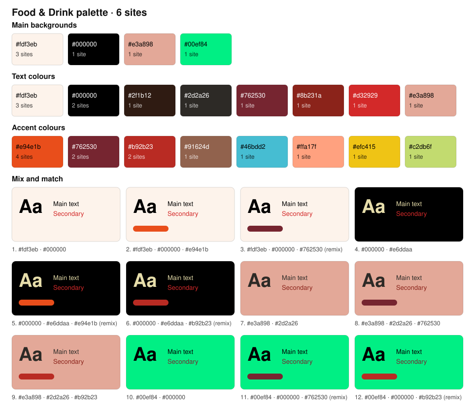

# Food & Drink palette

6 sites. 3 of them were captured as one screen only, so their colours come from the first screen.

Colours that look alike are merged and named by the most used shade; the counts are sites, not uses. Translucent colours are mixed onto each site's main background first.

## Main backgrounds

| Colour | Sites | Merged shades | Seen on |
| --- | --- | --- | --- |
| `#fdf3eb` | 3 of 6 | `#fff4e3`, `#ffffff` | [Agrumea Farm](../../agrumeafarm.it-en/overview.md), [Theobroma](../../theobromachocolat.com/overview.md), [Shinkei Systems](../../shinkei.systems/overview.md) |
| `#000000` | 1 of 6 | — | [Imperiale Bolgheri](../../imperialebolgheri.com-en/overview.md) |
| `#e3a898` | 1 of 6 | — | [Henrietta Said](../../henrietta.wearetattoodigital.com/overview.md) |
| `#00ef84` | 1 of 6 | — | [Lajoya](../../lajoya-foods.com-en/overview.md) |

## Second backgrounds

Section and panel colours that differ from the site's main background.

| Colour | Sites | Merged shades | Seen on |
| --- | --- | --- | --- |
| `#000000` | 1 of 6 | — | [Shinkei Systems](../../shinkei.systems/overview.md) |
| `#131313` | 1 of 6 | `#1d1d1d` | [Imperiale Bolgheri](../../imperialebolgheri.com-en/overview.md) |
| `#2f1b12` | 1 of 6 | — | [Theobroma](../../theobromachocolat.com/overview.md) |
| `#762530` | 1 of 6 | — | [Agrumea Farm](../../agrumeafarm.it-en/overview.md) |
| `#d32929` | 1 of 6 | — | [Henrietta Said](../../henrietta.wearetattoodigital.com/overview.md) |
| `#46bdd2` | 1 of 6 | — | [Theobroma](../../theobromachocolat.com/overview.md) |
| `#c2db6f` | 1 of 6 | — | [Theobroma](../../theobromachocolat.com/overview.md) |
| `#bfded0` | 1 of 6 | — | [Lajoya](../../lajoya-foods.com-en/overview.md) |

## Text colours

| Colour | Sites | Contrast on `#fdf3eb` | Contrast on `#000000` | Seen on |
| --- | --- | --- | --- | --- |
| `#fdf3eb` | 3 of 6 | 1.0 | 19.2 | [Agrumea Farm](../../agrumeafarm.it-en/overview.md), [Theobroma](../../theobromachocolat.com/overview.md), [Shinkei Systems](../../shinkei.systems/overview.md) |
| `#000000` | 2 of 6 | 19.2 | 1.0 | [Lajoya](../../lajoya-foods.com-en/overview.md), [Shinkei Systems](../../shinkei.systems/overview.md) |
| `#2f1b12` | 1 of 6 | 14.9 | 1.3 | [Theobroma](../../theobromachocolat.com/overview.md) |
| `#2d2a26` | 1 of 6 | 13.1 | 1.5 | [Henrietta Said](../../henrietta.wearetattoodigital.com/overview.md) |
| `#762530` | 1 of 6 | 9.2 | 2.1 | [Agrumea Farm](../../agrumeafarm.it-en/overview.md) |
| `#8b231a` | 1 of 6 | 8.2 | 2.4 | [Henrietta Said](../../henrietta.wearetattoodigital.com/overview.md) |
| `#d32929` | 1 of 6 | 4.7 | 4.1 | [Henrietta Said](../../henrietta.wearetattoodigital.com/overview.md) |
| `#e3a898` | 1 of 6 | 1.9 | 10.3 | [Henrietta Said](../../henrietta.wearetattoodigital.com/overview.md) |

## Accent colours

Any colour with real saturation (OKLab chroma 0.06 or more) that is not near-black, wherever the site uses it.

| Colour | Sites | Merged shades | Seen on |
| --- | --- | --- | --- |
| `#e94e1b` | 4 of 6 | `#ea3323`, `#f45016`, `#fe620c`, `#ff4400` | [Agrumea Farm](../../agrumeafarm.it-en/overview.md), [Lajoya](../../lajoya-foods.com-en/overview.md), [Henrietta Said](../../henrietta.wearetattoodigital.com/overview.md), [Shinkei Systems](../../shinkei.systems/overview.md) |
| `#762530` | 2 of 6 | `#8b231a` | [Agrumea Farm](../../agrumeafarm.it-en/overview.md), [Henrietta Said](../../henrietta.wearetattoodigital.com/overview.md) |
| `#b92b23` | 2 of 6 | `#d32929` | [Shinkei Systems](../../shinkei.systems/overview.md), [Henrietta Said](../../henrietta.wearetattoodigital.com/overview.md) |
| `#91624d` | 1 of 6 | — | [Theobroma](../../theobromachocolat.com/overview.md) |
| `#46bdd2` | 1 of 6 | — | [Theobroma](../../theobromachocolat.com/overview.md) |
| `#ffa17f` | 1 of 6 | — | [Shinkei Systems](../../shinkei.systems/overview.md) |
| `#efc415` | 1 of 6 | — | [Henrietta Said](../../henrietta.wearetattoodigital.com/overview.md) |
| `#c2db6f` | 1 of 6 | — | [Theobroma](../../theobromachocolat.com/overview.md) |

## Mix and match

For each of the most common backgrounds: a main text colour at 7:1 or more where one exists (never below 4.5:1, WCAG AA body text), a muted secondary text between 3:1 and 7:1, and up to two accents at 3:1 or more (large text and UI parts). Colours that appear together on the same site are picked first; a remix borrows colours from different sites in this category.

| # | Background | Text | Secondary | Accent | Contrast text / secondary / accent | Source |
| --- | --- | --- | --- | --- | --- | --- |
| 1 | `#fdf3eb` | `#000000` | `#d32929` | — | 19.2 / 4.7 / — | seen on [Shinkei Systems](../../shinkei.systems/overview.md) |
| 2 | `#fdf3eb` | `#000000` | `#d32929` | `#e94e1b` | 19.2 / 4.7 / 3.4 | seen on [Shinkei Systems](../../shinkei.systems/overview.md) |
| 3 | `#fdf3eb` | `#000000` | `#d32929` | `#762530` | 19.2 / 4.7 / 9.2 | remix: ground from [Agrumea Farm](../../agrumeafarm.it-en/overview.md), text from [Lajoya](../../lajoya-foods.com-en/overview.md), accent from [Agrumea Farm](../../agrumeafarm.it-en/overview.md) |
| 4 | `#000000` | `#e6ddaa` | `#d32929` | — | 15.3 / 4.1 / — | seen on [Imperiale Bolgheri](../../imperialebolgheri.com-en/overview.md) |
| 5 | `#000000` | `#e6ddaa` | `#d32929` | `#e94e1b` | 15.3 / 4.1 / 5.6 | remix: ground from [Imperiale Bolgheri](../../imperialebolgheri.com-en/overview.md), text from [Imperiale Bolgheri](../../imperialebolgheri.com-en/overview.md), accent from [Agrumea Farm](../../agrumeafarm.it-en/overview.md) |
| 6 | `#000000` | `#e6ddaa` | `#d32929` | `#b92b23` | 15.3 / 4.1 / 3.4 | remix: ground from [Imperiale Bolgheri](../../imperialebolgheri.com-en/overview.md), text from [Imperiale Bolgheri](../../imperialebolgheri.com-en/overview.md), accent from [Shinkei Systems](../../shinkei.systems/overview.md) |
| 7 | `#e3a898` | `#2d2a26` | `#8b231a` | — | 7.0 / 4.4 / — | seen on [Henrietta Said](../../henrietta.wearetattoodigital.com/overview.md) |
| 8 | `#e3a898` | `#2d2a26` | `#8b231a` | `#762530` | 7.0 / 4.4 / 5.0 | seen on [Henrietta Said](../../henrietta.wearetattoodigital.com/overview.md) |
| 9 | `#e3a898` | `#2d2a26` | `#8b231a` | `#b92b23` | 7.0 / 4.4 / 3.0 | seen on [Henrietta Said](../../henrietta.wearetattoodigital.com/overview.md) |
| 10 | `#00ef84` | `#000000` | `#762530` | — | 13.7 / 6.6 / — | seen on [Lajoya](../../lajoya-foods.com-en/overview.md) |
| 11 | `#00ef84` | `#000000` | `#762530` | `#762530` | 13.7 / 6.6 / 6.6 | remix: ground from [Lajoya](../../lajoya-foods.com-en/overview.md), text from [Lajoya](../../lajoya-foods.com-en/overview.md), accent from [Agrumea Farm](../../agrumeafarm.it-en/overview.md) |
| 12 | `#00ef84` | `#000000` | `#762530` | `#b92b23` | 13.7 / 6.6 / 4.0 | remix: ground from [Lajoya](../../lajoya-foods.com-en/overview.md), text from [Lajoya](../../lajoya-foods.com-en/overview.md), accent from [Shinkei Systems](../../shinkei.systems/overview.md) |
