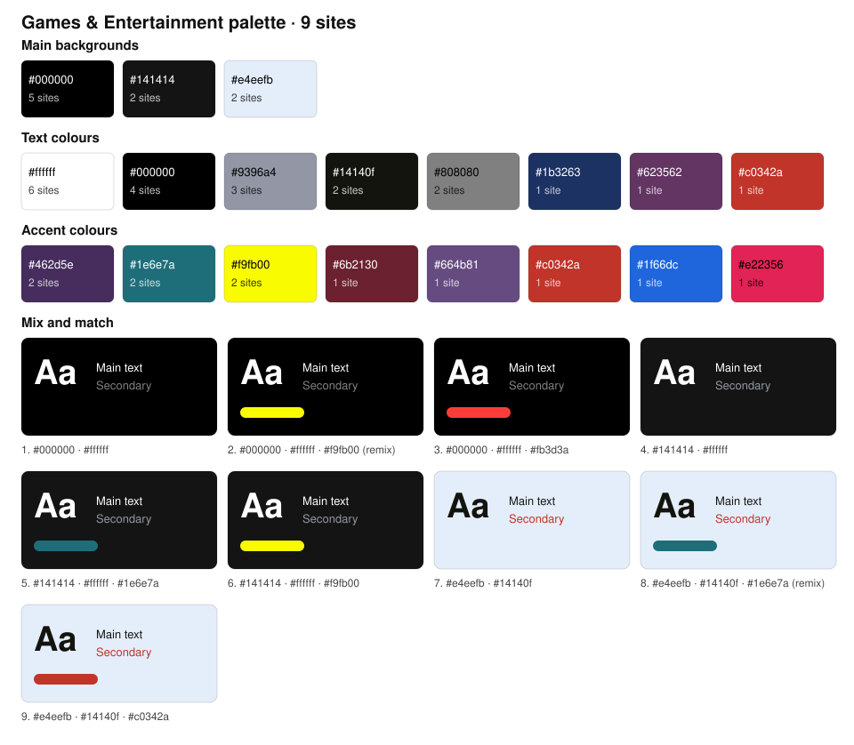

# Games & Entertainment palette

9 sites. 4 of them were captured as one screen only, so their colours come from the first screen.

Colours that look alike are merged and named by the most used shade; the counts are sites, not uses. Translucent colours are mixed onto each site's main background first.

## Main backgrounds

| Colour | Sites | Merged shades | Seen on |
| --- | --- | --- | --- |
| `#000000` | 5 of 9 | — | [Awards Racing](../../awards.racing/overview.md), [Save for later](../../clicktokeep.com/overview.md), [Grail](../../grail-app.com/overview.md), [Huxley Saga](../../huxleysaga.com/overview.md) and 1 more |
| `#141414` | 2 of 9 | `#1b1b1b` | [Stéfano Girardelli — Designer](../../stefanobg.com/overview.md), [Night Drive Racing Game](../../threejspunk.com/overview.md) |
| `#e4eefb` | 2 of 9 | `#f4f3ef` | [Zesiger.net](../../zesiger.net/overview.md), [Dont Look up game](../../dontlookup.app/overview.md) |

## Second backgrounds

Section and panel colours that differ from the site's main background.

| Colour | Sites | Merged shades | Seen on |
| --- | --- | --- | --- |
| `#ffffff` | 3 of 9 | `#f6f6f6` | [Stéfano Girardelli — Designer](../../stefanobg.com/overview.md), [Zesiger.net](../../zesiger.net/overview.md), [Grail](../../grail-app.com/overview.md) |
| `#ecebe7` | 2 of 9 | `#efefef`, `#f0f0f0` | [Hello Party](../../thisishelloparty.com/overview.md), [Save for later](../../clicktokeep.com/overview.md) |
| `#0a0a0a` | 1 of 9 | — | [Night Drive Racing Game](../../threejspunk.com/overview.md) |

## Text colours

| Colour | Sites | Contrast on `#000000` | Contrast on `#141414` | Seen on |
| --- | --- | --- | --- | --- |
| `#ffffff` | 6 of 9 | 21.0 | 18.4 | [Awards Racing](../../awards.racing/overview.md), [Save for later](../../clicktokeep.com/overview.md), [Grail](../../grail-app.com/overview.md), [Huxley Saga](../../huxleysaga.com/overview.md) and 2 more |
| `#000000` | 4 of 9 | 1.0 | 1.1 | [Save for later](../../clicktokeep.com/overview.md), [Grail](../../grail-app.com/overview.md), [Hello Party](../../thisishelloparty.com/overview.md), [Night Drive Racing Game](../../threejspunk.com/overview.md) |
| `#9396a4` | 3 of 9 | 7.1 | 6.3 | [Night Drive Racing Game](../../threejspunk.com/overview.md), [Stéfano Girardelli — Designer](../../stefanobg.com/overview.md), [Huxley Saga](../../huxleysaga.com/overview.md) |
| `#14140f` | 2 of 9 | 1.1 | 1.0 | [Dont Look up game](../../dontlookup.app/overview.md), [Stéfano Girardelli — Designer](../../stefanobg.com/overview.md) |
| `#808080` | 2 of 9 | 5.3 | 4.7 | [Grail](../../grail-app.com/overview.md), [Night Drive Racing Game](../../threejspunk.com/overview.md) |
| `#1b3263` | 1 of 9 | 1.7 | 1.5 | [Zesiger.net](../../zesiger.net/overview.md) |
| `#623562` | 1 of 9 | 2.2 | 1.9 | [Grail](../../grail-app.com/overview.md) |
| `#c0342a` | 1 of 9 | 3.8 | 3.3 | [Dont Look up game](../../dontlookup.app/overview.md) |

## Accent colours

Any colour with real saturation (OKLab chroma 0.06 or more) that is not near-black, wherever the site uses it.

| Colour | Sites | Merged shades | Seen on |
| --- | --- | --- | --- |
| `#462d5e` | 2 of 9 | `#623562` | [Night Drive Racing Game](../../threejspunk.com/overview.md), [Grail](../../grail-app.com/overview.md) |
| `#1e6e7a` | 2 of 9 | `#1f6376`, `#1f7784`, `#1f808f`, `#217e98` | [Night Drive Racing Game](../../threejspunk.com/overview.md), [Zesiger.net](../../zesiger.net/overview.md) |
| `#f9fb00` | 2 of 9 | `#fcee0a` | [Hello Party](../../thisishelloparty.com/overview.md), [Night Drive Racing Game](../../threejspunk.com/overview.md) |
| `#6b2130` | 1 of 9 | `#76224e` | [Night Drive Racing Game](../../threejspunk.com/overview.md) |
| `#664b81` | 1 of 9 | — | [Night Drive Racing Game](../../threejspunk.com/overview.md) |
| `#c0342a` | 1 of 9 | — | [Dont Look up game](../../dontlookup.app/overview.md) |
| `#1f66dc` | 1 of 9 | — | [Zesiger.net](../../zesiger.net/overview.md) |
| `#e22356` | 1 of 9 | — | [Stéfano Girardelli — Designer](../../stefanobg.com/overview.md) |

## Mix and match

For each of the most common backgrounds: a main text colour at 7:1 or more where one exists (never below 4.5:1, WCAG AA body text), a muted secondary text between 3:1 and 7:1, and up to two accents at 3:1 or more (large text and UI parts). Colours that appear together on the same site are picked first; a remix borrows colours from different sites in this category.

| # | Background | Text | Secondary | Accent | Contrast text / secondary / accent | Source |
| --- | --- | --- | --- | --- | --- | --- |
| 1 | `#000000` | `#ffffff` | `#808080` | — | 21.0 / 5.3 / — | seen on [Awards Racing](../../awards.racing/overview.md), [Save for later](../../clicktokeep.com/overview.md) and 2 more |
| 2 | `#000000` | `#ffffff` | `#808080` | `#f9fb00` | 21.0 / 5.3 / 18.8 | remix: ground from [Awards Racing](../../awards.racing/overview.md), text from [Awards Racing](../../awards.racing/overview.md), accent from [Hello Party](../../thisishelloparty.com/overview.md) |
| 3 | `#000000` | `#ffffff` | `#808080` | `#fb3d3a` | 21.0 / 5.3 / 5.8 | seen on [Save for later](../../clicktokeep.com/overview.md) |
| 4 | `#141414` | `#ffffff` | `#9396a4` | — | 18.4 / 6.3 / — | seen on [Stéfano Girardelli — Designer](../../stefanobg.com/overview.md), [Night Drive Racing Game](../../threejspunk.com/overview.md) |
| 5 | `#141414` | `#ffffff` | `#9396a4` | `#1e6e7a` | 18.4 / 6.3 / 3.1 | seen on [Night Drive Racing Game](../../threejspunk.com/overview.md) |
| 6 | `#141414` | `#ffffff` | `#9396a4` | `#f9fb00` | 18.4 / 6.3 / 16.5 | seen on [Night Drive Racing Game](../../threejspunk.com/overview.md) |
| 7 | `#e4eefb` | `#14140f` | `#c0342a` | — | 15.8 / 4.8 / — | seen on [Dont Look up game](../../dontlookup.app/overview.md) |
| 8 | `#e4eefb` | `#14140f` | `#c0342a` | `#1e6e7a` | 15.8 / 4.8 / 5.0 | remix: ground from [Zesiger.net](../../zesiger.net/overview.md), text from [Dont Look up game](../../dontlookup.app/overview.md), accent from [Night Drive Racing Game](../../threejspunk.com/overview.md) |
| 9 | `#e4eefb` | `#14140f` | `#c0342a` | `#c0342a` | 15.8 / 4.8 / 4.8 | seen on [Dont Look up game](../../dontlookup.app/overview.md) |
