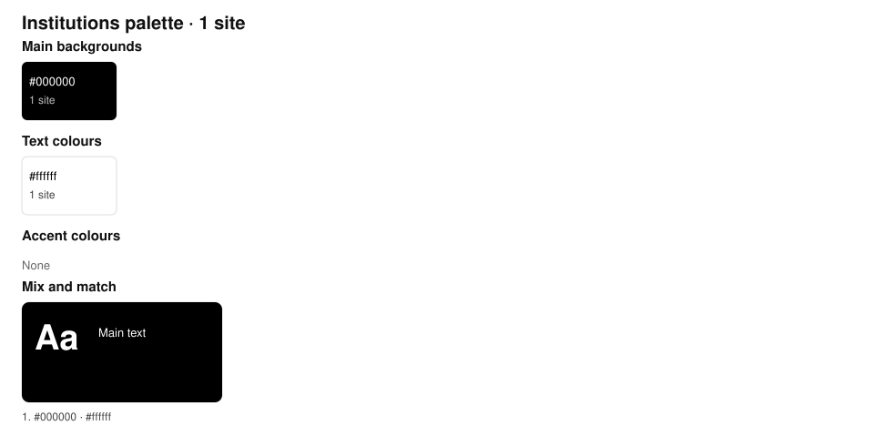

# Institutions palette

1 site (too few to call a pattern: read these as examples). 0 of them were captured as one screen only, so their colours come from the first screen.

Colours that look alike are merged and named by the most used shade; the counts are sites, not uses. Translucent colours are mixed onto each site's main background first.

## Main backgrounds

| Colour | Sites | Merged shades | Seen on |
| --- | --- | --- | --- |
| `#000000` | 1 of 1 | — | [Clevermellow](../../clevermellow.co/overview.md) |

## Second backgrounds

Section and panel colours that differ from the site's main background.

_None in this category._

## Text colours

| Colour | Sites | Contrast on `#000000` | Seen on |
| --- | --- | --- | --- |
| `#ffffff` | 1 of 1 | 21.0 | [Clevermellow](../../clevermellow.co/overview.md) |

## Accent colours

Any colour with real saturation (OKLab chroma 0.06 or more) that is not near-black, wherever the site uses it.

_None in this category._

## Mix and match

For each of the most common backgrounds: a main text colour at 7:1 or more where one exists (never below 4.5:1, WCAG AA body text), a muted secondary text between 3:1 and 7:1, and up to two accents at 3:1 or more (large text and UI parts). Colours that appear together on the same site are picked first; a remix borrows colours from different sites in this category.

| # | Background | Text | Secondary | Accent | Contrast text / secondary / accent | Source |
| --- | --- | --- | --- | --- | --- | --- |
| 1 | `#000000` | `#ffffff` | — | — | 21.0 / — / — | seen on [Clevermellow](../../clevermellow.co/overview.md) |
