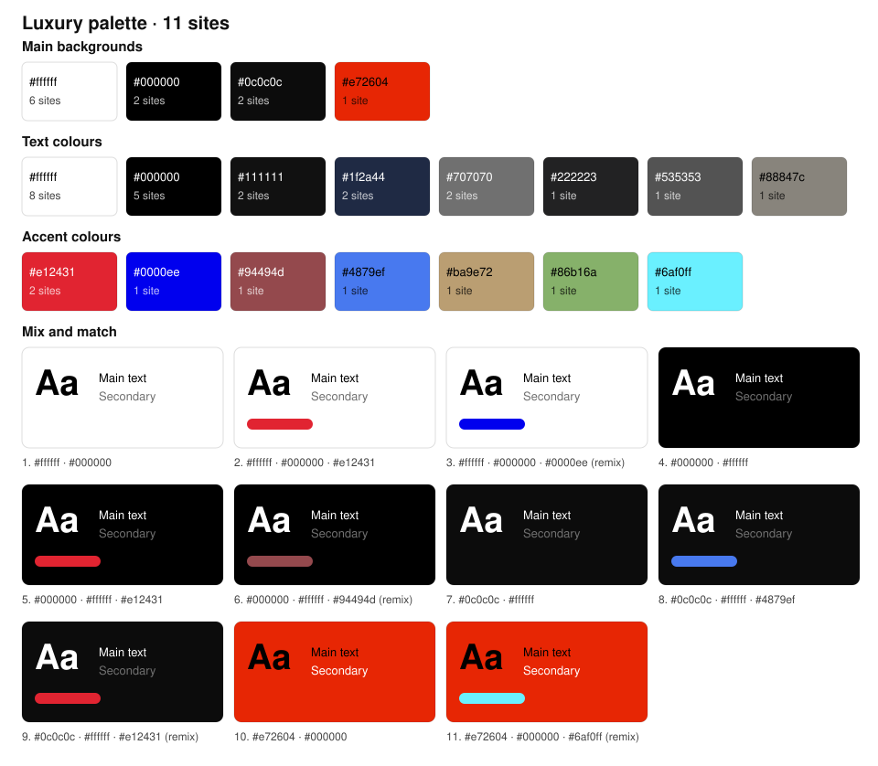

# Luxury palette

11 sites. 3 of them were captured as one screen only, so their colours come from the first screen.

Colours that look alike are merged and named by the most used shade; the counts are sites, not uses. Translucent colours are mixed onto each site's main background first.

## Main backgrounds

| Colour | Sites | Merged shades | Seen on |
| --- | --- | --- | --- |
| `#ffffff` | 6 of 11 | `#f8f6f2` | [Almada Label](../../almadalabel.com/overview.md), [David Spaeth](../../davidspaeth.com/overview.md), [ESR Bespoke](../../esrbespoke.au/overview.md), [Here & Away](../../here-away.com/overview.md) and 2 more |
| `#000000` | 2 of 11 | — | [Camper & Nicholsons](../../camperandnicholsons.com/overview.md), [YLEM](../../ylem.watch/overview.md) |
| `#0c0c0c` | 2 of 11 | `#0f0f15` | [Forge Automotive](../../forgeautomotive.co.uk/overview.md), [Villiers](../../villiers.ai/overview.md) |
| `#e72604` | 1 of 11 | — | [Love and Money](../../loveandmoney.com/overview.md) |

## Second backgrounds

Section and panel colours that differ from the site's main background.

| Colour | Sites | Merged shades | Seen on |
| --- | --- | --- | --- |
| `#ffffff` | 3 of 11 | `#f8f9f9` | [Camper & Nicholsons](../../camperandnicholsons.com/overview.md), [YLEM](../../ylem.watch/overview.md), [Villiers](../../villiers.ai/overview.md) |
| `#000000` | 2 of 11 | — | [ESR Bespoke](../../esrbespoke.au/overview.md), [Forge Automotive](../../forgeautomotive.co.uk/overview.md) |
| `#090b10` | 1 of 11 | — | [White Desert](../../white-desert.com/overview.md) |
| `#e12431` | 1 of 11 | — | [YLEM](../../ylem.watch/overview.md) |
| `#e5e5e5` | 1 of 11 | `#f0efed` | [Here & Away](../../here-away.com/overview.md) |

## Text colours

| Colour | Sites | Contrast on `#ffffff` | Contrast on `#000000` | Seen on |
| --- | --- | --- | --- | --- |
| `#ffffff` | 8 of 11 | 1.0 | 21.0 | [Almada Label](../../almadalabel.com/overview.md), [Camper & Nicholsons](../../camperandnicholsons.com/overview.md), [ESR Bespoke](../../esrbespoke.au/overview.md), [Forge Automotive](../../forgeautomotive.co.uk/overview.md) and 4 more |
| `#000000` | 5 of 11 | 21.0 | 1.0 | [Camper & Nicholsons](../../camperandnicholsons.com/overview.md), [David Spaeth](../../davidspaeth.com/overview.md), [ESR Bespoke](../../esrbespoke.au/overview.md), [Here & Away](../../here-away.com/overview.md) and 1 more |
| `#111111` | 2 of 11 | 18.9 | 1.1 | [Brandon Yasin](../../brandonyasin.com/overview.md), [Almada Label](../../almadalabel.com/overview.md) |
| `#1f2a44` | 2 of 11 | 14.3 | 1.5 | [White Desert](../../white-desert.com/overview.md), [Villiers](../../villiers.ai/overview.md) |
| `#707070` | 2 of 11 | 5.0 | 4.2 | [Villiers](../../villiers.ai/overview.md), [Here & Away](../../here-away.com/overview.md) |
| `#222223` | 1 of 11 | 15.9 | 1.3 | [YLEM](../../ylem.watch/overview.md) |
| `#535353` | 1 of 11 | 7.7 | 2.7 | [White Desert](../../white-desert.com/overview.md) |
| `#88847c` | 1 of 11 | 3.7 | 5.6 | [Almada Label](../../almadalabel.com/overview.md) |

## Accent colours

Any colour with real saturation (OKLab chroma 0.06 or more) that is not near-black, wherever the site uses it.

| Colour | Sites | Merged shades | Seen on |
| --- | --- | --- | --- |
| `#e12431` | 2 of 11 | `#ff0000` | [YLEM](../../ylem.watch/overview.md), [David Spaeth](../../davidspaeth.com/overview.md) |
| `#0000ee` | 1 of 11 | — | [Almada Label](../../almadalabel.com/overview.md) |
| `#94494d` | 1 of 11 | — | [Love and Money](../../loveandmoney.com/overview.md) |
| `#4879ef` | 1 of 11 | — | [Villiers](../../villiers.ai/overview.md) |
| `#ba9e72` | 1 of 11 | — | [Love and Money](../../loveandmoney.com/overview.md) |
| `#86b16a` | 1 of 11 | — | [Love and Money](../../loveandmoney.com/overview.md) |
| `#6af0ff` | 1 of 11 | — | [White Desert](../../white-desert.com/overview.md) |

## Mix and match

For each of the most common backgrounds: a main text colour at 7:1 or more where one exists (never below 4.5:1, WCAG AA body text), a muted secondary text between 3:1 and 7:1, and up to two accents at 3:1 or more (large text and UI parts). Colours that appear together on the same site are picked first; a remix borrows colours from different sites in this category.

| # | Background | Text | Secondary | Accent | Contrast text / secondary / accent | Source |
| --- | --- | --- | --- | --- | --- | --- |
| 1 | `#ffffff` | `#000000` | `#707070` | — | 21.0 / 5.0 / — | seen on [David Spaeth](../../davidspaeth.com/overview.md), [ESR Bespoke](../../esrbespoke.au/overview.md) and 1 more |
| 2 | `#ffffff` | `#000000` | `#707070` | `#e12431` | 21.0 / 5.0 / 4.7 | seen on [David Spaeth](../../davidspaeth.com/overview.md) |
| 3 | `#ffffff` | `#000000` | `#707070` | `#0000ee` | 21.0 / 5.0 / 9.4 | remix: ground from [Almada Label](../../almadalabel.com/overview.md), text from [Camper & Nicholsons](../../camperandnicholsons.com/overview.md), accent from [Almada Label](../../almadalabel.com/overview.md) |
| 4 | `#000000` | `#ffffff` | `#707070` | — | 21.0 / 4.2 / — | seen on [Camper & Nicholsons](../../camperandnicholsons.com/overview.md), [YLEM](../../ylem.watch/overview.md) |
| 5 | `#000000` | `#ffffff` | `#707070` | `#e12431` | 21.0 / 4.2 / 4.5 | seen on [YLEM](../../ylem.watch/overview.md) |
| 6 | `#000000` | `#ffffff` | `#707070` | `#94494d` | 21.0 / 4.2 / 3.3 | remix: ground from [Camper & Nicholsons](../../camperandnicholsons.com/overview.md), text from [Almada Label](../../almadalabel.com/overview.md), accent from [Love and Money](../../loveandmoney.com/overview.md) |
| 7 | `#0c0c0c` | `#ffffff` | `#707070` | — | 19.6 / 4.0 / — | seen on [Forge Automotive](../../forgeautomotive.co.uk/overview.md), [Villiers](../../villiers.ai/overview.md) |
| 8 | `#0c0c0c` | `#ffffff` | `#707070` | `#4879ef` | 19.6 / 4.0 / 4.9 | seen on [Villiers](../../villiers.ai/overview.md) |
| 9 | `#0c0c0c` | `#ffffff` | `#707070` | `#e12431` | 19.6 / 4.0 / 4.2 | remix: ground from [Forge Automotive](../../forgeautomotive.co.uk/overview.md), text from [Almada Label](../../almadalabel.com/overview.md), accent from [YLEM](../../ylem.watch/overview.md) |
| 10 | `#e72604` | `#000000` | `#ffffff` | — | 4.7 / 4.5 / — | seen on [Love and Money](../../loveandmoney.com/overview.md) |
| 11 | `#e72604` | `#000000` | `#ffffff` | `#6af0ff` | 4.7 / 4.5 / 3.3 | remix: ground from [Love and Money](../../loveandmoney.com/overview.md), text from [Camper & Nicholsons](../../camperandnicholsons.com/overview.md), accent from [White Desert](../../white-desert.com/overview.md) |
