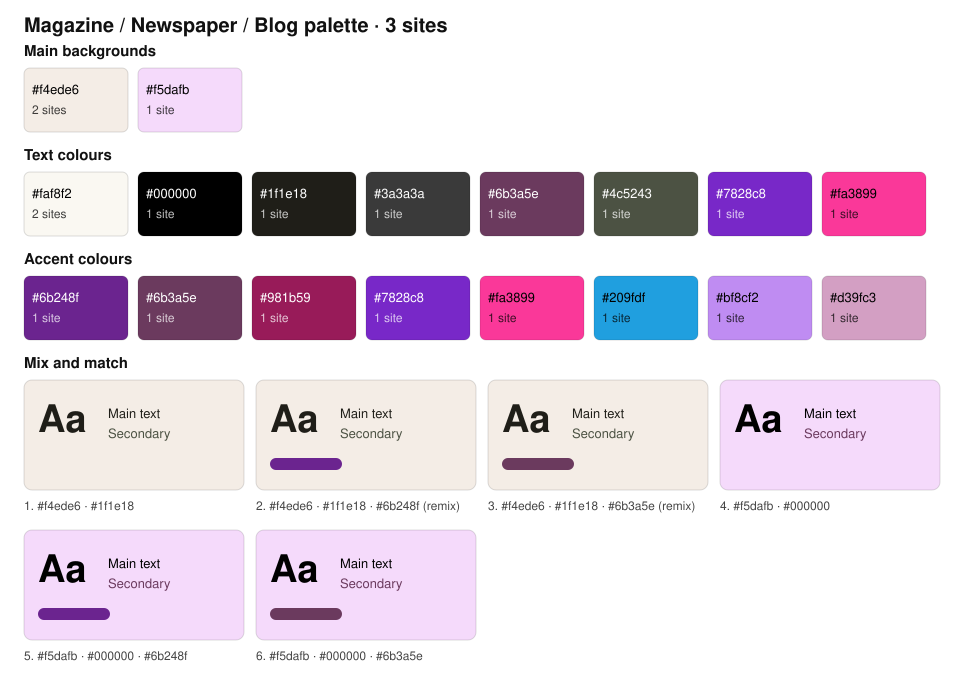

# Magazine / Newspaper / Blog palette

3 sites. 1 of them were captured as one screen only, so their colours come from the first screen.

Colours that look alike are merged and named by the most used shade; the counts are sites, not uses. Translucent colours are mixed onto each site's main background first.

## Main backgrounds

| Colour | Sites | Merged shades | Seen on |
| --- | --- | --- | --- |
| `#f4ede6` | 2 of 3 | `#faf8f2` | [How F1 has evolved since 1950](../../espn.com-espn-feature-story/overview.md), [The boring blog](../../theboringblog.ai/overview.md) |
| `#f5dafb` | 1 of 3 | — | [Rozalia Boma - Writer](../../rozaliabomawrites.com/overview.md) |

## Second backgrounds

Section and panel colours that differ from the site's main background.

| Colour | Sites | Merged shades | Seen on |
| --- | --- | --- | --- |
| `#300940` | 1 of 3 | — | [Rozalia Boma - Writer](../../rozaliabomawrites.com/overview.md) |
| `#fddf49` | 1 of 3 | — | [Rozalia Boma - Writer](../../rozaliabomawrites.com/overview.md) |

## Text colours

| Colour | Sites | Contrast on `#f4ede6` | Contrast on `#f5dafb` | Seen on |
| --- | --- | --- | --- | --- |
| `#faf8f2` | 2 of 3 | 1.1 | 1.2 | [The boring blog](../../theboringblog.ai/overview.md), [Rozalia Boma - Writer](../../rozaliabomawrites.com/overview.md) |
| `#000000` | 1 of 3 | 18.1 | 16.3 | [Rozalia Boma - Writer](../../rozaliabomawrites.com/overview.md) |
| `#1f1e18` | 1 of 3 | 14.4 | 13.0 | [The boring blog](../../theboringblog.ai/overview.md) |
| `#3a3a3a` | 1 of 3 | 9.8 | 8.8 | [How F1 has evolved since 1950](../../espn.com-espn-feature-story/overview.md) |
| `#6b3a5e` | 1 of 3 | 7.6 | 6.8 | [Rozalia Boma - Writer](../../rozaliabomawrites.com/overview.md) |
| `#4c5243` | 1 of 3 | 7.0 | 6.3 | [The boring blog](../../theboringblog.ai/overview.md) |
| `#7828c8` | 1 of 3 | 6.2 | 5.6 | [Rozalia Boma - Writer](../../rozaliabomawrites.com/overview.md) |
| `#fa3899` | 1 of 3 | 3.0 | 2.7 | [Rozalia Boma - Writer](../../rozaliabomawrites.com/overview.md) |

## Accent colours

Any colour with real saturation (OKLab chroma 0.06 or more) that is not near-black, wherever the site uses it.

| Colour | Sites | Merged shades | Seen on |
| --- | --- | --- | --- |
| `#6b248f` | 1 of 3 | — | [Rozalia Boma - Writer](../../rozaliabomawrites.com/overview.md) |
| `#6b3a5e` | 1 of 3 | — | [Rozalia Boma - Writer](../../rozaliabomawrites.com/overview.md) |
| `#981b59` | 1 of 3 | — | [Rozalia Boma - Writer](../../rozaliabomawrites.com/overview.md) |
| `#7828c8` | 1 of 3 | `#7e22ce` | [Rozalia Boma - Writer](../../rozaliabomawrites.com/overview.md) |
| `#fa3899` | 1 of 3 | — | [Rozalia Boma - Writer](../../rozaliabomawrites.com/overview.md) |
| `#209fdf` | 1 of 3 | — | [Rozalia Boma - Writer](../../rozaliabomawrites.com/overview.md) |
| `#bf8cf2` | 1 of 3 | — | [Rozalia Boma - Writer](../../rozaliabomawrites.com/overview.md) |
| `#d39fc3` | 1 of 3 | `#deb3d6`, `#df8cbc` | [Rozalia Boma - Writer](../../rozaliabomawrites.com/overview.md) |

## Mix and match

For each of the most common backgrounds: a main text colour at 7:1 or more where one exists (never below 4.5:1, WCAG AA body text), a muted secondary text between 3:1 and 7:1, and up to two accents at 3:1 or more (large text and UI parts). Colours that appear together on the same site are picked first; a remix borrows colours from different sites in this category.

| # | Background | Text | Secondary | Accent | Contrast text / secondary / accent | Source |
| --- | --- | --- | --- | --- | --- | --- |
| 1 | `#f4ede6` | `#1f1e18` | `#4c5243` | — | 14.4 / 7.0 / — | seen on [The boring blog](../../theboringblog.ai/overview.md) |
| 2 | `#f4ede6` | `#1f1e18` | `#4c5243` | `#6b248f` | 14.4 / 7.0 / 8.0 | remix: ground from [How F1 has evolved since 1950](../../espn.com-espn-feature-story/overview.md), text from [The boring blog](../../theboringblog.ai/overview.md), accent from [Rozalia Boma - Writer](../../rozaliabomawrites.com/overview.md) |
| 3 | `#f4ede6` | `#1f1e18` | `#4c5243` | `#6b3a5e` | 14.4 / 7.0 / 7.6 | remix: ground from [How F1 has evolved since 1950](../../espn.com-espn-feature-story/overview.md), text from [The boring blog](../../theboringblog.ai/overview.md), accent from [Rozalia Boma - Writer](../../rozaliabomawrites.com/overview.md) |
| 4 | `#f5dafb` | `#000000` | `#6b3a5e` | — | 16.3 / 6.8 / — | seen on [Rozalia Boma - Writer](../../rozaliabomawrites.com/overview.md) |
| 5 | `#f5dafb` | `#000000` | `#6b3a5e` | `#6b248f` | 16.3 / 6.8 / 7.2 | seen on [Rozalia Boma - Writer](../../rozaliabomawrites.com/overview.md) |
| 6 | `#f5dafb` | `#000000` | `#6b3a5e` | `#6b3a5e` | 16.3 / 6.8 / 6.8 | seen on [Rozalia Boma - Writer](../../rozaliabomawrites.com/overview.md) |
