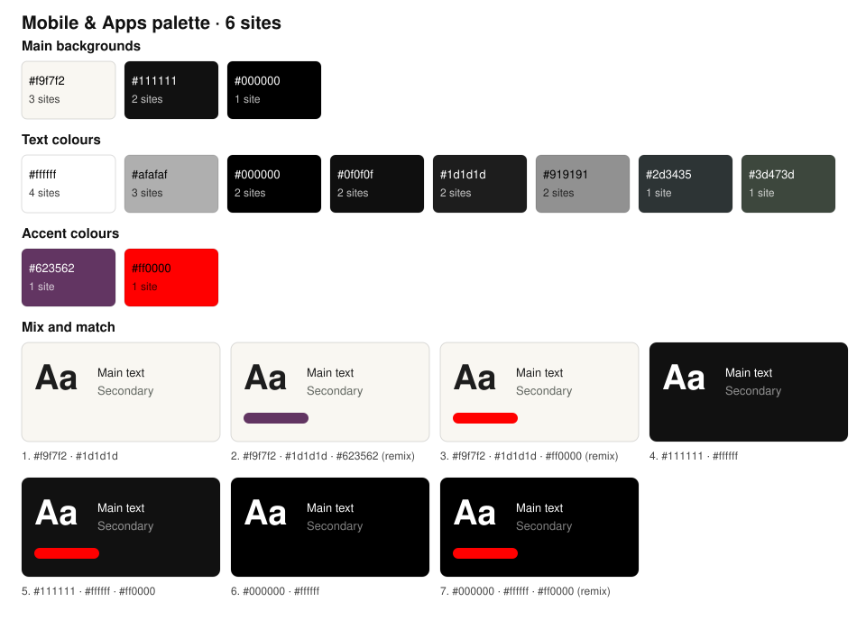

# Mobile & Apps palette

6 sites. 2 of them were captured as one screen only, so their colours come from the first screen.

Colours that look alike are merged and named by the most used shade; the counts are sites, not uses. Translucent colours are mixed onto each site's main background first.

## Main backgrounds

| Colour | Sites | Merged shades | Seen on |
| --- | --- | --- | --- |
| `#f9f7f2` | 3 of 6 | `#fafafa`, `#ffffff` | [GoShuin — Every stamp, a memory.](../../aestudio.studio-goshuin-en/overview.md), [Butter](../../butter.video/overview.md), [Mubien](../../mubien.com/overview.md) |
| `#111111` | 2 of 6 | `#131313` | [Boldium](../../boldium.com/overview.md), [Elva](../../elva-labs.com/overview.md) |
| `#000000` | 1 of 6 | — | [Grail](../../grail-app.com/overview.md) |

## Second backgrounds

Section and panel colours that differ from the site's main background.

| Colour | Sites | Merged shades | Seen on |
| --- | --- | --- | --- |
| `#f6f6f6` | 2 of 6 | `#ffffff` | [Grail](../../grail-app.com/overview.md), [Boldium](../../boldium.com/overview.md) |
| `#ff0000` | 1 of 6 | — | [Elva](../../elva-labs.com/overview.md) |
| `#d3d3d3` | 1 of 6 | — | [Butter](../../butter.video/overview.md) |
| `#e7e5df` | 1 of 6 | `#eee7d4`, `#eee9da`, `#eee9dc` | [GoShuin — Every stamp, a memory.](../../aestudio.studio-goshuin-en/overview.md) |

## Text colours

| Colour | Sites | Contrast on `#f9f7f2` | Contrast on `#111111` | Seen on |
| --- | --- | --- | --- | --- |
| `#ffffff` | 4 of 6 | 1.1 | 18.9 | [Boldium](../../boldium.com/overview.md), [Elva](../../elva-labs.com/overview.md), [Grail](../../grail-app.com/overview.md), [Mubien](../../mubien.com/overview.md) |
| `#afafaf` | 3 of 6 | 2.0 | 8.6 | [Boldium](../../boldium.com/overview.md), [Elva](../../elva-labs.com/overview.md), [Grail](../../grail-app.com/overview.md) |
| `#000000` | 2 of 6 | 19.6 | 1.1 | [Elva](../../elva-labs.com/overview.md), [Grail](../../grail-app.com/overview.md) |
| `#0f0f0f` | 2 of 6 | 17.9 | 1.0 | [Butter](../../butter.video/overview.md), [Boldium](../../boldium.com/overview.md) |
| `#1d1d1d` | 2 of 6 | 15.7 | 1.1 | [Mubien](../../mubien.com/overview.md), [Butter](../../butter.video/overview.md) |
| `#919191` | 2 of 6 | 2.9 | 6.0 | [Boldium](../../boldium.com/overview.md), [Butter](../../butter.video/overview.md) |
| `#2d3435` | 1 of 6 | 11.9 | 1.5 | [GoShuin — Every stamp, a memory.](../../aestudio.studio-goshuin-en/overview.md) |
| `#3d473d` | 1 of 6 | 9.1 | 1.9 | [GoShuin — Every stamp, a memory.](../../aestudio.studio-goshuin-en/overview.md) |

## Accent colours

Any colour with real saturation (OKLab chroma 0.06 or more) that is not near-black, wherever the site uses it.

| Colour | Sites | Merged shades | Seen on |
| --- | --- | --- | --- |
| `#623562` | 1 of 6 | — | [Grail](../../grail-app.com/overview.md) |
| `#ff0000` | 1 of 6 | — | [Elva](../../elva-labs.com/overview.md) |

## Mix and match

For each of the most common backgrounds: a main text colour at 7:1 or more where one exists (never below 4.5:1, WCAG AA body text), a muted secondary text between 3:1 and 7:1, and up to two accents at 3:1 or more (large text and UI parts). Colours that appear together on the same site are picked first; a remix borrows colours from different sites in this category.

| # | Background | Text | Secondary | Accent | Contrast text / secondary / accent | Source |
| --- | --- | --- | --- | --- | --- | --- |
| 1 | `#f9f7f2` | `#1d1d1d` | `#626761` | — | 15.7 / 5.4 / — | seen on [Butter](../../butter.video/overview.md), [Mubien](../../mubien.com/overview.md) |
| 2 | `#f9f7f2` | `#1d1d1d` | `#626761` | `#623562` | 15.7 / 5.4 / 8.9 | remix: ground from [GoShuin — Every stamp, a memory.](../../aestudio.studio-goshuin-en/overview.md), text from [Mubien](../../mubien.com/overview.md), accent from [Grail](../../grail-app.com/overview.md) |
| 3 | `#f9f7f2` | `#1d1d1d` | `#626761` | `#ff0000` | 15.7 / 5.4 / 3.7 | remix: ground from [GoShuin — Every stamp, a memory.](../../aestudio.studio-goshuin-en/overview.md), text from [Mubien](../../mubien.com/overview.md), accent from [Elva](../../elva-labs.com/overview.md) |
| 4 | `#111111` | `#ffffff` | `#919191` | — | 18.9 / 6.0 / — | seen on [Boldium](../../boldium.com/overview.md), [Elva](../../elva-labs.com/overview.md) |
| 5 | `#111111` | `#ffffff` | `#919191` | `#ff0000` | 18.9 / 6.0 / 4.7 | seen on [Elva](../../elva-labs.com/overview.md) |
| 6 | `#000000` | `#ffffff` | `#808080` | — | 21.0 / 5.3 / — | seen on [Grail](../../grail-app.com/overview.md) |
| 7 | `#000000` | `#ffffff` | `#808080` | `#ff0000` | 21.0 / 5.3 / 5.3 | remix: ground from [Grail](../../grail-app.com/overview.md), text from [Boldium](../../boldium.com/overview.md), accent from [Elva](../../elva-labs.com/overview.md) |
