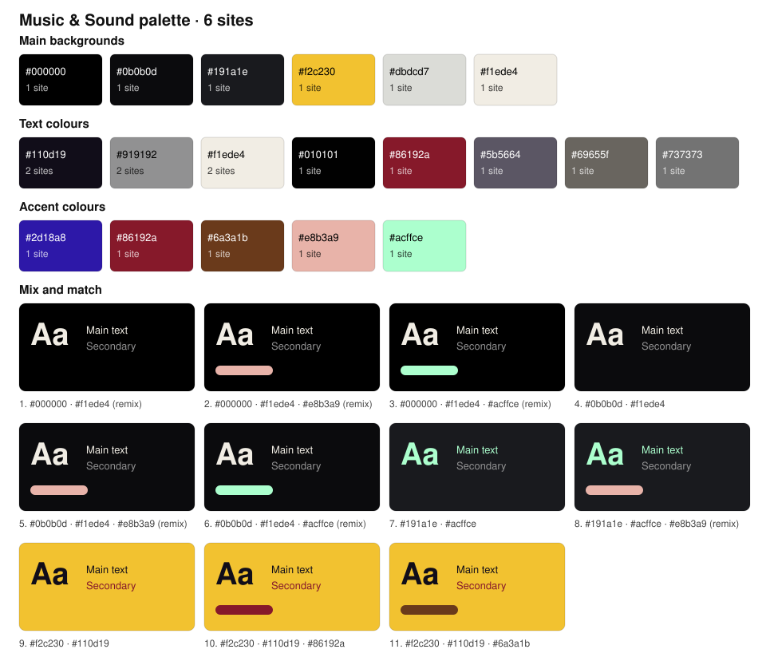

# Music & Sound palette

6 sites. 3 of them were captured as one screen only, so their colours come from the first screen.

Colours that look alike are merged and named by the most used shade; the counts are sites, not uses. Translucent colours are mixed onto each site's main background first.

## Main backgrounds

| Colour | Sites | Merged shades | Seen on |
| --- | --- | --- | --- |
| `#000000` | 1 of 6 | — | [aorum](../../aorum.io/overview.md) |
| `#0b0b0d` | 1 of 6 | — | [Still Night](../../stillnight.joshua-garcia.com/overview.md) |
| `#191a1e` | 1 of 6 | — | [Byotōne](../../byotone.com/overview.md) |
| `#f2c230` | 1 of 6 | — | [Nicolás Zarcero — Box Office](../../zarcerog.com/overview.md) |
| `#dbdcd7` | 1 of 6 | — | [Driftime's 2025 Impact Report](../../2025.driftime.com/overview.md) |
| `#f1ede4` | 1 of 6 | — | [Kelvin Music Festival 2027](../../kelvin.8b.com/overview.md) |

## Second backgrounds

Section and panel colours that differ from the site's main background.

| Colour | Sites | Merged shades | Seen on |
| --- | --- | --- | --- |
| `#070506` | 2 of 6 | `#110d19` | [Nicolás Zarcero — Box Office](../../zarcerog.com/overview.md), [Kelvin Music Festival 2027](../../kelvin.8b.com/overview.md) |
| `#2d18a8` | 1 of 6 | — | [Kelvin Music Festival 2027](../../kelvin.8b.com/overview.md) |
| `#b3aca1` | 1 of 6 | — | [Nicolás Zarcero — Box Office](../../zarcerog.com/overview.md) |
| `#e8b3a9` | 1 of 6 | — | [Nicolás Zarcero — Box Office](../../zarcerog.com/overview.md) |
| `#ffffff` | 1 of 6 | — | [Driftime's 2025 Impact Report](../../2025.driftime.com/overview.md) |

## Text colours

| Colour | Sites | Contrast on `#000000` | Contrast on `#0b0b0d` | Seen on |
| --- | --- | --- | --- | --- |
| `#110d19` | 2 of 6 | 1.1 | 1.0 | [Kelvin Music Festival 2027](../../kelvin.8b.com/overview.md), [Nicolás Zarcero — Box Office](../../zarcerog.com/overview.md) |
| `#919192` | 2 of 6 | 6.7 | 6.2 | [Still Night](../../stillnight.joshua-garcia.com/overview.md), [aorum](../../aorum.io/overview.md) |
| `#f1ede4` | 2 of 6 | 18.0 | 16.8 | [Kelvin Music Festival 2027](../../kelvin.8b.com/overview.md), [Still Night](../../stillnight.joshua-garcia.com/overview.md) |
| `#010101` | 1 of 6 | 1.0 | 1.1 | [Driftime's 2025 Impact Report](../../2025.driftime.com/overview.md) |
| `#86192a` | 1 of 6 | 2.2 | 2.0 | [Nicolás Zarcero — Box Office](../../zarcerog.com/overview.md) |
| `#5b5664` | 1 of 6 | 3.0 | 2.8 | [Kelvin Music Festival 2027](../../kelvin.8b.com/overview.md) |
| `#69655f` | 1 of 6 | 3.6 | 3.4 | [Still Night](../../stillnight.joshua-garcia.com/overview.md) |
| `#737373` | 1 of 6 | 4.4 | 4.1 | [Driftime's 2025 Impact Report](../../2025.driftime.com/overview.md) |

## Accent colours

Any colour with real saturation (OKLab chroma 0.06 or more) that is not near-black, wherever the site uses it.

| Colour | Sites | Merged shades | Seen on |
| --- | --- | --- | --- |
| `#2d18a8` | 1 of 6 | — | [Kelvin Music Festival 2027](../../kelvin.8b.com/overview.md) |
| `#86192a` | 1 of 6 | — | [Nicolás Zarcero — Box Office](../../zarcerog.com/overview.md) |
| `#6a3a1b` | 1 of 6 | — | [Nicolás Zarcero — Box Office](../../zarcerog.com/overview.md) |
| `#e8b3a9` | 1 of 6 | — | [Nicolás Zarcero — Box Office](../../zarcerog.com/overview.md) |
| `#acffce` | 1 of 6 | — | [Byotōne](../../byotone.com/overview.md) |

## Mix and match

For each of the most common backgrounds: a main text colour at 7:1 or more where one exists (never below 4.5:1, WCAG AA body text), a muted secondary text between 3:1 and 7:1, and up to two accents at 3:1 or more (large text and UI parts). Colours that appear together on the same site are picked first; a remix borrows colours from different sites in this category.

| # | Background | Text | Secondary | Accent | Contrast text / secondary / accent | Source |
| --- | --- | --- | --- | --- | --- | --- |
| 1 | `#000000` | `#f1ede4` | `#919192` | — | 18.0 / 6.7 / — | remix: ground from [aorum](../../aorum.io/overview.md), text from [Kelvin Music Festival 2027](../../kelvin.8b.com/overview.md) |
| 2 | `#000000` | `#f1ede4` | `#919192` | `#e8b3a9` | 18.0 / 6.7 / 11.5 | remix: ground from [aorum](../../aorum.io/overview.md), text from [Kelvin Music Festival 2027](../../kelvin.8b.com/overview.md), accent from [Nicolás Zarcero — Box Office](../../zarcerog.com/overview.md) |
| 3 | `#000000` | `#f1ede4` | `#919192` | `#acffce` | 18.0 / 6.7 / 17.9 | remix: ground from [aorum](../../aorum.io/overview.md), text from [Kelvin Music Festival 2027](../../kelvin.8b.com/overview.md), accent from [Byotōne](../../byotone.com/overview.md) |
| 4 | `#0b0b0d` | `#f1ede4` | `#919192` | — | 16.8 / 6.2 / — | seen on [Still Night](../../stillnight.joshua-garcia.com/overview.md) |
| 5 | `#0b0b0d` | `#f1ede4` | `#919192` | `#e8b3a9` | 16.8 / 6.2 / 10.7 | remix: ground from [Still Night](../../stillnight.joshua-garcia.com/overview.md), text from [Kelvin Music Festival 2027](../../kelvin.8b.com/overview.md), accent from [Nicolás Zarcero — Box Office](../../zarcerog.com/overview.md) |
| 6 | `#0b0b0d` | `#f1ede4` | `#919192` | `#acffce` | 16.8 / 6.2 / 16.8 | remix: ground from [Still Night](../../stillnight.joshua-garcia.com/overview.md), text from [Kelvin Music Festival 2027](../../kelvin.8b.com/overview.md), accent from [Byotōne](../../byotone.com/overview.md) |
| 7 | `#191a1e` | `#acffce` | `#919192` | — | 14.9 / 5.5 / — | seen on [Byotōne](../../byotone.com/overview.md) |
| 8 | `#191a1e` | `#acffce` | `#919192` | `#e8b3a9` | 14.9 / 5.5 / 9.5 | remix: ground from [Byotōne](../../byotone.com/overview.md), text from [Byotōne](../../byotone.com/overview.md), accent from [Nicolás Zarcero — Box Office](../../zarcerog.com/overview.md) |
| 9 | `#f2c230` | `#110d19` | `#86192a` | — | 11.4 / 5.7 / — | seen on [Nicolás Zarcero — Box Office](../../zarcerog.com/overview.md) |
| 10 | `#f2c230` | `#110d19` | `#86192a` | `#86192a` | 11.4 / 5.7 / 5.7 | seen on [Nicolás Zarcero — Box Office](../../zarcerog.com/overview.md) |
| 11 | `#f2c230` | `#110d19` | `#86192a` | `#6a3a1b` | 11.4 / 5.7 / 5.6 | seen on [Nicolás Zarcero — Box Office](../../zarcerog.com/overview.md) |
