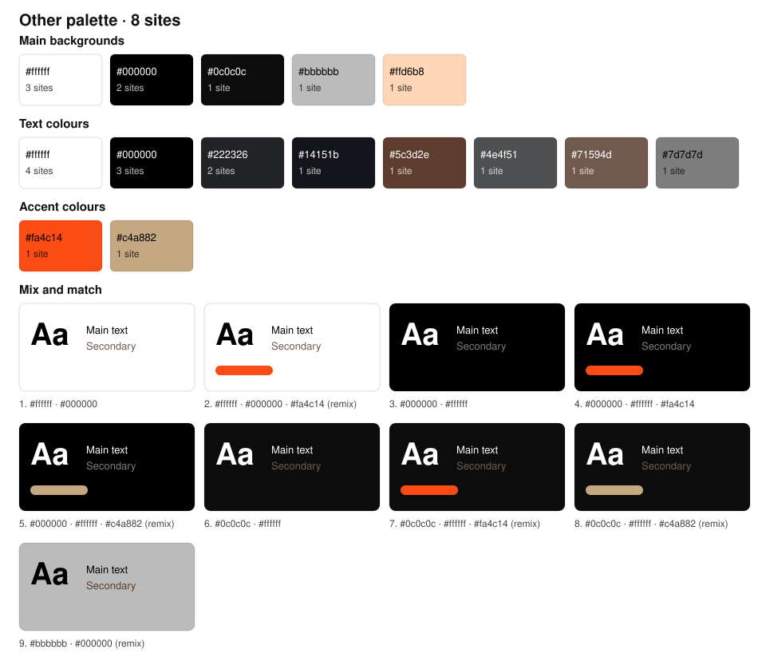

# Other palette

8 sites. 3 of them were captured as one screen only, so their colours come from the first screen.

Colours that look alike are merged and named by the most used shade; the counts are sites, not uses. Translucent colours are mixed onto each site's main background first.

## Main backgrounds

| Colour | Sites | Merged shades | Seen on |
| --- | --- | --- | --- |
| `#ffffff` | 3 of 8 | `#f5f5f5` | [Idealworks](../../idealworks.com/overview.md), [Nova Dental](../../nova-dental-dev.webflow.io/overview.md), [Emma Portner – Islands](../../emmaportner.com/overview.md) |
| `#000000` | 2 of 8 | — | [Camper & Nicholsons](../../camperandnicholsons.com/overview.md), [Dragonfly Redux](../../dragonfly2.studiofreight.dev/overview.md) |
| `#0c0c0c` | 1 of 8 | — | [Forge Automotive](../../forgeautomotive.co.uk/overview.md) |
| `#bbbbbb` | 1 of 8 | — | [John and Patricia's Space](../../john-and-patricias-comfort-site-about-attachment-styles.com/overview.md) |
| `#ffd6b8` | 1 of 8 | — | [Roof Studio](../../roofstudio.tv/overview.md) |

## Second backgrounds

Section and panel colours that differ from the site's main background.

| Colour | Sites | Merged shades | Seen on |
| --- | --- | --- | --- |
| `#000000` | 2 of 8 | — | [Forge Automotive](../../forgeautomotive.co.uk/overview.md), [Idealworks](../../idealworks.com/overview.md) |
| `#c4c6ca` | 1 of 8 | — | [Nova Dental](../../nova-dental-dev.webflow.io/overview.md) |
| `#f5ecd7` | 1 of 8 | — | [John and Patricia's Space](../../john-and-patricias-comfort-site-about-attachment-styles.com/overview.md) |
| `#ffffff` | 1 of 8 | — | [Camper & Nicholsons](../../camperandnicholsons.com/overview.md) |

## Text colours

| Colour | Sites | Contrast on `#ffffff` | Contrast on `#000000` | Seen on |
| --- | --- | --- | --- | --- |
| `#ffffff` | 4 of 8 | 1.0 | 21.0 | [Camper & Nicholsons](../../camperandnicholsons.com/overview.md), [Forge Automotive](../../forgeautomotive.co.uk/overview.md), [Idealworks](../../idealworks.com/overview.md), [Dragonfly Redux](../../dragonfly2.studiofreight.dev/overview.md) |
| `#000000` | 3 of 8 | 21.0 | 1.0 | [Camper & Nicholsons](../../camperandnicholsons.com/overview.md), [Emma Portner – Islands](../../emmaportner.com/overview.md), [Idealworks](../../idealworks.com/overview.md) |
| `#222326` | 2 of 8 | 15.7 | 1.3 | [Nova Dental](../../nova-dental-dev.webflow.io/overview.md), [Roof Studio](../../roofstudio.tv/overview.md) |
| `#14151b` | 1 of 8 | 18.2 | 1.2 | [Idealworks](../../idealworks.com/overview.md) |
| `#5c3d2e` | 1 of 8 | 9.7 | 2.2 | [John and Patricia's Space](../../john-and-patricias-comfort-site-about-attachment-styles.com/overview.md) |
| `#4e4f51` | 1 of 8 | 8.2 | 2.6 | [Nova Dental](../../nova-dental-dev.webflow.io/overview.md) |
| `#71594d` | 1 of 8 | 6.5 | 3.2 | [John and Patricia's Space](../../john-and-patricias-comfort-site-about-attachment-styles.com/overview.md) |
| `#7d7d7d` | 1 of 8 | 4.1 | 5.1 | [Dragonfly Redux](../../dragonfly2.studiofreight.dev/overview.md) |

## Accent colours

Any colour with real saturation (OKLab chroma 0.06 or more) that is not near-black, wherever the site uses it.

| Colour | Sites | Merged shades | Seen on |
| --- | --- | --- | --- |
| `#fa4c14` | 1 of 8 | — | [Dragonfly Redux](../../dragonfly2.studiofreight.dev/overview.md) |
| `#c4a882` | 1 of 8 | — | [John and Patricia's Space](../../john-and-patricias-comfort-site-about-attachment-styles.com/overview.md) |

## Mix and match

For each of the most common backgrounds: a main text colour at 7:1 or more where one exists (never below 4.5:1, WCAG AA body text), a muted secondary text between 3:1 and 7:1, and up to two accents at 3:1 or more (large text and UI parts). Colours that appear together on the same site are picked first; a remix borrows colours from different sites in this category.

| # | Background | Text | Secondary | Accent | Contrast text / secondary / accent | Source |
| --- | --- | --- | --- | --- | --- | --- |
| 1 | `#ffffff` | `#000000` | `#71594d` | — | 21.0 / 6.5 / — | seen on [Emma Portner – Islands](../../emmaportner.com/overview.md), [Idealworks](../../idealworks.com/overview.md) |
| 2 | `#ffffff` | `#000000` | `#71594d` | `#fa4c14` | 21.0 / 6.5 / 3.4 | remix: ground from [Idealworks](../../idealworks.com/overview.md), text from [Camper & Nicholsons](../../camperandnicholsons.com/overview.md), accent from [Dragonfly Redux](../../dragonfly2.studiofreight.dev/overview.md) |
| 3 | `#000000` | `#ffffff` | `#7d7d7d` | — | 21.0 / 5.1 / — | seen on [Camper & Nicholsons](../../camperandnicholsons.com/overview.md), [Dragonfly Redux](../../dragonfly2.studiofreight.dev/overview.md) |
| 4 | `#000000` | `#ffffff` | `#7d7d7d` | `#fa4c14` | 21.0 / 5.1 / 6.1 | seen on [Dragonfly Redux](../../dragonfly2.studiofreight.dev/overview.md) |
| 5 | `#000000` | `#ffffff` | `#7d7d7d` | `#c4a882` | 21.0 / 5.1 / 9.3 | remix: ground from [Camper & Nicholsons](../../camperandnicholsons.com/overview.md), text from [Camper & Nicholsons](../../camperandnicholsons.com/overview.md), accent from [John and Patricia's Space](../../john-and-patricias-comfort-site-about-attachment-styles.com/overview.md) |
| 6 | `#0c0c0c` | `#ffffff` | `#71594d` | — | 19.6 / 3.0 / — | seen on [Forge Automotive](../../forgeautomotive.co.uk/overview.md) |
| 7 | `#0c0c0c` | `#ffffff` | `#71594d` | `#fa4c14` | 19.6 / 3.0 / 5.7 | remix: ground from [Forge Automotive](../../forgeautomotive.co.uk/overview.md), text from [Camper & Nicholsons](../../camperandnicholsons.com/overview.md), accent from [Dragonfly Redux](../../dragonfly2.studiofreight.dev/overview.md) |
| 8 | `#0c0c0c` | `#ffffff` | `#71594d` | `#c4a882` | 19.6 / 3.0 / 8.6 | remix: ground from [Forge Automotive](../../forgeautomotive.co.uk/overview.md), text from [Camper & Nicholsons](../../camperandnicholsons.com/overview.md), accent from [John and Patricia's Space](../../john-and-patricias-comfort-site-about-attachment-styles.com/overview.md) |
| 9 | `#bbbbbb` | `#000000` | `#5c3d2e` | — | 10.9 / 5.1 / — | remix: ground from [John and Patricia's Space](../../john-and-patricias-comfort-site-about-attachment-styles.com/overview.md), text from [Camper & Nicholsons](../../camperandnicholsons.com/overview.md) |
