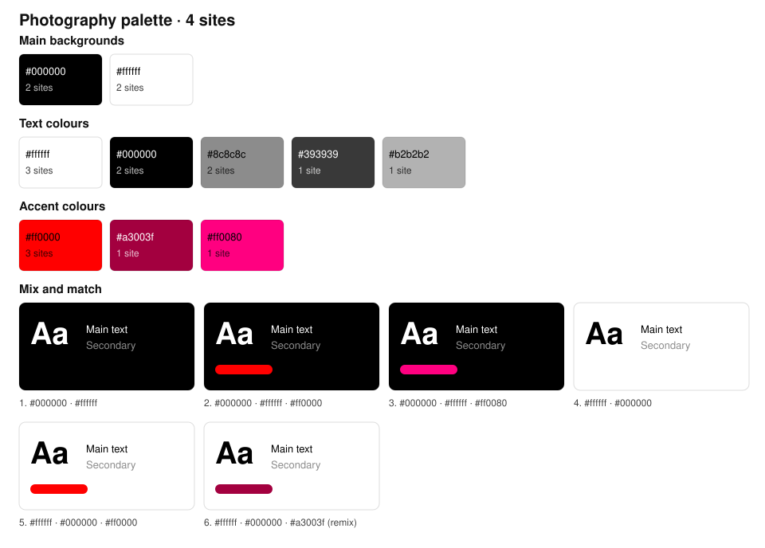

# Photography palette

4 sites. 2 of them were captured as one screen only, so their colours come from the first screen.

Colours that look alike are merged and named by the most used shade; the counts are sites, not uses. Translucent colours are mixed onto each site's main background first.

## Main backgrounds

| Colour | Sites | Merged shades | Seen on |
| --- | --- | --- | --- |
| `#000000` | 2 of 4 | — | [PSP Production](../../productionportugal.com/overview.md), [Unbelievably Crap](../../unbelievablycrap.com/overview.md) |
| `#ffffff` | 2 of 4 | — | [Brady Perron](../../bradyperron.com/overview.md), [David Spaeth](../../davidspaeth.com/overview.md) |

## Second backgrounds

Section and panel colours that differ from the site's main background.

| Colour | Sites | Merged shades | Seen on |
| --- | --- | --- | --- |
| `#393939` | 1 of 4 | — | [Unbelievably Crap](../../unbelievablycrap.com/overview.md) |
| `#e8271c` | 1 of 4 | `#ff0000` | [Unbelievably Crap](../../unbelievablycrap.com/overview.md) |
| `#ff0080` | 1 of 4 | `#ff126f` | [PSP Production](../../productionportugal.com/overview.md) |

## Text colours

| Colour | Sites | Contrast on `#000000` | Contrast on `#ffffff` | Seen on |
| --- | --- | --- | --- | --- |
| `#ffffff` | 3 of 4 | 21.0 | 1.0 | [Brady Perron](../../bradyperron.com/overview.md), [PSP Production](../../productionportugal.com/overview.md), [Unbelievably Crap](../../unbelievablycrap.com/overview.md) |
| `#000000` | 2 of 4 | 1.0 | 21.0 | [Brady Perron](../../bradyperron.com/overview.md), [David Spaeth](../../davidspaeth.com/overview.md) |
| `#8c8c8c` | 2 of 4 | 6.2 | 3.4 | [Brady Perron](../../bradyperron.com/overview.md), [Unbelievably Crap](../../unbelievablycrap.com/overview.md) |
| `#393939` | 1 of 4 | 1.8 | 11.5 | [Unbelievably Crap](../../unbelievablycrap.com/overview.md) |
| `#b2b2b2` | 1 of 4 | 9.9 | 2.1 | [Brady Perron](../../bradyperron.com/overview.md) |

## Accent colours

Any colour with real saturation (OKLab chroma 0.06 or more) that is not near-black, wherever the site uses it.

| Colour | Sites | Merged shades | Seen on |
| --- | --- | --- | --- |
| `#ff0000` | 3 of 4 | `#e8271c`, `#ff004d` | [David Spaeth](../../davidspaeth.com/overview.md), [Unbelievably Crap](../../unbelievablycrap.com/overview.md), [PSP Production](../../productionportugal.com/overview.md) |
| `#a3003f` | 1 of 4 | — | [PSP Production](../../productionportugal.com/overview.md) |
| `#ff0080` | 1 of 4 | `#ff126f` | [PSP Production](../../productionportugal.com/overview.md) |

## Mix and match

For each of the most common backgrounds: a main text colour at 7:1 or more where one exists (never below 4.5:1, WCAG AA body text), a muted secondary text between 3:1 and 7:1, and up to two accents at 3:1 or more (large text and UI parts). Colours that appear together on the same site are picked first; a remix borrows colours from different sites in this category.

| # | Background | Text | Secondary | Accent | Contrast text / secondary / accent | Source |
| --- | --- | --- | --- | --- | --- | --- |
| 1 | `#000000` | `#ffffff` | `#8c8c8c` | — | 21.0 / 6.2 / — | seen on [PSP Production](../../productionportugal.com/overview.md), [Unbelievably Crap](../../unbelievablycrap.com/overview.md) |
| 2 | `#000000` | `#ffffff` | `#8c8c8c` | `#ff0000` | 21.0 / 6.2 / 5.3 | seen on [PSP Production](../../productionportugal.com/overview.md), [Unbelievably Crap](../../unbelievablycrap.com/overview.md) |
| 3 | `#000000` | `#ffffff` | `#8c8c8c` | `#ff0080` | 21.0 / 6.2 / 5.6 | seen on [PSP Production](../../productionportugal.com/overview.md) |
| 4 | `#ffffff` | `#000000` | `#8c8c8c` | — | 21.0 / 3.4 / — | seen on [Brady Perron](../../bradyperron.com/overview.md), [David Spaeth](../../davidspaeth.com/overview.md) |
| 5 | `#ffffff` | `#000000` | `#8c8c8c` | `#ff0000` | 21.0 / 3.4 / 4.0 | seen on [David Spaeth](../../davidspaeth.com/overview.md) |
| 6 | `#ffffff` | `#000000` | `#8c8c8c` | `#a3003f` | 21.0 / 3.4 / 8.0 | remix: ground from [Brady Perron](../../bradyperron.com/overview.md), text from [Brady Perron](../../bradyperron.com/overview.md), accent from [PSP Production](../../productionportugal.com/overview.md) |
