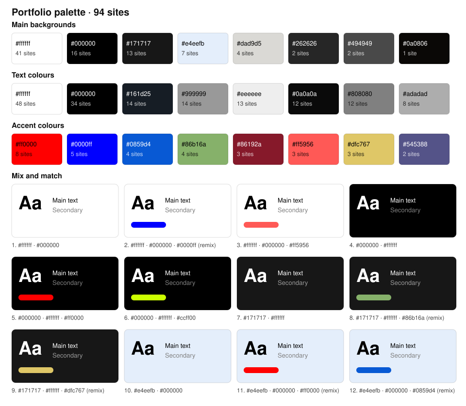

# Portfolio palette

94 sites. 49 of them were captured as one screen only, so their colours come from the first screen.

Colours that look alike are merged and named by the most used shade; the counts are sites, not uses. Translucent colours are mixed onto each site's main background first.

## Main backgrounds

| Colour | Sites | Merged shades | Seen on |
| --- | --- | --- | --- |
| `#ffffff` | 41 of 94 | `#f2f2f2`, `#f5f5f5`, `#f1f1f1`, `#f1f3f5` | [AAT Architecten](../../aat-architecten.be/overview.md), [Alicia Dubuis](../../aliciadubuis.com/overview.md), [Arrova](../../arrova.eu/overview.md), [AVEA](../../avea.studio/overview.md) and 37 more |
| `#000000` | 16 of 94 | `#04040e`, `#050505`, `#080808` | [Allan Leone - Product Designer](../../allanleone.com/overview.md), [Dash Creative](../../dashcreative.co/overview.md), [Dopamine Studio](../../dopaminestudio.io/overview.md), [galekto](../../galekto.com/overview.md) and 12 more |
| `#171717` | 13 of 94 | `#0b0b0a`, `#101012`, `#121212`, `#141414` | [Giordano Betti](../../giordanobetti.com/overview.md), [Sam Goddard](../../samgoddard.co.uk/overview.md), [Yuya Film Studio](../../yuyafilmstudio.dev/overview.md), [Nahiyan Khan - Personal Site](../../nahiyan.codes/overview.md) and 9 more |
| `#e4eefb` | 7 of 94 | `#eaece5`, `#ececec`, `#edeee5`, `#f2ecdf` | [Zesiger.net](../../zesiger.net/overview.md), [Melike Turgut](../../meliketurgut.com/overview.md), [Huy Phan Vol.2](../../huyml.co/overview.md), [AUGE Experience](../../auge-xp.com/overview.md) and 3 more |
| `#dad9d5` | 4 of 94 | `#dddbe7`, `#e4e4e4`, `#ebe1db` | [Grafik](../../grafik.nz/overview.md), [Made in May](../../madeinmay.studio/overview.md), [Lesse Studio](../../lessestudio.com/overview.md), [Jaytel](../../jay.tel/overview.md) |
| `#262626` | 2 of 94 | `#2d2822` | [Josh Goldsmith - Director & EP](../../josh-goldsmith.com/overview.md), [Houmahani Kane](../../houmahani.com/overview.md) |
| `#494949` | 2 of 94 | `#594037` | [Onseis Studio](../../onseis.com/overview.md), [dsgn Interior](../../dsgninterior.se/overview.md) |
| `#0a0806` | 1 of 94 | — | [David Estrada](../../david-estrada.dev/overview.md) |

## Second backgrounds

Section and panel colours that differ from the site's main background.

| Colour | Sites | Merged shades | Seen on |
| --- | --- | --- | --- |
| `#000000` | 15 of 94 | `#070506` | [A24](../../a24.raviklaassens.com/overview.md), [AUGE Experience](../../auge-xp.com/overview.md), [Carter Ogunsola](../../carterogunsola.com/overview.md), [Josh Goldsmith - Director & EP](../../josh-goldsmith.com/overview.md) and 11 more |
| `#ffffff` | 15 of 94 | `#f0f2f4`, `#f5f5f5`, `#f6f5f4`, `#f7f7f7` | [David Estrada](../../david-estrada.dev/overview.md), [Giordano Betti](../../giordanobetti.com/overview.md), [Grafik](../../grafik.nz/overview.md), [Huy Phan Vol.2](../../huyml.co/overview.md) and 11 more |
| `#0a0a0a` | 7 of 94 | `#070b00`, `#101010`, `#111111`, `#141414` | [Petrillo.studio](../../petrillo.studio/overview.md), [Vantra (Featured Template)](../../vantra-studio.webflow.io/overview.md), [Made in May](../../madeinmay.studio/overview.md), [Lesse Studio](../../lessestudio.com/overview.md) and 3 more |
| `#161d25` | 4 of 94 | `#201d1d`, `#222222`, `#242424` | [Awake Agency](../../awakeagency.dev/overview.md), [ViV Management](../../vivmgmt.com/overview.md), [Onlines](../../onlines.com.ar/overview.md), [Martin Foucaut](../../martinfoucaut.com/overview.md) |
| `#e2e0d9` | 4 of 94 | `#e8e4e0`, `#efece8`, `#fae3e2` | [Mathis Biabiany](../../mathis-biabiany.fr/overview.md), [Reckon House Staples](../../reckon.house/overview.md), [Kigo Studio](../../kigo.studio/overview.md), [Two26 Studio](../../two26.studio/overview.md) |
| `#ff0000` | 3 of 94 | `#ff003d` | [Studio OL](../../ol.studio/overview.md), [Petrillo.studio](../../petrillo.studio/overview.md), [Awake Agency](../../awakeagency.dev/overview.md) |
| `#acc7c9` | 3 of 94 | `#c3c5ba`, `#c4c1be` | [Scullion Architects](../../scullion.ie/overview.md), [Onseis Studio](../../onseis.com/overview.md), [Sam Thies](../../samthies.com/overview.md) |
| `#cccccc` | 3 of 94 | `#cdcdcd`, `#d9d5d5` | [Arrova](../../arrova.eu/overview.md), [Lesse Studio](../../lessestudio.com/overview.md), [pu—ente](../../pu-ente.com-en/overview.md) |

## Text colours

| Colour | Sites | Contrast on `#ffffff` | Contrast on `#000000` | Seen on |
| --- | --- | --- | --- | --- |
| `#ffffff` | 48 of 94 | 1.0 | 21.0 | [Allan Leone - Product Designer](../../allanleone.com/overview.md), [Anthracite Studio](../../anthracitestudio.be/overview.md), [AUGE Experience](../../auge-xp.com/overview.md), [Awake Agency](../../awakeagency.dev/overview.md) and 44 more |
| `#000000` | 34 of 94 | 21.0 | 1.0 | [A24](../../a24.raviklaassens.com/overview.md), [Arrova](../../arrova.eu/overview.md), [AVEA](../../avea.studio/overview.md), [bleibtgleich'26](../../bleibtgleich.dev/overview.md) and 30 more |
| `#161d25` | 14 of 94 | 17.0 | 1.2 | [Awake Agency](../../awakeagency.dev/overview.md), [Philipp Hafner](../../philipphafner.com/overview.md), [pu—ente](../../pu-ente.com-en/overview.md), [Ev Astapov](../../astapable.com/overview.md) and 10 more |
| `#999999` | 14 of 94 | 2.8 | 7.4 | [AVEA](../../avea.studio/overview.md), [Brady Perron](../../bradyperron.com/overview.md), [Kalok Yeung](../../kalokyeung.com/overview.md), [Mubien](../../mubien.com/overview.md) and 10 more |
| `#eeeeee` | 13 of 94 | 1.2 | 18.1 | [Pilato](../../pilato.it/overview.md), [TREY HOLLINGER](../../treyhollinger.com/overview.md), [Studio Mirage](../../studiomirage.io/overview.md), [Hamza's Desk](../../raomuhammadhamza.tech/overview.md) and 9 more |
| `#0a0a0a` | 12 of 94 | 19.8 | 1.1 | [blue2purple](../../blue2purple.com/overview.md), [Vantra (Featured Template)](../../vantra-studio.webflow.io/overview.md), [Mathis Biabiany](../../mathis-biabiany.fr/overview.md), [Stéfano Girardelli — Designer](../../stefanobg.com/overview.md) and 8 more |
| `#808080` | 12 of 94 | 3.9 | 5.3 | [Martin Foucaut](../../martinfoucaut.com/overview.md), [Petrillo.studio](../../petrillo.studio/overview.md), [Melike Turgut](../../meliketurgut.com/overview.md), [GOBOLD™ Agency](../../gobold.live/overview.md) and 8 more |
| `#adadad` | 8 of 94 | 2.2 | 9.4 | [Boc.Studio](../../boc.studio/overview.md), [Carter Ogunsola](../../carterogunsola.com/overview.md), [Brady Perron](../../bradyperron.com/overview.md), [Tommy Biglow](../../tommybiglow.com/overview.md) and 4 more |

## Accent colours

Any colour with real saturation (OKLab chroma 0.06 or more) that is not near-black, wherever the site uses it.

| Colour | Sites | Merged shades | Seen on |
| --- | --- | --- | --- |
| `#ff0000` | 8 of 94 | `#ff003d`, `#ff004d`, `#ff2b2b`, `#ff4f00` | [David Spaeth](../../davidspaeth.com/overview.md), [galekto](../../galekto.com/overview.md), [GOBOLD™ Agency](../../gobold.live/overview.md), [Studio OL](../../ol.studio/overview.md) and 4 more |
| `#0000ff` | 5 of 94 | `#0c00ff`, `#1d00ff`, `#251aff` | [Design by Ency](../../designbyency.com/overview.md), [galekto](../../galekto.com/overview.md), [blue2purple](../../blue2purple.com/overview.md), [Shelby's Desk](../../shelbykho.com/overview.md) and 1 more |
| `#0859d4` | 4 of 94 | `#1447e6`, `#1f66dc`, `#3d4bff` | [Onlines](../../onlines.com.ar/overview.md), [Kalok Yeung](../../kalokyeung.com/overview.md), [Zesiger.net](../../zesiger.net/overview.md), [Anthracite Studio](../../anthracitestudio.be/overview.md) |
| `#86b16a` | 4 of 94 | `#919e44`, `#b5a96f`, `#b9b36d` | [Love and Money](../../loveandmoney.com/overview.md), [bleibtgleich'26](../../bleibtgleich.dev/overview.md), [Frédéric Lord](../../fredericlord.com/overview.md), [Structure Consulting Engineers](../../structureengineering.com.au/overview.md) |
| `#86192a` | 3 of 94 | `#990000`, `#a3003f` | [Nicolás Zarcero — Box Office](../../zarcerog.com/overview.md), [IWONDERU Studios](../../iwonderu.se/overview.md), [PSP Production](../../productionportugal.com/overview.md) |
| `#ff5956` | 3 of 94 | `#ff633d`, `#ff7136` | [The Robot and Me](../../therobotand.me/overview.md), [bleibtgleich'26](../../bleibtgleich.dev/overview.md), [Right Hemisphere](../../righthemisphere.studio/overview.md) |
| `#dfc767` | 3 of 94 | `#facc15`, `#ffb000`, `#ffc840`, `#ffd060` | [Frédéric Lord](../../fredericlord.com/overview.md), [galekto](../../galekto.com/overview.md), [UNDPLUS](../../undplus.com/overview.md) |
| `#545388` | 2 of 94 | `#565a92` | [Nesil's Lucid Dreams](../../nesilnoble.com/overview.md), [Design by Ency](../../designbyency.com/overview.md) |

## Mix and match

For each of the most common backgrounds: a main text colour at 7:1 or more where one exists (never below 4.5:1, WCAG AA body text), a muted secondary text between 3:1 and 7:1, and up to two accents at 3:1 or more (large text and UI parts). Colours that appear together on the same site are picked first; a remix borrows colours from different sites in this category.

| # | Background | Text | Secondary | Accent | Contrast text / secondary / accent | Source |
| --- | --- | --- | --- | --- | --- | --- |
| 1 | `#ffffff` | `#000000` | `#808080` | — | 21.0 / 3.9 / — | seen on [A24](../../a24.raviklaassens.com/overview.md), [Arrova](../../arrova.eu/overview.md) and 16 more |
| 2 | `#ffffff` | `#000000` | `#808080` | `#0000ff` | 21.0 / 3.9 / 8.6 | remix: ground from [AAT Architecten](../../aat-architecten.be/overview.md), text from [A24](../../a24.raviklaassens.com/overview.md), accent from [Design by Ency](../../designbyency.com/overview.md) |
| 3 | `#ffffff` | `#000000` | `#808080` | `#ff5956` | 21.0 / 3.9 / 3.1 | seen on [bleibtgleich'26](../../bleibtgleich.dev/overview.md), [Right Hemisphere](../../righthemisphere.studio/overview.md) |
| 4 | `#000000` | `#ffffff` | `#808080` | — | 21.0 / 5.3 / — | seen on [Allan Leone - Product Designer](../../allanleone.com/overview.md), [Anthracite Studio](../../anthracitestudio.be/overview.md) and 9 more |
| 5 | `#000000` | `#ffffff` | `#808080` | `#ff0000` | 21.0 / 5.3 / 5.3 | seen on [PSP Production](../../productionportugal.com/overview.md) |
| 6 | `#000000` | `#ffffff` | `#808080` | `#ccff00` | 21.0 / 5.3 / 17.9 | seen on [Dopamine Studio](../../dopaminestudio.io/overview.md) |
| 7 | `#171717` | `#ffffff` | `#999999` | — | 17.9 / 6.3 / — | seen on [Boc.Studio](../../boc.studio/overview.md), [Carter Ogunsola](../../carterogunsola.com/overview.md) and 6 more |
| 8 | `#171717` | `#ffffff` | `#999999` | `#86b16a` | 17.9 / 6.3 / 7.3 | remix: ground from [Giordano Betti](../../giordanobetti.com/overview.md), text from [Allan Leone - Product Designer](../../allanleone.com/overview.md), accent from [Love and Money](../../loveandmoney.com/overview.md) |
| 9 | `#171717` | `#ffffff` | `#999999` | `#dfc767` | 17.9 / 6.3 / 10.7 | remix: ground from [Giordano Betti](../../giordanobetti.com/overview.md), text from [Allan Leone - Product Designer](../../allanleone.com/overview.md), accent from [Frédéric Lord](../../fredericlord.com/overview.md) |
| 10 | `#e4eefb` | `#000000` | `#808080` | — | 17.9 / 3.4 / — | seen on [Melike Turgut](../../meliketurgut.com/overview.md) |
| 11 | `#e4eefb` | `#000000` | `#808080` | `#ff0000` | 17.9 / 3.4 / 3.4 | remix: ground from [Zesiger.net](../../zesiger.net/overview.md), text from [A24](../../a24.raviklaassens.com/overview.md), accent from [David Spaeth](../../davidspaeth.com/overview.md) |
| 12 | `#e4eefb` | `#000000` | `#808080` | `#0859d4` | 17.9 / 3.4 / 5.3 | remix: ground from [Zesiger.net](../../zesiger.net/overview.md), text from [A24](../../a24.raviklaassens.com/overview.md), accent from [Onlines](../../onlines.com.ar/overview.md) |
