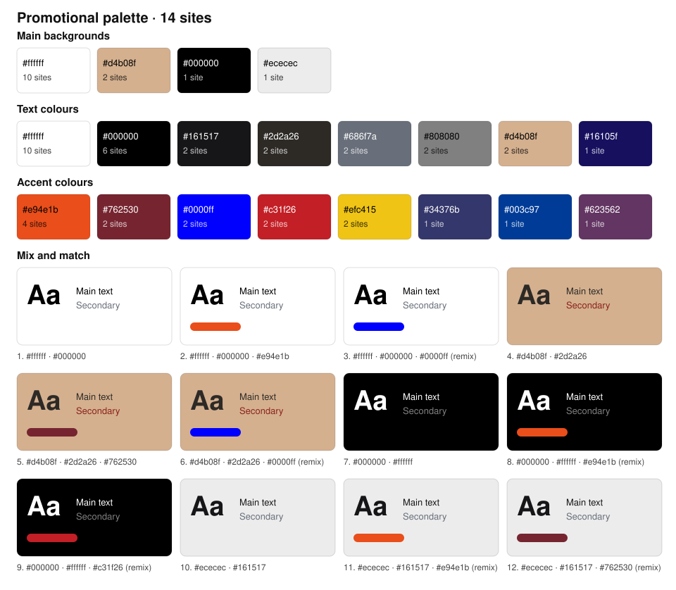

# Promotional palette

14 sites. 3 of them were captured as one screen only, so their colours come from the first screen.

Colours that look alike are merged and named by the most used shade; the counts are sites, not uses. Translucent colours are mixed onto each site's main background first.

## Main backgrounds

| Colour | Sites | Merged shades | Seen on |
| --- | --- | --- | --- |
| `#ffffff` | 10 of 14 | `#f4f2f0`, `#f8f2ea`, `#fdf3eb`, `#fff2e6` | [bleibtgleich'26](../../bleibtgleich.dev/overview.md), [Design by Ency](../../designbyency.com/overview.md), [ESR Bespoke](../../esrbespoke.au/overview.md), [Garvin Promotion Group](../../gpg.dops.agency/overview.md) and 6 more |
| `#d4b08f` | 2 of 14 | `#e3a898` | [Relevo & Vinco](../../relevovinco.com/overview.md), [Henrietta Said](../../henrietta.wearetattoodigital.com/overview.md) |
| `#000000` | 1 of 14 | — | [Grail](../../grail-app.com/overview.md) |
| `#ececec` | 1 of 14 | — | [Huy Phan Vol.2](../../huyml.co/overview.md) |

## Second backgrounds

Section and panel colours that differ from the site's main background.

| Colour | Sites | Merged shades | Seen on |
| --- | --- | --- | --- |
| `#000000` | 2 of 14 | — | [ESR Bespoke](../../esrbespoke.au/overview.md), [Grounded](../../grounded2026.com/overview.md) |
| `#0000ff` | 2 of 14 | `#0625ee` | [Design by Ency](../../designbyency.com/overview.md), [Lydia Leiwang's Portfolio](../../lydialeiwang.com/overview.md) |
| `#f6f6f6` | 2 of 14 | `#ffffff` | [Grail](../../grail-app.com/overview.md), [Huy Phan Vol.2](../../huyml.co/overview.md) |
| `#16105f` | 1 of 14 | — | [Design by Ency](../../designbyency.com/overview.md) |
| `#201878` | 1 of 14 | — | [Design by Ency](../../designbyency.com/overview.md) |
| `#47331f` | 1 of 14 | — | [Relevo & Vinco](../../relevovinco.com/overview.md) |
| `#762530` | 1 of 14 | — | [Agrumea Farm](../../agrumeafarm.it-en/overview.md) |
| `#003c97` | 1 of 14 | — | [Garvin Promotion Group](../../gpg.dops.agency/overview.md) |

## Text colours

| Colour | Sites | Contrast on `#ffffff` | Contrast on `#d4b08f` | Seen on |
| --- | --- | --- | --- | --- |
| `#ffffff` | 10 of 14 | 1.0 | 2.0 | [Design by Ency](../../designbyency.com/overview.md), [ESR Bespoke](../../esrbespoke.au/overview.md), [Garvin Promotion Group](../../gpg.dops.agency/overview.md), [Grail](../../grail-app.com/overview.md) and 6 more |
| `#000000` | 6 of 14 | 21.0 | 10.4 | [bleibtgleich'26](../../bleibtgleich.dev/overview.md), [ESR Bespoke](../../esrbespoke.au/overview.md), [Grail](../../grail-app.com/overview.md), [Grounded](../../grounded2026.com/overview.md) and 2 more |
| `#161517` | 2 of 14 | 18.2 | 9.0 | [Polpharma Biologics](../../polpharmabiologics.com/overview.md), [Huy Phan Vol.2](../../huyml.co/overview.md) |
| `#2d2a26` | 2 of 14 | 14.3 | 7.1 | [Henrietta Said](../../henrietta.wearetattoodigital.com/overview.md), [Relevo & Vinco](../../relevovinco.com/overview.md) |
| `#686f7a` | 2 of 14 | 5.1 | 2.5 | [Garvin Promotion Group](../../gpg.dops.agency/overview.md), [Grounded](../../grounded2026.com/overview.md) |
| `#808080` | 2 of 14 | 3.9 | 2.0 | [Grail](../../grail-app.com/overview.md), [Garvin Promotion Group](../../gpg.dops.agency/overview.md) |
| `#d4b08f` | 2 of 14 | 2.0 | 1.0 | [Relevo & Vinco](../../relevovinco.com/overview.md), [Henrietta Said](../../henrietta.wearetattoodigital.com/overview.md) |
| `#16105f` | 1 of 14 | 16.5 | 8.2 | [Design by Ency](../../designbyency.com/overview.md) |

## Accent colours

Any colour with real saturation (OKLab chroma 0.06 or more) that is not near-black, wherever the site uses it.

| Colour | Sites | Merged shades | Seen on |
| --- | --- | --- | --- |
| `#e94e1b` | 4 of 14 | `#f15928`, `#f45016`, `#ff633d` | [Agrumea Farm](../../agrumeafarm.it-en/overview.md), [Garvin Promotion Group](../../gpg.dops.agency/overview.md), [Henrietta Said](../../henrietta.wearetattoodigital.com/overview.md), [bleibtgleich'26](../../bleibtgleich.dev/overview.md) |
| `#762530` | 2 of 14 | `#8b231a` | [Agrumea Farm](../../agrumeafarm.it-en/overview.md), [Henrietta Said](../../henrietta.wearetattoodigital.com/overview.md) |
| `#0000ff` | 2 of 14 | `#0625ee` | [Design by Ency](../../designbyency.com/overview.md), [Lydia Leiwang's Portfolio](../../lydialeiwang.com/overview.md) |
| `#c31f26` | 2 of 14 | `#d32929` | [bleibtgleich'26](../../bleibtgleich.dev/overview.md), [Henrietta Said](../../henrietta.wearetattoodigital.com/overview.md) |
| `#efc415` | 2 of 14 | `#ffd60a` | [Henrietta Said](../../henrietta.wearetattoodigital.com/overview.md), [Design by Ency](../../designbyency.com/overview.md) |
| `#34376b` | 1 of 14 | — | [Design by Ency](../../designbyency.com/overview.md) |
| `#003c97` | 1 of 14 | — | [Garvin Promotion Group](../../gpg.dops.agency/overview.md) |
| `#623562` | 1 of 14 | — | [Grail](../../grail-app.com/overview.md) |

## Mix and match

For each of the most common backgrounds: a main text colour at 7:1 or more where one exists (never below 4.5:1, WCAG AA body text), a muted secondary text between 3:1 and 7:1, and up to two accents at 3:1 or more (large text and UI parts). Colours that appear together on the same site are picked first; a remix borrows colours from different sites in this category.

| # | Background | Text | Secondary | Accent | Contrast text / secondary / accent | Source |
| --- | --- | --- | --- | --- | --- | --- |
| 1 | `#ffffff` | `#000000` | `#686f7a` | — | 21.0 / 5.1 / — | seen on [bleibtgleich'26](../../bleibtgleich.dev/overview.md), [ESR Bespoke](../../esrbespoke.au/overview.md) and 3 more |
| 2 | `#ffffff` | `#000000` | `#686f7a` | `#e94e1b` | 21.0 / 5.1 / 3.8 | seen on [bleibtgleich'26](../../bleibtgleich.dev/overview.md) |
| 3 | `#ffffff` | `#000000` | `#686f7a` | `#0000ff` | 21.0 / 5.1 / 8.6 | remix: ground from [bleibtgleich'26](../../bleibtgleich.dev/overview.md), text from [bleibtgleich'26](../../bleibtgleich.dev/overview.md), accent from [Design by Ency](../../designbyency.com/overview.md) |
| 4 | `#d4b08f` | `#2d2a26` | `#8b231a` | — | 7.1 / 4.4 / — | seen on [Henrietta Said](../../henrietta.wearetattoodigital.com/overview.md), [Relevo & Vinco](../../relevovinco.com/overview.md) |
| 5 | `#d4b08f` | `#2d2a26` | `#8b231a` | `#762530` | 7.1 / 4.4 / 5.0 | seen on [Henrietta Said](../../henrietta.wearetattoodigital.com/overview.md) |
| 6 | `#d4b08f` | `#2d2a26` | `#8b231a` | `#0000ff` | 7.1 / 4.4 / 4.3 | remix: ground from [Relevo & Vinco](../../relevovinco.com/overview.md), text from [Henrietta Said](../../henrietta.wearetattoodigital.com/overview.md), accent from [Design by Ency](../../designbyency.com/overview.md) |
| 7 | `#000000` | `#ffffff` | `#808080` | — | 21.0 / 5.3 / — | seen on [Grail](../../grail-app.com/overview.md) |
| 8 | `#000000` | `#ffffff` | `#808080` | `#e94e1b` | 21.0 / 5.3 / 5.6 | remix: ground from [Grail](../../grail-app.com/overview.md), text from [Design by Ency](../../designbyency.com/overview.md), accent from [Agrumea Farm](../../agrumeafarm.it-en/overview.md) |
| 9 | `#000000` | `#ffffff` | `#808080` | `#c31f26` | 21.0 / 5.3 / 3.5 | remix: ground from [Grail](../../grail-app.com/overview.md), text from [Design by Ency](../../designbyency.com/overview.md), accent from [bleibtgleich'26](../../bleibtgleich.dev/overview.md) |
| 10 | `#ececec` | `#161517` | `#686f7a` | — | 15.4 / 4.3 / — | seen on [Huy Phan Vol.2](../../huyml.co/overview.md) |
| 11 | `#ececec` | `#161517` | `#686f7a` | `#e94e1b` | 15.4 / 4.3 / 3.2 | remix: ground from [Huy Phan Vol.2](../../huyml.co/overview.md), text from [Polpharma Biologics](../../polpharmabiologics.com/overview.md), accent from [Agrumea Farm](../../agrumeafarm.it-en/overview.md) |
| 12 | `#ececec` | `#161517` | `#686f7a` | `#762530` | 15.4 / 4.3 / 8.6 | remix: ground from [Huy Phan Vol.2](../../huyml.co/overview.md), text from [Polpharma Biologics](../../polpharmabiologics.com/overview.md), accent from [Agrumea Farm](../../agrumeafarm.it-en/overview.md) |
