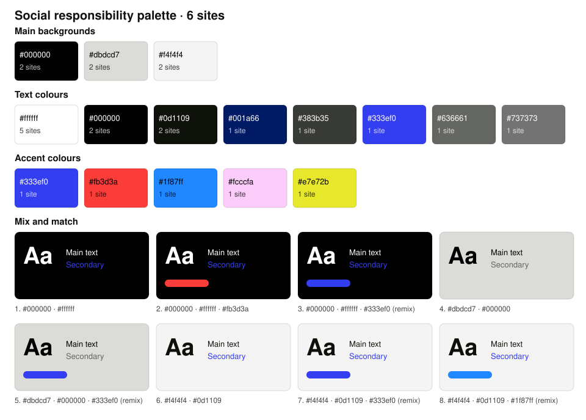

# Social responsibility palette

6 sites. 1 of them were captured as one screen only, so their colours come from the first screen.

Colours that look alike are merged and named by the most used shade; the counts are sites, not uses. Translucent colours are mixed onto each site's main background first.

## Main backgrounds

| Colour | Sites | Merged shades | Seen on |
| --- | --- | --- | --- |
| `#000000` | 2 of 6 | — | [Clevermellow](../../clevermellow.co/overview.md), [Save for later](../../clicktokeep.com/overview.md) |
| `#dbdcd7` | 2 of 6 | `#e5e5e5` | [Driftime's 2025 Impact Report](../../2025.driftime.com/overview.md), [Xiloteca Trevigiana](../../xiloteca.it-en/overview.md) |
| `#f4f4f4` | 2 of 6 | `#ffffff` | [Montreal Canadiens Foundation](../../fondation.canadiens.com/overview.md), [Where Opportunity Takes Root](../../opportunity.waltonfamilyfoundation.org/overview.md) |

## Second backgrounds

Section and panel colours that differ from the site's main background.

| Colour | Sites | Merged shades | Seen on |
| --- | --- | --- | --- |
| `#000000` | 1 of 6 | — | [Where Opportunity Takes Root](../../opportunity.waltonfamilyfoundation.org/overview.md) |
| `#212a15` | 1 of 6 | — | [Xiloteca Trevigiana](../../xiloteca.it-en/overview.md) |
| `#5c5c5c` | 1 of 6 | — | [Xiloteca Trevigiana](../../xiloteca.it-en/overview.md) |
| `#1f87ff` | 1 of 6 | — | [Montreal Canadiens Foundation](../../fondation.canadiens.com/overview.md) |
| `#efefef` | 1 of 6 | `#f0f0f0` | [Save for later](../../clicktokeep.com/overview.md) |
| `#ffffff` | 1 of 6 | — | [Driftime's 2025 Impact Report](../../2025.driftime.com/overview.md) |

## Text colours

| Colour | Sites | Contrast on `#000000` | Contrast on `#dbdcd7` | Seen on |
| --- | --- | --- | --- | --- |
| `#ffffff` | 5 of 6 | 21.0 | 1.4 | [Clevermellow](../../clevermellow.co/overview.md), [Save for later](../../clicktokeep.com/overview.md), [Montreal Canadiens Foundation](../../fondation.canadiens.com/overview.md), [Where Opportunity Takes Root](../../opportunity.waltonfamilyfoundation.org/overview.md) and 1 more |
| `#000000` | 2 of 6 | 1.0 | 15.2 | [Save for later](../../clicktokeep.com/overview.md), [Driftime's 2025 Impact Report](../../2025.driftime.com/overview.md) |
| `#0d1109` | 2 of 6 | 1.1 | 13.8 | [Xiloteca Trevigiana](../../xiloteca.it-en/overview.md), [Where Opportunity Takes Root](../../opportunity.waltonfamilyfoundation.org/overview.md) |
| `#001a66` | 1 of 6 | 1.3 | 11.4 | [Montreal Canadiens Foundation](../../fondation.canadiens.com/overview.md) |
| `#383b35` | 1 of 6 | 1.8 | 8.3 | [Xiloteca Trevigiana](../../xiloteca.it-en/overview.md) |
| `#333ef0` | 1 of 6 | 3.1 | 4.9 | [Montreal Canadiens Foundation](../../fondation.canadiens.com/overview.md) |
| `#636661` | 1 of 6 | 3.6 | 4.2 | [Xiloteca Trevigiana](../../xiloteca.it-en/overview.md) |
| `#737373` | 1 of 6 | 4.4 | 3.4 | [Driftime's 2025 Impact Report](../../2025.driftime.com/overview.md) |

## Accent colours

Any colour with real saturation (OKLab chroma 0.06 or more) that is not near-black, wherever the site uses it.

| Colour | Sites | Merged shades | Seen on |
| --- | --- | --- | --- |
| `#333ef0` | 1 of 6 | — | [Montreal Canadiens Foundation](../../fondation.canadiens.com/overview.md) |
| `#fb3d3a` | 1 of 6 | — | [Save for later](../../clicktokeep.com/overview.md) |
| `#1f87ff` | 1 of 6 | — | [Montreal Canadiens Foundation](../../fondation.canadiens.com/overview.md) |
| `#fcccfa` | 1 of 6 | — | [Montreal Canadiens Foundation](../../fondation.canadiens.com/overview.md) |
| `#e7e72b` | 1 of 6 | — | [Where Opportunity Takes Root](../../opportunity.waltonfamilyfoundation.org/overview.md) |

## Mix and match

For each of the most common backgrounds: a main text colour at 7:1 or more where one exists (never below 4.5:1, WCAG AA body text), a muted secondary text between 3:1 and 7:1, and up to two accents at 3:1 or more (large text and UI parts). Colours that appear together on the same site are picked first; a remix borrows colours from different sites in this category.

| # | Background | Text | Secondary | Accent | Contrast text / secondary / accent | Source |
| --- | --- | --- | --- | --- | --- | --- |
| 1 | `#000000` | `#ffffff` | `#333ef0` | — | 21.0 / 3.1 / — | seen on [Clevermellow](../../clevermellow.co/overview.md), [Save for later](../../clicktokeep.com/overview.md) |
| 2 | `#000000` | `#ffffff` | `#333ef0` | `#fb3d3a` | 21.0 / 3.1 / 5.8 | seen on [Save for later](../../clicktokeep.com/overview.md) |
| 3 | `#000000` | `#ffffff` | `#333ef0` | `#333ef0` | 21.0 / 3.1 / 3.1 | remix: ground from [Clevermellow](../../clevermellow.co/overview.md), text from [Clevermellow](../../clevermellow.co/overview.md), accent from [Montreal Canadiens Foundation](../../fondation.canadiens.com/overview.md) |
| 4 | `#dbdcd7` | `#000000` | `#636661` | — | 15.2 / 4.2 / — | seen on [Driftime's 2025 Impact Report](../../2025.driftime.com/overview.md) |
| 5 | `#dbdcd7` | `#000000` | `#636661` | `#333ef0` | 15.2 / 4.2 / 4.9 | remix: ground from [Driftime's 2025 Impact Report](../../2025.driftime.com/overview.md), text from [Save for later](../../clicktokeep.com/overview.md), accent from [Montreal Canadiens Foundation](../../fondation.canadiens.com/overview.md) |
| 6 | `#f4f4f4` | `#0d1109` | `#333ef0` | — | 17.3 / 6.2 / — | seen on [Where Opportunity Takes Root](../../opportunity.waltonfamilyfoundation.org/overview.md) |
| 7 | `#f4f4f4` | `#0d1109` | `#333ef0` | `#333ef0` | 17.3 / 6.2 / 6.2 | remix: ground from [Montreal Canadiens Foundation](../../fondation.canadiens.com/overview.md), text from [Xiloteca Trevigiana](../../xiloteca.it-en/overview.md), accent from [Montreal Canadiens Foundation](../../fondation.canadiens.com/overview.md) |
| 8 | `#f4f4f4` | `#0d1109` | `#333ef0` | `#1f87ff` | 17.3 / 6.2 / 3.2 | remix: ground from [Montreal Canadiens Foundation](../../fondation.canadiens.com/overview.md), text from [Xiloteca Trevigiana](../../xiloteca.it-en/overview.md), accent from [Montreal Canadiens Foundation](../../fondation.canadiens.com/overview.md) |
