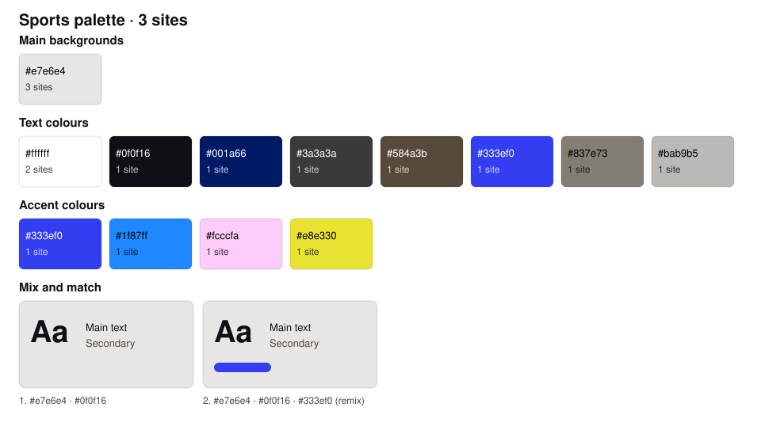

# Sports palette

3 sites. 0 of them were captured as one screen only, so their colours come from the first screen.

Colours that look alike are merged and named by the most used shade; the counts are sites, not uses. Translucent colours are mixed onto each site's main background first.

## Main backgrounds

| Colour | Sites | Merged shades | Seen on |
| --- | --- | --- | --- |
| `#e7e6e4` | 3 of 3 | `#f4ede6`, `#f4f4f4` | [sensiq.co](../../sensiq.co/overview.md), [How F1 has evolved since 1950](../../espn.com-espn-feature-story/overview.md), [Montreal Canadiens Foundation](../../fondation.canadiens.com/overview.md) |

## Second backgrounds

Section and panel colours that differ from the site's main background.

| Colour | Sites | Merged shades | Seen on |
| --- | --- | --- | --- |
| `#6b665b` | 1 of 3 | — | [sensiq.co](../../sensiq.co/overview.md) |
| `#1f87ff` | 1 of 3 | — | [Montreal Canadiens Foundation](../../fondation.canadiens.com/overview.md) |

## Text colours

| Colour | Sites | Contrast on `#e7e6e4` | Seen on |
| --- | --- | --- | --- |
| `#ffffff` | 2 of 3 | 1.2 | [Montreal Canadiens Foundation](../../fondation.canadiens.com/overview.md), [sensiq.co](../../sensiq.co/overview.md) |
| `#0f0f16` | 1 of 3 | 15.3 | [sensiq.co](../../sensiq.co/overview.md) |
| `#001a66` | 1 of 3 | 12.6 | [Montreal Canadiens Foundation](../../fondation.canadiens.com/overview.md) |
| `#3a3a3a` | 1 of 3 | 9.1 | [How F1 has evolved since 1950](../../espn.com-espn-feature-story/overview.md) |
| `#584a3b` | 1 of 3 | 6.9 | [sensiq.co](../../sensiq.co/overview.md) |
| `#333ef0` | 1 of 3 | 5.5 | [Montreal Canadiens Foundation](../../fondation.canadiens.com/overview.md) |
| `#837e73` | 1 of 3 | 3.2 | [sensiq.co](../../sensiq.co/overview.md) |
| `#bab9b5` | 1 of 3 | 1.6 | [sensiq.co](../../sensiq.co/overview.md) |

## Accent colours

Any colour with real saturation (OKLab chroma 0.06 or more) that is not near-black, wherever the site uses it.

| Colour | Sites | Merged shades | Seen on |
| --- | --- | --- | --- |
| `#333ef0` | 1 of 3 | — | [Montreal Canadiens Foundation](../../fondation.canadiens.com/overview.md) |
| `#1f87ff` | 1 of 3 | — | [Montreal Canadiens Foundation](../../fondation.canadiens.com/overview.md) |
| `#fcccfa` | 1 of 3 | — | [Montreal Canadiens Foundation](../../fondation.canadiens.com/overview.md) |
| `#e8e330` | 1 of 3 | `#e9e48c` | [sensiq.co](../../sensiq.co/overview.md) |

## Mix and match

For each of the most common backgrounds: a main text colour at 7:1 or more where one exists (never below 4.5:1, WCAG AA body text), a muted secondary text between 3:1 and 7:1, and up to two accents at 3:1 or more (large text and UI parts). Colours that appear together on the same site are picked first; a remix borrows colours from different sites in this category.

| # | Background | Text | Secondary | Accent | Contrast text / secondary / accent | Source |
| --- | --- | --- | --- | --- | --- | --- |
| 1 | `#e7e6e4` | `#0f0f16` | `#584a3b` | — | 15.3 / 6.9 / — | seen on [sensiq.co](../../sensiq.co/overview.md) |
| 2 | `#e7e6e4` | `#0f0f16` | `#584a3b` | `#333ef0` | 15.3 / 6.9 / 5.5 | remix: ground from [sensiq.co](../../sensiq.co/overview.md), text from [sensiq.co](../../sensiq.co/overview.md), accent from [Montreal Canadiens Foundation](../../fondation.canadiens.com/overview.md) |
