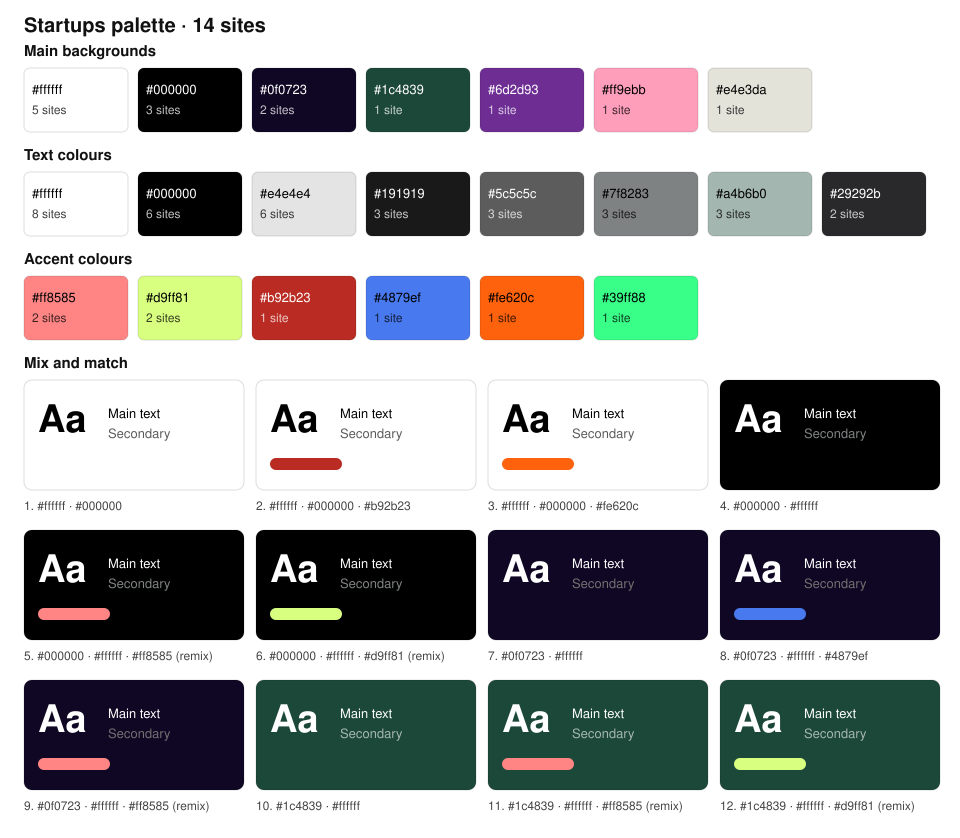

# Startups palette

14 sites. 3 of them were captured as one screen only, so their colours come from the first screen.

Colours that look alike are merged and named by the most used shade; the counts are sites, not uses. Translucent colours are mixed onto each site's main background first.

## Main backgrounds

| Colour | Sites | Merged shades | Seen on |
| --- | --- | --- | --- |
| `#ffffff` | 5 of 14 | `#f1f1f1`, `#fefbf6` | [Best Website Template](../../bestwebsitetemplate.com/overview.md), [Deep White Gallery](../../deepwhite-gallery.com/overview.md), [Shinkei Systems](../../shinkei.systems/overview.md), [incredibles](../../incredibles.dev/overview.md) and 1 more |
| `#000000` | 3 of 14 | `#050505`, `#06070a` | [Giga](../../giga.ai/overview.md), [Second Ride](../../second-ride.de-en/overview.md), [Interract](../../interractlabs.com/overview.md) |
| `#0f0723` | 2 of 14 | `#0f0f15` | [Imogen: Agentic AI](../../vsproject-imogen.vendredi-society.com/overview.md), [Villiers](../../villiers.ai/overview.md) |
| `#1c4839` | 1 of 14 | — | [Why Zero](../../why.zero.university/overview.md) |
| `#6d2d93` | 1 of 14 | — | [Cyera AI Guardian](../../secure-the-unknown.cyera.com/overview.md) |
| `#ff9ebb` | 1 of 14 | — | [Hamza's Desk](../../raomuhammadhamza.tech/overview.md) |
| `#e4e3da` | 1 of 14 | — | [tricks GmbH](../../tricks.de/overview.md) |

## Second backgrounds

Section and panel colours that differ from the site's main background.

| Colour | Sites | Merged shades | Seen on |
| --- | --- | --- | --- |
| `#252324` | 3 of 14 | `#282828`, `#2b2b2b` | [Podium](../../podiumautomation.com/overview.md), [Second Ride](../../second-ride.de-en/overview.md), [incredibles](../../incredibles.dev/overview.md) |
| `#000000` | 2 of 14 | — | [Cyera AI Guardian](../../secure-the-unknown.cyera.com/overview.md), [Shinkei Systems](../../shinkei.systems/overview.md) |
| `#0d1114` | 2 of 14 | `#13151a`, `#16181f` | [Giga](../../giga.ai/overview.md), [Interract](../../interractlabs.com/overview.md) |
| `#f8f9f9` | 2 of 14 | `#fffeea` | [Villiers](../../villiers.ai/overview.md), [Interract](../../interractlabs.com/overview.md) |
| `#411b5b` | 1 of 14 | — | [Cyera AI Guardian](../../secure-the-unknown.cyera.com/overview.md) |
| `#797762` | 1 of 14 | — | [Deep White Gallery](../../deepwhite-gallery.com/overview.md) |
| `#ede8e4` | 1 of 14 | — | [Podium](../../podiumautomation.com/overview.md) |
| `#d9ff81` | 1 of 14 | — | [tricks GmbH](../../tricks.de/overview.md) |

## Text colours

| Colour | Sites | Contrast on `#ffffff` | Contrast on `#000000` | Seen on |
| --- | --- | --- | --- | --- |
| `#ffffff` | 8 of 14 | 1.0 | 21.0 | [Deep White Gallery](../../deepwhite-gallery.com/overview.md), [Giga](../../giga.ai/overview.md), [Shinkei Systems](../../shinkei.systems/overview.md), [Imogen: Agentic AI](../../vsproject-imogen.vendredi-society.com/overview.md) and 4 more |
| `#000000` | 6 of 14 | 21.0 | 1.0 | [Best Website Template](../../bestwebsitetemplate.com/overview.md), [Deep White Gallery](../../deepwhite-gallery.com/overview.md), [Podium](../../podiumautomation.com/overview.md), [Shinkei Systems](../../shinkei.systems/overview.md) and 2 more |
| `#e4e4e4` | 6 of 14 | 1.3 | 16.5 | [Second Ride](../../second-ride.de-en/overview.md), [Giga](../../giga.ai/overview.md), [Hamza's Desk](../../raomuhammadhamza.tech/overview.md), [Why Zero](../../why.zero.university/overview.md) and 2 more |
| `#191919` | 3 of 14 | 17.6 | 1.2 | [tricks GmbH](../../tricks.de/overview.md), [Second Ride](../../second-ride.de-en/overview.md), [Podium](../../podiumautomation.com/overview.md) |
| `#5c5c5c` | 3 of 14 | 6.7 | 3.1 | [Second Ride](../../second-ride.de-en/overview.md), [incredibles](../../incredibles.dev/overview.md), [Best Website Template](../../bestwebsitetemplate.com/overview.md) |
| `#7f8283` | 3 of 14 | 3.9 | 5.4 | [Giga](../../giga.ai/overview.md), [Second Ride](../../second-ride.de-en/overview.md), [Hamza's Desk](../../raomuhammadhamza.tech/overview.md) |
| `#a4b6b0` | 3 of 14 | 2.1 | 9.9 | [Why Zero](../../why.zero.university/overview.md), [Giga](../../giga.ai/overview.md), [Hamza's Desk](../../raomuhammadhamza.tech/overview.md) |
| `#29292b` | 2 of 14 | 14.5 | 1.4 | [Villiers](../../villiers.ai/overview.md), [incredibles](../../incredibles.dev/overview.md) |

## Accent colours

Any colour with real saturation (OKLab chroma 0.06 or more) that is not near-black, wherever the site uses it.

| Colour | Sites | Merged shades | Seen on |
| --- | --- | --- | --- |
| `#ff8585` | 2 of 14 | `#ffa17f` | [tricks GmbH](../../tricks.de/overview.md), [Shinkei Systems](../../shinkei.systems/overview.md) |
| `#d9ff81` | 2 of 14 | `#ffec88` | [tricks GmbH](../../tricks.de/overview.md), [Podium](../../podiumautomation.com/overview.md) |
| `#b92b23` | 1 of 14 | — | [Shinkei Systems](../../shinkei.systems/overview.md) |
| `#4879ef` | 1 of 14 | — | [Villiers](../../villiers.ai/overview.md) |
| `#fe620c` | 1 of 14 | `#ff4400` | [Shinkei Systems](../../shinkei.systems/overview.md) |
| `#39ff88` | 1 of 14 | — | [Hamza's Desk](../../raomuhammadhamza.tech/overview.md) |

## Mix and match

For each of the most common backgrounds: a main text colour at 7:1 or more where one exists (never below 4.5:1, WCAG AA body text), a muted secondary text between 3:1 and 7:1, and up to two accents at 3:1 or more (large text and UI parts). Colours that appear together on the same site are picked first; a remix borrows colours from different sites in this category.

| # | Background | Text | Secondary | Accent | Contrast text / secondary / accent | Source |
| --- | --- | --- | --- | --- | --- | --- |
| 1 | `#ffffff` | `#000000` | `#5c5c5c` | — | 21.0 / 6.7 / — | seen on [Best Website Template](../../bestwebsitetemplate.com/overview.md), [Deep White Gallery](../../deepwhite-gallery.com/overview.md) and 2 more |
| 2 | `#ffffff` | `#000000` | `#5c5c5c` | `#b92b23` | 21.0 / 6.7 / 6.1 | seen on [Shinkei Systems](../../shinkei.systems/overview.md) |
| 3 | `#ffffff` | `#000000` | `#5c5c5c` | `#fe620c` | 21.0 / 6.7 / 3.0 | seen on [Shinkei Systems](../../shinkei.systems/overview.md) |
| 4 | `#000000` | `#ffffff` | `#7f8283` | — | 21.0 / 5.4 / — | seen on [Giga](../../giga.ai/overview.md), [Interract](../../interractlabs.com/overview.md) |
| 5 | `#000000` | `#ffffff` | `#7f8283` | `#ff8585` | 21.0 / 5.4 / 8.9 | remix: ground from [Giga](../../giga.ai/overview.md), text from [Deep White Gallery](../../deepwhite-gallery.com/overview.md), accent from [tricks GmbH](../../tricks.de/overview.md) |
| 6 | `#000000` | `#ffffff` | `#7f8283` | `#d9ff81` | 21.0 / 5.4 / 18.6 | remix: ground from [Giga](../../giga.ai/overview.md), text from [Deep White Gallery](../../deepwhite-gallery.com/overview.md), accent from [tricks GmbH](../../tricks.de/overview.md) |
| 7 | `#0f0723` | `#ffffff` | `#707070` | — | 19.5 / 3.9 / — | seen on [Villiers](../../villiers.ai/overview.md), [Imogen: Agentic AI](../../vsproject-imogen.vendredi-society.com/overview.md) |
| 8 | `#0f0723` | `#ffffff` | `#707070` | `#4879ef` | 19.5 / 3.9 / 4.9 | seen on [Villiers](../../villiers.ai/overview.md) |
| 9 | `#0f0723` | `#ffffff` | `#707070` | `#ff8585` | 19.5 / 3.9 / 8.3 | remix: ground from [Imogen: Agentic AI](../../vsproject-imogen.vendredi-society.com/overview.md), text from [Deep White Gallery](../../deepwhite-gallery.com/overview.md), accent from [tricks GmbH](../../tricks.de/overview.md) |
| 10 | `#1c4839` | `#ffffff` | `#a4b6b0` | — | 10.3 / 4.9 / — | seen on [Why Zero](../../why.zero.university/overview.md) |
| 11 | `#1c4839` | `#ffffff` | `#a4b6b0` | `#ff8585` | 10.3 / 4.9 / 4.4 | remix: ground from [Why Zero](../../why.zero.university/overview.md), text from [Deep White Gallery](../../deepwhite-gallery.com/overview.md), accent from [tricks GmbH](../../tricks.de/overview.md) |
| 12 | `#1c4839` | `#ffffff` | `#a4b6b0` | `#d9ff81` | 10.3 / 4.9 / 9.1 | remix: ground from [Why Zero](../../why.zero.university/overview.md), text from [Deep White Gallery](../../deepwhite-gallery.com/overview.md), accent from [tricks GmbH](../../tricks.de/overview.md) |
