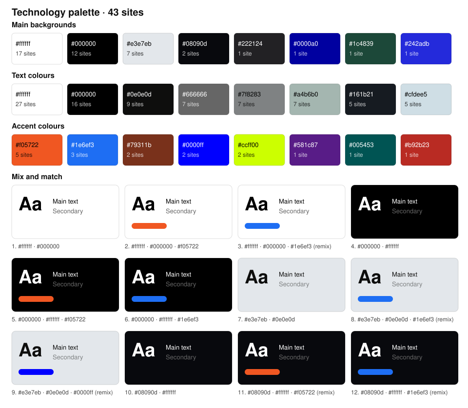

# Technology palette

43 sites. 14 of them were captured as one screen only, so their colours come from the first screen. Left out as failed captures: [Seek and Deploy](../../seekanddeploy.com/overview.md).

Colours that look alike are merged and named by the most used shade; the counts are sites, not uses. Translucent colours are mixed onto each site's main background first.

## Main backgrounds

| Colour | Sites | Merged shades | Seen on |
| --- | --- | --- | --- |
| `#ffffff` | 17 of 43 | `#f1f1f1`, `#f1f3f5`, `#f2f2f2`, `#f2f2f6` | [Best Website Template](../../bestwebsitetemplate.com/overview.md), [.txt](../../dottxt.ai/overview.md), [Idealworks](../../idealworks.com/overview.md), [MECHA](../../mecha-xyz.webflow.io/overview.md) and 13 more |
| `#000000` | 12 of 43 | `#050505`, `#080808` | [Allan Leone - Product Designer](../../allanleone.com/overview.md), [DeepBook](../../deepbook-v2-wip.webflow.io/overview.md), [Dopamine Studio](../../dopaminestudio.io/overview.md), [Dragonfly Redux](../../dragonfly2.studiofreight.dev/overview.md) and 8 more |
| `#e3e7eb` | 7 of 43 | `#e4e4e4`, `#e4eefb`, `#e7e6e4`, `#e9e9ea` | [CROX](../../crox.framer.website/overview.md), [Lesse Studio](../../lessestudio.com/overview.md), [Zesiger.net](../../zesiger.net/overview.md), [sensiq.co](../../sensiq.co/overview.md) and 3 more |
| `#08090d` | 2 of 43 | `#121212` | [The state of the gallery](../../mesh3d.gallery-the-state-of-the-gallery/overview.md), [Share Bien](../../sharebien.com/overview.md) |
| `#222124` | 1 of 43 | — | [Ingrassia Daniel - Portfolio](../../ingrassiadaniel.it/overview.md) |
| `#0000a0` | 1 of 43 | — | [TREY HOLLINGER](../../treyhollinger.com/overview.md) |
| `#1c4839` | 1 of 43 | — | [Why Zero](../../why.zero.university/overview.md) |
| `#242adb` | 1 of 43 | — | [Pixelismo Studio](../../pixelismo.it/overview.md) |

## Second backgrounds

Section and panel colours that differ from the site's main background.

| Colour | Sites | Merged shades | Seen on |
| --- | --- | --- | --- |
| `#000000` | 10 of 43 | — | [A24](../../a24.raviklaassens.com/overview.md), [.txt](../../dottxt.ai/overview.md), [Idealworks](../../idealworks.com/overview.md), [Lesse Studio](../../lessestudio.com/overview.md) and 6 more |
| `#ffffff` | 6 of 43 | `#f4f5f7` | [CROX](../../crox.framer.website/overview.md), [DeepBook](../../deepbook-v2-wip.webflow.io/overview.md), [Faers](../../faers.tech/overview.md), [Lesse Studio](../../lessestudio.com/overview.md) and 2 more |
| `#0d1114` | 4 of 43 | `#101010`, `#131419`, `#1a1b1c` | [Giga](../../giga.ai/overview.md), [Lesse Studio](../../lessestudio.com/overview.md), [Room and Pillar](../../roomandpillar.com/overview.md), [CROX](../../crox.framer.website/overview.md) |
| `#252324` | 3 of 43 | `#282828`, `#2b2b2b` | [Podium](../../podiumautomation.com/overview.md), [Second Ride](../../second-ride.de-en/overview.md), [incredibles](../../incredibles.dev/overview.md) |
| `#606162` | 2 of 43 | `#6b665b` | [Preymaker](../../preymaker.com/overview.md), [sensiq.co](../../sensiq.co/overview.md) |
| `#e2e0d9` | 2 of 43 | `#ede8e4` | [Mathis Biabiany](../../mathis-biabiany.fr/overview.md), [Podium](../../podiumautomation.com/overview.md) |
| `#13193b` | 1 of 43 | — | [8am Showcase '26 Fall Release](../../showcase.8am.com/overview.md) |
| `#79311b` | 1 of 43 | — | [.txt](../../dottxt.ai/overview.md) |

## Text colours

| Colour | Sites | Contrast on `#ffffff` | Contrast on `#000000` | Seen on |
| --- | --- | --- | --- | --- |
| `#ffffff` | 27 of 43 | 1.0 | 21.0 | [Allan Leone - Product Designer](../../allanleone.com/overview.md), [DeepBook](../../deepbook-v2-wip.webflow.io/overview.md), [Dopamine Studio](../../dopaminestudio.io/overview.md), [.txt](../../dottxt.ai/overview.md) and 23 more |
| `#000000` | 16 of 43 | 21.0 | 1.0 | [A24](../../a24.raviklaassens.com/overview.md), [Best Website Template](../../bestwebsitetemplate.com/overview.md), [DeepBook](../../deepbook-v2-wip.webflow.io/overview.md), [Dopamine Studio](../../dopaminestudio.io/overview.md) and 12 more |
| `#0e0e0d` | 9 of 43 | 19.3 | 1.1 | [Pier Gorelli](../../piergorelli.com/overview.md), [sensiq.co](../../sensiq.co/overview.md), [Roveia Health](../../roveia.com/overview.md), [Pixelismo Studio](../../pixelismo.it/overview.md) and 5 more |
| `#666666` | 7 of 43 | 5.7 | 3.7 | [Best Website Template](../../bestwebsitetemplate.com/overview.md), [Faers](../../faers.tech/overview.md), [Second Ride](../../second-ride.de-en/overview.md), [Pier Gorelli](../../piergorelli.com/overview.md) and 3 more |
| `#7f8283` | 7 of 43 | 3.9 | 5.4 | [Giga](../../giga.ai/overview.md), [DeepBook](../../deepbook-v2-wip.webflow.io/overview.md), [Second Ride](../../second-ride.de-en/overview.md), [sensiq.co](../../sensiq.co/overview.md) and 3 more |
| `#a4b6b0` | 7 of 43 | 2.1 | 9.9 | [Why Zero](../../why.zero.university/overview.md), [Endurosat Space Service](../../endurosat.com-space-service/overview.md), [Giga](../../giga.ai/overview.md), [Share Bien](../../sharebien.com/overview.md) and 3 more |
| `#161b21` | 5 of 43 | 17.3 | 1.2 | [Endurosat Space Service](../../endurosat.com-space-service/overview.md), [CROX](../../crox.framer.website/overview.md), [Second Ride](../../second-ride.de-en/overview.md), [Zenarate](../../zenarate.com/overview.md) and 1 more |
| `#cfdee5` | 5 of 43 | 1.4 | 15.2 | [The state of the gallery](../../mesh3d.gallery-the-state-of-the-gallery/overview.md), [Hamza's Desk](../../raomuhammadhamza.tech/overview.md), [Studio Mirage](../../studiomirage.io/overview.md), [CROX](../../crox.framer.website/overview.md) and 1 more |

## Accent colours

Any colour with real saturation (OKLab chroma 0.06 or more) that is not near-black, wherever the site uses it.

| Colour | Sites | Merged shades | Seen on |
| --- | --- | --- | --- |
| `#f05722` | 5 of 43 | `#fa4c14`, `#fc6a18`, `#fe620c`, `#ff3701` | [8am Showcase '26 Fall Release](../../showcase.8am.com/overview.md), [Dragonfly Redux](../../dragonfly2.studiofreight.dev/overview.md), [Endurosat Space Service](../../endurosat.com-space-service/overview.md), [Shinkei Systems](../../shinkei.systems/overview.md) and 1 more |
| `#1e6ef3` | 3 of 43 | `#1f66dc`, `#2a52f0` | [DeepBook](../../deepbook-v2-wip.webflow.io/overview.md), [Zesiger.net](../../zesiger.net/overview.md), [Pier Gorelli](../../piergorelli.com/overview.md) |
| `#79311b` | 2 of 43 | `#8e3f01` | [.txt](../../dottxt.ai/overview.md), [Faers](../../faers.tech/overview.md) |
| `#0000ff` | 2 of 43 | — | [AI Uis](../../aiu.is/overview.md), [MECHA](../../mecha-xyz.webflow.io/overview.md) |
| `#ccff00` | 2 of 43 | `#d2fe71` | [Dopamine Studio](../../dopaminestudio.io/overview.md), [Room and Pillar](../../roomandpillar.com/overview.md) |
| `#581c87` | 1 of 43 | — | [Emotion Agency](../../emotion-agency.com/overview.md) |
| `#005453` | 1 of 43 | — | [Polpharma Biologics](../../polpharmabiologics.com/overview.md) |
| `#b92b23` | 1 of 43 | — | [Shinkei Systems](../../shinkei.systems/overview.md) |

## Mix and match

For each of the most common backgrounds: a main text colour at 7:1 or more where one exists (never below 4.5:1, WCAG AA body text), a muted secondary text between 3:1 and 7:1, and up to two accents at 3:1 or more (large text and UI parts). Colours that appear together on the same site are picked first; a remix borrows colours from different sites in this category.

| # | Background | Text | Secondary | Accent | Contrast text / secondary / accent | Source |
| --- | --- | --- | --- | --- | --- | --- |
| 1 | `#ffffff` | `#000000` | `#666666` | — | 21.0 / 5.7 / — | seen on [A24](../../a24.raviklaassens.com/overview.md), [Best Website Template](../../bestwebsitetemplate.com/overview.md) and 7 more |
| 2 | `#ffffff` | `#000000` | `#666666` | `#f05722` | 21.0 / 5.7 / 3.4 | seen on [Shinkei Systems](../../shinkei.systems/overview.md) |
| 3 | `#ffffff` | `#000000` | `#666666` | `#1e6ef3` | 21.0 / 5.7 / 4.6 | remix: ground from [Best Website Template](../../bestwebsitetemplate.com/overview.md), text from [A24](../../a24.raviklaassens.com/overview.md), accent from [DeepBook](../../deepbook-v2-wip.webflow.io/overview.md) |
| 4 | `#000000` | `#ffffff` | `#666666` | — | 21.0 / 3.7 / — | seen on [Allan Leone - Product Designer](../../allanleone.com/overview.md), [ASTRODITHER](../../astrodither.robertborghesi.is/overview.md) and 8 more |
| 5 | `#000000` | `#ffffff` | `#666666` | `#f05722` | 21.0 / 3.7 / 6.1 | seen on [Dragonfly Redux](../../dragonfly2.studiofreight.dev/overview.md), [Endurosat Space Service](../../endurosat.com-space-service/overview.md) and 1 more |
| 6 | `#000000` | `#ffffff` | `#666666` | `#1e6ef3` | 21.0 / 3.7 / 4.6 | seen on [DeepBook](../../deepbook-v2-wip.webflow.io/overview.md) |
| 7 | `#e3e7eb` | `#0e0e0d` | `#7f8283` | — | 15.5 / 3.1 / — | seen on [Mathis Biabiany](../../mathis-biabiany.fr/overview.md), [sensiq.co](../../sensiq.co/overview.md) |
| 8 | `#e3e7eb` | `#0e0e0d` | `#7f8283` | `#1e6ef3` | 15.5 / 3.1 / 3.7 | remix: ground from [CROX](../../crox.framer.website/overview.md), text from [Pier Gorelli](../../piergorelli.com/overview.md), accent from [DeepBook](../../deepbook-v2-wip.webflow.io/overview.md) |
| 9 | `#e3e7eb` | `#0e0e0d` | `#7f8283` | `#0000ff` | 15.5 / 3.1 / 6.9 | remix: ground from [CROX](../../crox.framer.website/overview.md), text from [Pier Gorelli](../../piergorelli.com/overview.md), accent from [AI Uis](../../aiu.is/overview.md) |
| 10 | `#08090d` | `#ffffff` | `#666666` | — | 19.9 / 3.5 / — | seen on [The state of the gallery](../../mesh3d.gallery-the-state-of-the-gallery/overview.md), [Share Bien](../../sharebien.com/overview.md) |
| 11 | `#08090d` | `#ffffff` | `#666666` | `#f05722` | 19.9 / 3.5 / 5.8 | remix: ground from [The state of the gallery](../../mesh3d.gallery-the-state-of-the-gallery/overview.md), text from [Allan Leone - Product Designer](../../allanleone.com/overview.md), accent from [8am Showcase '26 Fall Release](../../showcase.8am.com/overview.md) |
| 12 | `#08090d` | `#ffffff` | `#666666` | `#1e6ef3` | 19.9 / 3.5 / 4.3 | remix: ground from [The state of the gallery](../../mesh3d.gallery-the-state-of-the-gallery/overview.md), text from [Allan Leone - Product Designer](../../allanleone.com/overview.md), accent from [DeepBook](../../deepbook-v2-wip.webflow.io/overview.md) |
