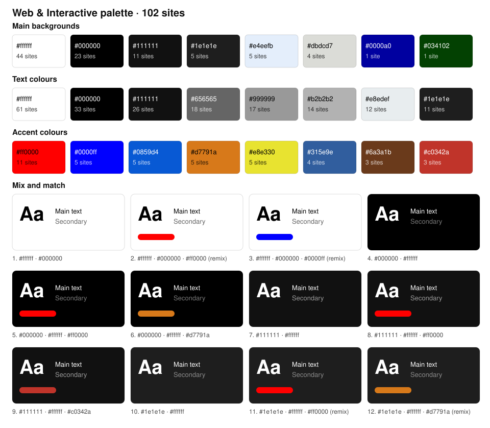

# Web & Interactive palette

102 sites. 46 of them were captured as one screen only, so their colours come from the first screen. Left out as failed captures: [Seek and Deploy](../../seekanddeploy.com/overview.md).

Colours that look alike are merged and named by the most used shade; the counts are sites, not uses. Translucent colours are mixed onto each site's main background first.

## Main backgrounds

| Colour | Sites | Merged shades | Seen on |
| --- | --- | --- | --- |
| `#ffffff` | 44 of 102 | `#fafafa`, `#f1f1f1`, `#f2f2f2`, `#f4f2f0` | [Achilles Heel](../../achillesheel.co.uk/overview.md), [ATO 痕時の器](../../atotimecapsule.com/overview.md), [AVEA](../../avea.studio/overview.md), [Best Website Template](../../bestwebsitetemplate.com/overview.md) and 40 more |
| `#000000` | 23 of 102 | `#080808`, `#010101`, `#04040e`, `#050505` | [Allan Leone - Product Designer](../../allanleone.com/overview.md), [aorum](../../aorum.io/overview.md), [Awards Racing](../../awards.racing/overview.md), [Dash Creative](../../dashcreative.co/overview.md) and 19 more |
| `#111111` | 11 of 102 | `#171717`, `#08090d`, `#0a0806`, `#0b0b0a` | [Arc's Portfolio](../../arcmarumo.com/overview.md), [Boldium](../../boldium.com/overview.md), [Giordano Betti](../../giordanobetti.com/overview.md), [Sam Goddard](../../samgoddard.co.uk/overview.md) and 7 more |
| `#1e1e1e` | 5 of 102 | `#222124`, `#222222`, `#262626`, `#2d2822` | [Carter Ogunsola](../../carterogunsola.com/overview.md), [Ingrassia Daniel - Portfolio](../../ingrassiadaniel.it/overview.md), [FORMAT](../../format.obys.agency/overview.md), [Josh Goldsmith - Director & EP](../../josh-goldsmith.com/overview.md) and 1 more |
| `#e4eefb` | 5 of 102 | `#ececec`, `#edeee5`, `#f3f1ea`, `#f5efff` | [Zesiger.net](../../zesiger.net/overview.md), [Huy Phan Vol.2](../../huyml.co/overview.md), [AUGE Experience](../../auge-xp.com/overview.md), [Mathis Biabiany](../../mathis-biabiany.fr/overview.md) and 1 more |
| `#dbdcd7` | 4 of 102 | `#e4e3da`, `#e5e5e5`, `#e7e6e4` | [Driftime's 2025 Impact Report](../../2025.driftime.com/overview.md), [tricks GmbH](../../tricks.de/overview.md), [Xiloteca Trevigiana](../../xiloteca.it-en/overview.md), [sensiq.co](../../sensiq.co/overview.md) |
| `#0000a0` | 1 of 102 | — | [TREY HOLLINGER](../../treyhollinger.com/overview.md) |
| `#034102` | 1 of 102 | — | [Sweet Tape](../../sweet-tape.com/overview.md) |

## Second backgrounds

Section and panel colours that differ from the site's main background.

| Colour | Sites | Merged shades | Seen on |
| --- | --- | --- | --- |
| `#000000` | 16 of 102 | `#020203`, `#050505`, `#070506`, `#080808` | [A24](../../a24.raviklaassens.com/overview.md), [AUGE Experience](../../auge-xp.com/overview.md), [Carter Ogunsola](../../carterogunsola.com/overview.md), [.txt](../../dottxt.ai/overview.md) and 12 more |
| `#ffffff` | 15 of 102 | `#f4f5f7`, `#f7f7f7`, `#fbfbfb`, `#fdf8f5` | [Driftime's 2025 Impact Report](../../2025.driftime.com/overview.md), [Boldium](../../boldium.com/overview.md), [David Estrada](../../david-estrada.dev/overview.md), [DeepBook](../../deepbook-v2-wip.webflow.io/overview.md) and 11 more |
| `#ebedf5` | 5 of 102 | `#efece8`, `#efefef`, `#f7efdc`, `#f8eee8` | [The Design Society](../../thedesignsociety.fr/overview.md), [Kigo Studio](../../kigo.studio/overview.md), [.txt](../../dottxt.ai/overview.md), [https://orbita.bar](../../orbita.bar/overview.md) and 1 more |
| `#0d0c0b` | 4 of 102 | `#0d1114`, `#13151a`, `#141414` | [Nod Marketing](../../nodmarketing.se/overview.md), [Giga](../../giga.ai/overview.md), [Interract](../../interractlabs.com/overview.md), [Dash Creative](../../dashcreative.co/overview.md) |
| `#1a1a1a` | 4 of 102 | `#1c1c1c`, `#212121`, `#222222` | [Dokmeh Agency](../../hidokmeh.com/overview.md), [Readymag Madrid Meetup](../../readymag.com-madrid-meetup/overview.md), [ATO 痕時の器](../../atotimecapsule.com/overview.md), [Onlines](../../onlines.com.ar/overview.md) |
| `#031b36` | 4 of 102 | `#0a1030`, `#13193b`, `#16181f` | [Think Company](../../thinkcompany.com/overview.md), [Tommy Biglow](../../tommybiglow.com/overview.md), [8am Showcase '26 Fall Release](../../showcase.8am.com/overview.md), [Interract](../../interractlabs.com/overview.md) |
| `#c4c6ca` | 4 of 102 | `#cdc4ab`, `#d3d3d3`, `#ddb8ca` | [Nova Dental](../../nova-dental-dev.webflow.io/overview.md), [Nocturnal Dream](../../nocturnaldream.com/overview.md), [Butter](../../butter.video/overview.md), [.txt](../../dottxt.ai/overview.md) |
| `#212a15` | 3 of 102 | `#282828`, `#2b2b2b` | [Xiloteca Trevigiana](../../xiloteca.it-en/overview.md), [Readymag Madrid Meetup](../../readymag.com-madrid-meetup/overview.md), [incredibles](../../incredibles.dev/overview.md) |

## Text colours

| Colour | Sites | Contrast on `#ffffff` | Contrast on `#000000` | Seen on |
| --- | --- | --- | --- | --- |
| `#ffffff` | 61 of 102 | 1.0 | 21.0 | [Allan Leone - Product Designer](../../allanleone.com/overview.md), [Anthracite Studio](../../anthracitestudio.be/overview.md), [Arc's Portfolio](../../arcmarumo.com/overview.md), [ATO 痕時の器](../../atotimecapsule.com/overview.md) and 57 more |
| `#000000` | 33 of 102 | 21.0 | 1.0 | [A24](../../a24.raviklaassens.com/overview.md), [Achilles Heel](../../achillesheel.co.uk/overview.md), [ATO 痕時の器](../../atotimecapsule.com/overview.md), [AVEA](../../avea.studio/overview.md) and 29 more |
| `#111111` | 26 of 102 | 18.9 | 1.1 | [Boldium](../../boldium.com/overview.md), [Brandon Yasin](../../brandonyasin.com/overview.md), [Pixelismo Studio](../../pixelismo.it/overview.md), [SYBIOSME](../../sybiosme.com-en/overview.md) and 22 more |
| `#656565` | 18 of 102 | 5.8 | 3.6 | [incredibles](../../incredibles.dev/overview.md), [Orionix - Creative Agency](../../orionix.framer.website/overview.md), [Best Website Template](../../bestwebsitetemplate.com/overview.md), [Junca Studio](../../juncastudio.com/overview.md) and 14 more |
| `#999999` | 17 of 102 | 2.8 | 7.4 | [aorum](../../aorum.io/overview.md), [AVEA](../../avea.studio/overview.md), [Brady Perron](../../bradyperron.com/overview.md), [Unbelievably Crap](../../unbelievablycrap.com/overview.md) and 13 more |
| `#b2b2b2` | 14 of 102 | 2.1 | 9.9 | [Brady Perron](../../bradyperron.com/overview.md), [Tommy Biglow](../../tommybiglow.com/overview.md), [Elva](../../elva-labs.com/overview.md), [Onlines](../../onlines.com.ar/overview.md) and 10 more |
| `#e8edef` | 12 of 102 | 1.2 | 17.8 | [Giga](../../giga.ai/overview.md), [Readymag Madrid Meetup](../../readymag.com-madrid-meetup/overview.md), [GOBOLD™ Agency](../../gobold.live/overview.md), [Nahiyan Khan - Personal Site](../../nahiyan.codes/overview.md) and 8 more |
| `#1e1e1e` | 11 of 102 | 16.7 | 1.3 | [Butter](../../butter.video/overview.md), [Huy Phan Vol.2](../../huyml.co/overview.md), [Nod Marketing](../../nodmarketing.se/overview.md), [The Design Society](../../thedesignsociety.fr/overview.md) and 7 more |

## Accent colours

Any colour with real saturation (OKLab chroma 0.06 or more) that is not near-black, wherever the site uses it.

| Colour | Sites | Merged shades | Seen on |
| --- | --- | --- | --- |
| `#ff0000` | 11 of 102 | `#e8271c`, `#ec520b`, `#f05722`, `#f15928` | [Elva](../../elva-labs.com/overview.md), [galekto](../../galekto.com/overview.md), [GOBOLD™ Agency](../../gobold.live/overview.md), [Unbelievably Crap](../../unbelievablycrap.com/overview.md) and 7 more |
| `#0000ff` | 5 of 102 | `#0625ee`, `#0c00ff`, `#1d00ff` | [Design by Ency](../../designbyency.com/overview.md), [galekto](../../galekto.com/overview.md), [Lydia Leiwang's Portfolio](../../lydialeiwang.com/overview.md), [blue2purple](../../blue2purple.com/overview.md) and 1 more |
| `#0859d4` | 5 of 102 | `#1051b4`, `#1f66dc`, `#2a52f0`, `#3d4bff` | [Onlines](../../onlines.com.ar/overview.md), [Garvin Promotion Group](../../gpg.dops.agency/overview.md), [Zesiger.net](../../zesiger.net/overview.md), [Pier Gorelli](../../piergorelli.com/overview.md) and 1 more |
| `#d7791a` | 5 of 102 | `#e45e3f`, `#f38422`, `#fa6b2a`, `#fa8005` | [Sweet Tape](../../sweet-tape.com/overview.md), [ATO 痕時の器](../../atotimecapsule.com/overview.md), [Strawberry Group](../../strawberrygroup.no/overview.md), [SYBIOSME](../../sybiosme.com-en/overview.md) and 1 more |
| `#e8e330` | 5 of 102 | `#e9e48c`, `#facc15`, `#ffc840`, `#ffcb00` | [sensiq.co](../../sensiq.co/overview.md), [galekto](../../galekto.com/overview.md), [Readymag Madrid Meetup](../../readymag.com-madrid-meetup/overview.md), [Design by Ency](../../designbyency.com/overview.md) and 1 more |
| `#315e9e` | 4 of 102 | `#545388`, `#565a92`, `#6165af` | [Garvin Promotion Group](../../gpg.dops.agency/overview.md), [Nesil's Lucid Dreams](../../nesilnoble.com/overview.md), [Design by Ency](../../designbyency.com/overview.md), [Right Hemisphere](../../righthemisphere.studio/overview.md) |
| `#6a3a1b` | 3 of 102 | `#754402`, `#79311b` | [Nicolás Zarcero — Box Office](../../zarcerog.com/overview.md), [Sweet Tape](../../sweet-tape.com/overview.md), [.txt](../../dottxt.ai/overview.md) |
| `#c0342a` | 3 of 102 | `#c85000`, `#cc4300` | [Dont Look up game](../../dontlookup.app/overview.md), [David Estrada](../../david-estrada.dev/overview.md), [Two26 Studio](../../two26.studio/overview.md) |

## Mix and match

For each of the most common backgrounds: a main text colour at 7:1 or more where one exists (never below 4.5:1, WCAG AA body text), a muted secondary text between 3:1 and 7:1, and up to two accents at 3:1 or more (large text and UI parts). Colours that appear together on the same site are picked first; a remix borrows colours from different sites in this category.

| # | Background | Text | Secondary | Accent | Contrast text / secondary / accent | Source |
| --- | --- | --- | --- | --- | --- | --- |
| 1 | `#ffffff` | `#000000` | `#656565` | — | 21.0 / 5.8 / — | seen on [A24](../../a24.raviklaassens.com/overview.md), [Achilles Heel](../../achillesheel.co.uk/overview.md) and 15 more |
| 2 | `#ffffff` | `#000000` | `#656565` | `#ff0000` | 21.0 / 5.8 / 4.0 | remix: ground from [Achilles Heel](../../achillesheel.co.uk/overview.md), text from [A24](../../a24.raviklaassens.com/overview.md), accent from [Elva](../../elva-labs.com/overview.md) |
| 3 | `#ffffff` | `#000000` | `#656565` | `#0000ff` | 21.0 / 5.8 / 8.6 | remix: ground from [Achilles Heel](../../achillesheel.co.uk/overview.md), text from [A24](../../a24.raviklaassens.com/overview.md), accent from [Design by Ency](../../designbyency.com/overview.md) |
| 4 | `#000000` | `#ffffff` | `#777777` | — | 21.0 / 4.7 / — | seen on [Allan Leone - Product Designer](../../allanleone.com/overview.md), [Anthracite Studio](../../anthracitestudio.be/overview.md) and 15 more |
| 5 | `#000000` | `#ffffff` | `#777777` | `#ff0000` | 21.0 / 4.7 / 5.3 | seen on [Unbelievably Crap](../../unbelievablycrap.com/overview.md), [ZEGGO](../../zeggo.com.sg/overview.md) |
| 6 | `#000000` | `#ffffff` | `#777777` | `#d7791a` | 21.0 / 4.7 / 6.6 | seen on [Endurosat Space Service](../../endurosat.com-space-service/overview.md) |
| 7 | `#111111` | `#ffffff` | `#999999` | — | 18.9 / 6.6 / — | seen on [Arc's Portfolio](../../arcmarumo.com/overview.md), [Boldium](../../boldium.com/overview.md) and 6 more |
| 8 | `#111111` | `#ffffff` | `#999999` | `#ff0000` | 18.9 / 6.6 / 4.7 | seen on [Elva](../../elva-labs.com/overview.md) |
| 9 | `#111111` | `#ffffff` | `#999999` | `#c0342a` | 18.9 / 6.6 / 3.4 | seen on [David Estrada](../../david-estrada.dev/overview.md) |
| 10 | `#1e1e1e` | `#ffffff` | `#8a8a8a` | — | 16.7 / 4.8 / — | seen on [Carter Ogunsola](../../carterogunsola.com/overview.md), [FORMAT](../../format.obys.agency/overview.md) and 2 more |
| 11 | `#1e1e1e` | `#ffffff` | `#8a8a8a` | `#ff0000` | 16.7 / 4.8 / 4.2 | remix: ground from [Carter Ogunsola](../../carterogunsola.com/overview.md), text from [Allan Leone - Product Designer](../../allanleone.com/overview.md), accent from [Elva](../../elva-labs.com/overview.md) |
| 12 | `#1e1e1e` | `#ffffff` | `#8a8a8a` | `#d7791a` | 16.7 / 4.8 / 5.3 | remix: ground from [Carter Ogunsola](../../carterogunsola.com/overview.md), text from [Allan Leone - Product Designer](../../allanleone.com/overview.md), accent from [Sweet Tape](../../sweet-tape.com/overview.md) |
