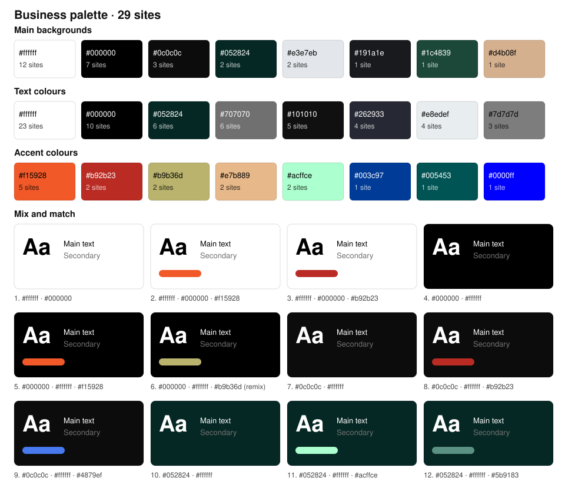

# Business palette

29 sites. 2 of them were captured as one screen only, so their colours come from the first screen.

Colours that look alike are merged and named by the most used shade; the counts are sites, not uses. Translucent colours are mixed onto each site's main background first.

## Main backgrounds

| Colour | Sites | Merged shades | Seen on |
| --- | --- | --- | --- |
| `#ffffff` | 12 of 29 | `#f2f2f6`, `#f5f5f5`, `#f6f4e9`, `#fefbf6` | [ESR Bespoke](../../esrbespoke.au/overview.md), [Garvin Promotion Group](../../gpg.dops.agency/overview.md), [Idealworks](../../idealworks.com/overview.md), [MECHA](../../mecha-xyz.webflow.io/overview.md) and 8 more |
| `#000000` | 7 of 29 | `#010101` | [Camper & Nicholsons](../../camperandnicholsons.com/overview.md), [Dragonfly Redux](../../dragonfly2.studiofreight.dev/overview.md), [Endurosat Space Service](../../endurosat.com-space-service/overview.md), [Faers](../../faers.tech/overview.md) and 3 more |
| `#0c0c0c` | 3 of 29 | `#0f0f15`, `#121212` | [Forge Automotive](../../forgeautomotive.co.uk/overview.md), [Villiers](../../villiers.ai/overview.md), [montarville](../../montarville.ca/overview.md) |
| `#052824` | 2 of 29 | `#212121` | [Leome and Partners](../../leome-and-partners.com/overview.md), [Pilato](../../pilato.it/overview.md) |
| `#e3e7eb` | 2 of 29 | `#f4f0ea` | [CROX](../../crox.framer.website/overview.md), [Auremin](../../auremin.com/overview.md) |
| `#191a1e` | 1 of 29 | — | [Byotōne](../../byotone.com/overview.md) |
| `#1c4839` | 1 of 29 | — | [Why Zero](../../why.zero.university/overview.md) |
| `#d4b08f` | 1 of 29 | — | [Relevo & Vinco](../../relevovinco.com/overview.md) |

## Second backgrounds

Section and panel colours that differ from the site's main background.

| Colour | Sites | Merged shades | Seen on |
| --- | --- | --- | --- |
| `#000000` | 7 of 29 | — | [ESR Bespoke](../../esrbespoke.au/overview.md), [Forge Automotive](../../forgeautomotive.co.uk/overview.md), [Idealworks](../../idealworks.com/overview.md), [Pilato](../../pilato.it/overview.md) and 3 more |
| `#ffffff` | 6 of 29 | `#f0f2f4`, `#f8f9f9` | [Auremin](../../auremin.com/overview.md), [Camper & Nicholsons](../../camperandnicholsons.com/overview.md), [CROX](../../crox.framer.website/overview.md), [Faers](../../faers.tech/overview.md) and 2 more |
| `#0d1114` | 3 of 29 | `#131419`, `#1a1b1c` | [Giga](../../giga.ai/overview.md), [Room and Pillar](../../roomandpillar.com/overview.md), [CROX](../../crox.framer.website/overview.md) |
| `#252324` | 2 of 29 | `#252525` | [Podium](../../podiumautomation.com/overview.md), [montarville](../../montarville.ca/overview.md) |
| `#c3c0bb` | 2 of 29 | `#c4c6ca` | [Auremin](../../auremin.com/overview.md), [Nova Dental](../../nova-dental-dev.webflow.io/overview.md) |
| `#47331f` | 1 of 29 | — | [Relevo & Vinco](../../relevovinco.com/overview.md) |
| `#003c97` | 1 of 29 | — | [Garvin Promotion Group](../../gpg.dops.agency/overview.md) |
| `#005453` | 1 of 29 | — | [Polpharma Biologics](../../polpharmabiologics.com/overview.md) |

## Text colours

| Colour | Sites | Contrast on `#ffffff` | Contrast on `#000000` | Seen on |
| --- | --- | --- | --- | --- |
| `#ffffff` | 23 of 29 | 1.0 | 21.0 | [Auremin](../../auremin.com/overview.md), [Byotōne](../../byotone.com/overview.md), [Camper & Nicholsons](../../camperandnicholsons.com/overview.md), [Endurosat Space Service](../../endurosat.com-space-service/overview.md) and 19 more |
| `#000000` | 10 of 29 | 21.0 | 1.0 | [Camper & Nicholsons](../../camperandnicholsons.com/overview.md), [Endurosat Space Service](../../endurosat.com-space-service/overview.md), [ESR Bespoke](../../esrbespoke.au/overview.md), [Idealworks](../../idealworks.com/overview.md) and 6 more |
| `#052824` | 6 of 29 | 15.7 | 1.3 | [Leome and Partners](../../leome-and-partners.com/overview.md), [Endurosat Space Service](../../endurosat.com-space-service/overview.md), [CROX](../../crox.framer.website/overview.md), [Lumena](../../lumena-partners.com/overview.md) and 2 more |
| `#707070` | 6 of 29 | 5.0 | 4.2 | [Roveia Health](../../roveia.com/overview.md), [Villiers](../../villiers.ai/overview.md), [Faers](../../faers.tech/overview.md), [Endurosat Space Service](../../endurosat.com-space-service/overview.md) and 2 more |
| `#101010` | 5 of 29 | 19.0 | 1.1 | [Roveia Health](../../roveia.com/overview.md), [montarville](../../montarville.ca/overview.md), [Room and Pillar](../../roomandpillar.com/overview.md), [Idealworks](../../idealworks.com/overview.md) and 1 more |
| `#262933` | 4 of 29 | 14.5 | 1.4 | [MECHA](../../mecha-xyz.webflow.io/overview.md), [Villiers](../../villiers.ai/overview.md), [Auremin](../../auremin.com/overview.md), [Relevo & Vinco](../../relevovinco.com/overview.md) |
| `#e8edef` | 4 of 29 | 1.2 | 17.8 | [Giga](../../giga.ai/overview.md), [Why Zero](../../why.zero.university/overview.md), [Pilato](../../pilato.it/overview.md), [Villiers](../../villiers.ai/overview.md) |
| `#7d7d7d` | 3 of 29 | 4.1 | 5.1 | [Dragonfly Redux](../../dragonfly2.studiofreight.dev/overview.md), [MECHA](../../mecha-xyz.webflow.io/overview.md), [Giga](../../giga.ai/overview.md) |

## Accent colours

Any colour with real saturation (OKLab chroma 0.06 or more) that is not near-black, wherever the site uses it.

| Colour | Sites | Merged shades | Seen on |
| --- | --- | --- | --- |
| `#f15928` | 5 of 29 | `#fa4c14`, `#fc6a18`, `#fe620c`, `#ff3701` | [Garvin Promotion Group](../../gpg.dops.agency/overview.md), [Dragonfly Redux](../../dragonfly2.studiofreight.dev/overview.md), [Endurosat Space Service](../../endurosat.com-space-service/overview.md), [Shinkei Systems](../../shinkei.systems/overview.md) and 1 more |
| `#b92b23` | 2 of 29 | `#d0112b` | [Shinkei Systems](../../shinkei.systems/overview.md), [montarville](../../montarville.ca/overview.md) |
| `#b9b36d` | 2 of 29 | `#d79e64` | [Structure Consulting Engineers](../../structureengineering.com.au/overview.md), [Strawberry Group](../../strawberrygroup.no/overview.md) |
| `#e7b889` | 2 of 29 | `#ffa17f` | [Strawberry Group](../../strawberrygroup.no/overview.md), [Shinkei Systems](../../shinkei.systems/overview.md) |
| `#acffce` | 2 of 29 | `#b1f9e1` | [Byotōne](../../byotone.com/overview.md), [Leome and Partners](../../leome-and-partners.com/overview.md) |
| `#003c97` | 1 of 29 | — | [Garvin Promotion Group](../../gpg.dops.agency/overview.md) |
| `#005453` | 1 of 29 | — | [Polpharma Biologics](../../polpharmabiologics.com/overview.md) |
| `#0000ff` | 1 of 29 | — | [MECHA](../../mecha-xyz.webflow.io/overview.md) |

## Mix and match

For each of the most common backgrounds: a main text colour at 7:1 or more where one exists (never below 4.5:1, WCAG AA body text), a muted secondary text between 3:1 and 7:1, and up to two accents at 3:1 or more (large text and UI parts). Colours that appear together on the same site are picked first; a remix borrows colours from different sites in this category.

| # | Background | Text | Secondary | Accent | Contrast text / secondary / accent | Source |
| --- | --- | --- | --- | --- | --- | --- |
| 1 | `#ffffff` | `#000000` | `#707070` | — | 21.0 / 5.0 / — | seen on [ESR Bespoke](../../esrbespoke.au/overview.md), [Idealworks](../../idealworks.com/overview.md) and 4 more |
| 2 | `#ffffff` | `#000000` | `#707070` | `#f15928` | 21.0 / 5.0 / 3.4 | seen on [Shinkei Systems](../../shinkei.systems/overview.md) |
| 3 | `#ffffff` | `#000000` | `#707070` | `#b92b23` | 21.0 / 5.0 / 6.1 | seen on [Shinkei Systems](../../shinkei.systems/overview.md) |
| 4 | `#000000` | `#ffffff` | `#707070` | — | 21.0 / 4.2 / — | seen on [Camper & Nicholsons](../../camperandnicholsons.com/overview.md), [Dragonfly Redux](../../dragonfly2.studiofreight.dev/overview.md) and 4 more |
| 5 | `#000000` | `#ffffff` | `#707070` | `#f15928` | 21.0 / 4.2 / 6.2 | seen on [Dragonfly Redux](../../dragonfly2.studiofreight.dev/overview.md), [Endurosat Space Service](../../endurosat.com-space-service/overview.md) and 1 more |
| 6 | `#000000` | `#ffffff` | `#707070` | `#b9b36d` | 21.0 / 4.2 / 9.7 | remix: ground from [Camper & Nicholsons](../../camperandnicholsons.com/overview.md), text from [Auremin](../../auremin.com/overview.md), accent from [Structure Consulting Engineers](../../structureengineering.com.au/overview.md) |
| 7 | `#0c0c0c` | `#ffffff` | `#707070` | — | 19.6 / 4.0 / — | seen on [Forge Automotive](../../forgeautomotive.co.uk/overview.md), [montarville](../../montarville.ca/overview.md) and 1 more |
| 8 | `#0c0c0c` | `#ffffff` | `#707070` | `#b92b23` | 19.6 / 4.0 / 3.2 | seen on [montarville](../../montarville.ca/overview.md) |
| 9 | `#0c0c0c` | `#ffffff` | `#707070` | `#4879ef` | 19.6 / 4.0 / 4.9 | seen on [Villiers](../../villiers.ai/overview.md) |
| 10 | `#052824` | `#ffffff` | `#707070` | — | 15.7 / 3.2 / — | seen on [Leome and Partners](../../leome-and-partners.com/overview.md), [Pilato](../../pilato.it/overview.md) |
| 11 | `#052824` | `#ffffff` | `#707070` | `#acffce` | 15.7 / 3.2 / 13.4 | seen on [Leome and Partners](../../leome-and-partners.com/overview.md) |
| 12 | `#052824` | `#ffffff` | `#707070` | `#5b9183` | 15.7 / 3.2 / 4.4 | seen on [Leome and Partners](../../leome-and-partners.com/overview.md) |
