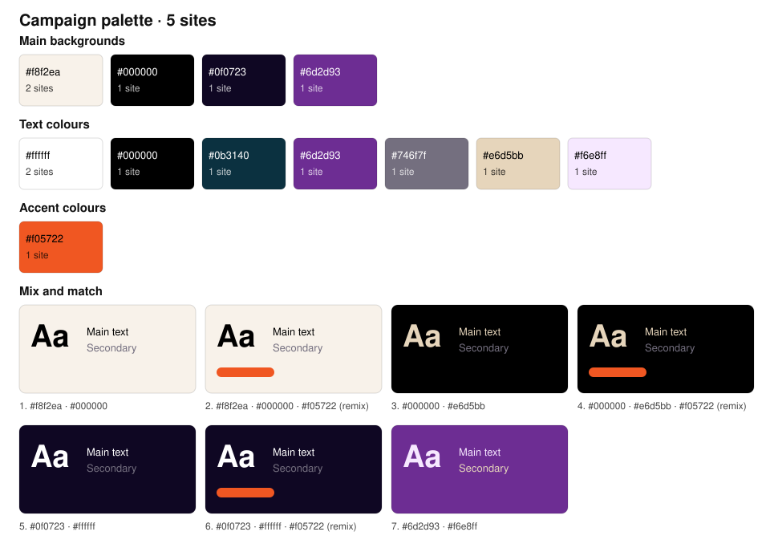

# Campaign palette

5 sites. 1 of them were captured as one screen only, so their colours come from the first screen.

Colours that look alike are merged and named by the most used shade; the counts are sites, not uses. Translucent colours are mixed onto each site's main background first.

## Main backgrounds

| Colour | Sites | Merged shades | Seen on |
| --- | --- | --- | --- |
| `#f8f2ea` | 2 of 5 | `#ffffff` | [Later's Made You Look](../../later.com-made-you-look/overview.md), [8am Showcase '26 Fall Release](../../showcase.8am.com/overview.md) |
| `#000000` | 1 of 5 | — | [RISK](../../risk.film/overview.md) |
| `#0f0723` | 1 of 5 | — | [Imogen: Agentic AI](../../vsproject-imogen.vendredi-society.com/overview.md) |
| `#6d2d93` | 1 of 5 | — | [Cyera AI Guardian](../../secure-the-unknown.cyera.com/overview.md) |

## Second backgrounds

Section and panel colours that differ from the site's main background.

| Colour | Sites | Merged shades | Seen on |
| --- | --- | --- | --- |
| `#000000` | 1 of 5 | — | [Cyera AI Guardian](../../secure-the-unknown.cyera.com/overview.md) |
| `#13193b` | 1 of 5 | — | [8am Showcase '26 Fall Release](../../showcase.8am.com/overview.md) |
| `#411b5b` | 1 of 5 | — | [Cyera AI Guardian](../../secure-the-unknown.cyera.com/overview.md) |

## Text colours

| Colour | Sites | Contrast on `#f8f2ea` | Contrast on `#000000` | Seen on |
| --- | --- | --- | --- | --- |
| `#ffffff` | 2 of 5 | 1.1 | 21.0 | [Later's Made You Look](../../later.com-made-you-look/overview.md), [Imogen: Agentic AI](../../vsproject-imogen.vendredi-society.com/overview.md) |
| `#000000` | 1 of 5 | 18.9 | 1.0 | [Later's Made You Look](../../later.com-made-you-look/overview.md) |
| `#0b3140` | 1 of 5 | 12.4 | 1.5 | [8am Showcase '26 Fall Release](../../showcase.8am.com/overview.md) |
| `#6d2d93` | 1 of 5 | 7.7 | 2.4 | [Cyera AI Guardian](../../secure-the-unknown.cyera.com/overview.md) |
| `#746f7f` | 1 of 5 | 4.4 | 4.3 | [Imogen: Agentic AI](../../vsproject-imogen.vendredi-society.com/overview.md) |
| `#e6d5bb` | 1 of 5 | 1.3 | 14.6 | [RISK](../../risk.film/overview.md) |
| `#f6e8ff` | 1 of 5 | 1.1 | 17.9 | [Cyera AI Guardian](../../secure-the-unknown.cyera.com/overview.md) |

## Accent colours

Any colour with real saturation (OKLab chroma 0.06 or more) that is not near-black, wherever the site uses it.

| Colour | Sites | Merged shades | Seen on |
| --- | --- | --- | --- |
| `#f05722` | 1 of 5 | — | [8am Showcase '26 Fall Release](../../showcase.8am.com/overview.md) |

## Mix and match

For each of the most common backgrounds: a main text colour at 7:1 or more where one exists (never below 4.5:1, WCAG AA body text), a muted secondary text between 3:1 and 7:1, and up to two accents at 3:1 or more (large text and UI parts). Colours that appear together on the same site are picked first; a remix borrows colours from different sites in this category.

| # | Background | Text | Secondary | Accent | Contrast text / secondary / accent | Source |
| --- | --- | --- | --- | --- | --- | --- |
| 1 | `#f8f2ea` | `#000000` | `#746f7f` | — | 18.9 / 4.4 / — | seen on [Later's Made You Look](../../later.com-made-you-look/overview.md) |
| 2 | `#f8f2ea` | `#000000` | `#746f7f` | `#f05722` | 18.9 / 4.4 / 3.1 | remix: ground from [Later's Made You Look](../../later.com-made-you-look/overview.md), text from [Later's Made You Look](../../later.com-made-you-look/overview.md), accent from [8am Showcase '26 Fall Release](../../showcase.8am.com/overview.md) |
| 3 | `#000000` | `#e6d5bb` | `#746f7f` | — | 14.6 / 4.3 / — | seen on [RISK](../../risk.film/overview.md) |
| 4 | `#000000` | `#e6d5bb` | `#746f7f` | `#f05722` | 14.6 / 4.3 / 6.1 | remix: ground from [RISK](../../risk.film/overview.md), text from [RISK](../../risk.film/overview.md), accent from [8am Showcase '26 Fall Release](../../showcase.8am.com/overview.md) |
| 5 | `#0f0723` | `#ffffff` | `#746f7f` | — | 19.5 / 4.0 / — | seen on [Imogen: Agentic AI](../../vsproject-imogen.vendredi-society.com/overview.md) |
| 6 | `#0f0723` | `#ffffff` | `#746f7f` | `#f05722` | 19.5 / 4.0 / 5.7 | remix: ground from [Imogen: Agentic AI](../../vsproject-imogen.vendredi-society.com/overview.md), text from [Later's Made You Look](../../later.com-made-you-look/overview.md), accent from [8am Showcase '26 Fall Release](../../showcase.8am.com/overview.md) |
| 7 | `#6d2d93` | `#f6e8ff` | `#e6d5bb` | — | 7.3 / 6.0 / — | seen on [Cyera AI Guardian](../../secure-the-unknown.cyera.com/overview.md) |
