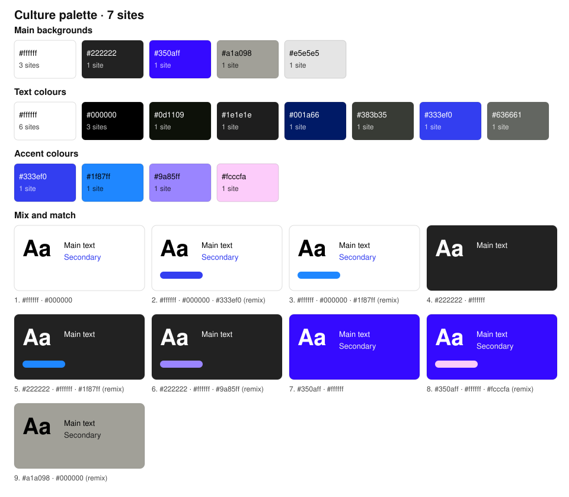

# Culture palette

7 sites. 2 of them were captured as one screen only, so their colours come from the first screen.

Colours that look alike are merged and named by the most used shade; the counts are sites, not uses. Translucent colours are mixed onto each site's main background first.

## Main backgrounds

| Colour | Sites | Merged shades | Seen on |
| --- | --- | --- | --- |
| `#ffffff` | 3 of 7 | `#f4f4f4` | [Deep White Gallery](../../deepwhite-gallery.com/overview.md), [Grids](../../grids03.obys.agency/overview.md), [Montreal Canadiens Foundation](../../fondation.canadiens.com/overview.md) |
| `#222222` | 1 of 7 | — | [FORMAT](../../format.obys.agency/overview.md) |
| `#350aff` | 1 of 7 | — | [The Design Society](../../thedesignsociety.fr/overview.md) |
| `#a1a098` | 1 of 7 | — | [Creative Reference Library](../../crl-2026.webflow.io/overview.md) |
| `#e5e5e5` | 1 of 7 | — | [Xiloteca Trevigiana](../../xiloteca.it-en/overview.md) |

## Second backgrounds

Section and panel colours that differ from the site's main background.

| Colour | Sites | Merged shades | Seen on |
| --- | --- | --- | --- |
| `#212a15` | 1 of 7 | — | [Xiloteca Trevigiana](../../xiloteca.it-en/overview.md) |
| `#5c5c5c` | 1 of 7 | — | [Xiloteca Trevigiana](../../xiloteca.it-en/overview.md) |
| `#797762` | 1 of 7 | — | [Deep White Gallery](../../deepwhite-gallery.com/overview.md) |
| `#1f87ff` | 1 of 7 | — | [Montreal Canadiens Foundation](../../fondation.canadiens.com/overview.md) |
| `#d9d9d9` | 1 of 7 | — | [Grids](../../grids03.obys.agency/overview.md) |
| `#ebedf5` | 1 of 7 | — | [The Design Society](../../thedesignsociety.fr/overview.md) |
| `#ffffff` | 1 of 7 | — | [FORMAT](../../format.obys.agency/overview.md) |

## Text colours

| Colour | Sites | Contrast on `#ffffff` | Contrast on `#222222` | Seen on |
| --- | --- | --- | --- | --- |
| `#ffffff` | 6 of 7 | 1.0 | 15.9 | [Creative Reference Library](../../crl-2026.webflow.io/overview.md), [Deep White Gallery](../../deepwhite-gallery.com/overview.md), [Montreal Canadiens Foundation](../../fondation.canadiens.com/overview.md), [FORMAT](../../format.obys.agency/overview.md) and 2 more |
| `#000000` | 3 of 7 | 21.0 | 1.3 | [Deep White Gallery](../../deepwhite-gallery.com/overview.md), [FORMAT](../../format.obys.agency/overview.md), [Grids](../../grids03.obys.agency/overview.md) |
| `#0d1109` | 1 of 7 | 19.1 | 1.2 | [Xiloteca Trevigiana](../../xiloteca.it-en/overview.md) |
| `#1e1e1e` | 1 of 7 | 16.7 | 1.0 | [The Design Society](../../thedesignsociety.fr/overview.md) |
| `#001a66` | 1 of 7 | 15.7 | 1.0 | [Montreal Canadiens Foundation](../../fondation.canadiens.com/overview.md) |
| `#383b35` | 1 of 7 | 11.4 | 1.4 | [Xiloteca Trevigiana](../../xiloteca.it-en/overview.md) |
| `#333ef0` | 1 of 7 | 6.8 | 2.3 | [Montreal Canadiens Foundation](../../fondation.canadiens.com/overview.md) |
| `#636661` | 1 of 7 | 5.8 | 2.7 | [Xiloteca Trevigiana](../../xiloteca.it-en/overview.md) |

## Accent colours

Any colour with real saturation (OKLab chroma 0.06 or more) that is not near-black, wherever the site uses it.

| Colour | Sites | Merged shades | Seen on |
| --- | --- | --- | --- |
| `#333ef0` | 1 of 7 | — | [Montreal Canadiens Foundation](../../fondation.canadiens.com/overview.md) |
| `#1f87ff` | 1 of 7 | — | [Montreal Canadiens Foundation](../../fondation.canadiens.com/overview.md) |
| `#9a85ff` | 1 of 7 | — | [The Design Society](../../thedesignsociety.fr/overview.md) |
| `#fcccfa` | 1 of 7 | — | [Montreal Canadiens Foundation](../../fondation.canadiens.com/overview.md) |

## Mix and match

For each of the most common backgrounds: a main text colour at 7:1 or more where one exists (never below 4.5:1, WCAG AA body text), a muted secondary text between 3:1 and 7:1, and up to two accents at 3:1 or more (large text and UI parts). Colours that appear together on the same site are picked first; a remix borrows colours from different sites in this category.

| # | Background | Text | Secondary | Accent | Contrast text / secondary / accent | Source |
| --- | --- | --- | --- | --- | --- | --- |
| 1 | `#ffffff` | `#000000` | `#333ef0` | — | 21.0 / 6.8 / — | seen on [Deep White Gallery](../../deepwhite-gallery.com/overview.md), [Grids](../../grids03.obys.agency/overview.md) |
| 2 | `#ffffff` | `#000000` | `#333ef0` | `#333ef0` | 21.0 / 6.8 / 6.8 | remix: ground from [Deep White Gallery](../../deepwhite-gallery.com/overview.md), text from [Deep White Gallery](../../deepwhite-gallery.com/overview.md), accent from [Montreal Canadiens Foundation](../../fondation.canadiens.com/overview.md) |
| 3 | `#ffffff` | `#000000` | `#333ef0` | `#1f87ff` | 21.0 / 6.8 / 3.5 | remix: ground from [Deep White Gallery](../../deepwhite-gallery.com/overview.md), text from [Deep White Gallery](../../deepwhite-gallery.com/overview.md), accent from [Montreal Canadiens Foundation](../../fondation.canadiens.com/overview.md) |
| 4 | `#222222` | `#ffffff` | — | — | 15.9 / — / — | seen on [FORMAT](../../format.obys.agency/overview.md) |
| 5 | `#222222` | `#ffffff` | — | `#1f87ff` | 15.9 / — / 4.5 | remix: ground from [FORMAT](../../format.obys.agency/overview.md), text from [Creative Reference Library](../../crl-2026.webflow.io/overview.md), accent from [Montreal Canadiens Foundation](../../fondation.canadiens.com/overview.md) |
| 6 | `#222222` | `#ffffff` | — | `#9a85ff` | 15.9 / — / 5.4 | remix: ground from [FORMAT](../../format.obys.agency/overview.md), text from [Creative Reference Library](../../crl-2026.webflow.io/overview.md), accent from [The Design Society](../../thedesignsociety.fr/overview.md) |
| 7 | `#350aff` | `#ffffff` | `#efeeec` | — | 8.0 / 6.9 / — | seen on [The Design Society](../../thedesignsociety.fr/overview.md) |
| 8 | `#350aff` | `#ffffff` | `#efeeec` | `#fcccfa` | 8.0 / 6.9 / 5.7 | remix: ground from [The Design Society](../../thedesignsociety.fr/overview.md), text from [Creative Reference Library](../../crl-2026.webflow.io/overview.md), accent from [Montreal Canadiens Foundation](../../fondation.canadiens.com/overview.md) |
| 9 | `#a1a098` | `#000000` | `#1e1e1e` | — | 8.0 / 6.3 / — | remix: ground from [Creative Reference Library](../../crl-2026.webflow.io/overview.md), text from [Deep White Gallery](../../deepwhite-gallery.com/overview.md) |
