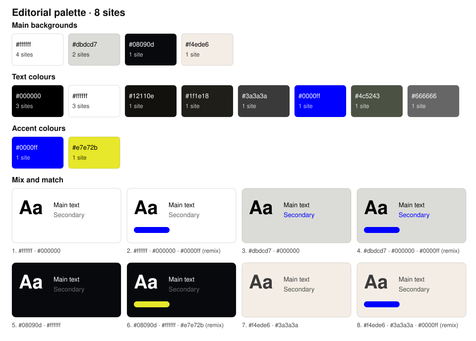

# Editorial palette

8 sites. 3 of them were captured as one screen only, so their colours come from the first screen.

Colours that look alike are merged and named by the most used shade; the counts are sites, not uses. Translucent colours are mixed onto each site's main background first.

## Main backgrounds

| Colour | Sites | Merged shades | Seen on |
| --- | --- | --- | --- |
| `#ffffff` | 4 of 8 | `#faf8f2` | [Best Website Template](../../bestwebsitetemplate.com/overview.md), [Where Opportunity Takes Root](../../opportunity.waltonfamilyfoundation.org/overview.md), [Stash](../../stash.cool/overview.md), [The boring blog](../../theboringblog.ai/overview.md) |
| `#dbdcd7` | 2 of 8 | `#e9e9ea` | [Driftime's 2025 Impact Report](../../2025.driftime.com/overview.md), [AI Uis](../../aiu.is/overview.md) |
| `#08090d` | 1 of 8 | — | [The state of the gallery](../../mesh3d.gallery-the-state-of-the-gallery/overview.md) |
| `#f4ede6` | 1 of 8 | — | [How F1 has evolved since 1950](../../espn.com-espn-feature-story/overview.md) |

## Second backgrounds

Section and panel colours that differ from the site's main background.

| Colour | Sites | Merged shades | Seen on |
| --- | --- | --- | --- |
| `#000000` | 1 of 8 | — | [Where Opportunity Takes Root](../../opportunity.waltonfamilyfoundation.org/overview.md) |
| `#ffffff` | 1 of 8 | — | [Driftime's 2025 Impact Report](../../2025.driftime.com/overview.md) |

## Text colours

| Colour | Sites | Contrast on `#ffffff` | Contrast on `#dbdcd7` | Seen on |
| --- | --- | --- | --- | --- |
| `#000000` | 3 of 8 | 21.0 | 15.2 | [Best Website Template](../../bestwebsitetemplate.com/overview.md), [Stash](../../stash.cool/overview.md), [Driftime's 2025 Impact Report](../../2025.driftime.com/overview.md) |
| `#ffffff` | 3 of 8 | 1.0 | 1.4 | [The state of the gallery](../../mesh3d.gallery-the-state-of-the-gallery/overview.md), [Where Opportunity Takes Root](../../opportunity.waltonfamilyfoundation.org/overview.md), [The boring blog](../../theboringblog.ai/overview.md) |
| `#12110e` | 1 of 8 | 18.9 | 13.7 | [Where Opportunity Takes Root](../../opportunity.waltonfamilyfoundation.org/overview.md) |
| `#1f1e18` | 1 of 8 | 16.7 | 12.1 | [The boring blog](../../theboringblog.ai/overview.md) |
| `#3a3a3a` | 1 of 8 | 11.4 | 8.2 | [How F1 has evolved since 1950](../../espn.com-espn-feature-story/overview.md) |
| `#0000ff` | 1 of 8 | 8.6 | 6.2 | [AI Uis](../../aiu.is/overview.md) |
| `#4c5243` | 1 of 8 | 8.1 | 5.9 | [The boring blog](../../theboringblog.ai/overview.md) |
| `#666666` | 1 of 8 | 5.7 | 4.2 | [Best Website Template](../../bestwebsitetemplate.com/overview.md) |

## Accent colours

Any colour with real saturation (OKLab chroma 0.06 or more) that is not near-black, wherever the site uses it.

| Colour | Sites | Merged shades | Seen on |
| --- | --- | --- | --- |
| `#0000ff` | 1 of 8 | — | [AI Uis](../../aiu.is/overview.md) |
| `#e7e72b` | 1 of 8 | — | [Where Opportunity Takes Root](../../opportunity.waltonfamilyfoundation.org/overview.md) |

## Mix and match

For each of the most common backgrounds: a main text colour at 7:1 or more where one exists (never below 4.5:1, WCAG AA body text), a muted secondary text between 3:1 and 7:1, and up to two accents at 3:1 or more (large text and UI parts). Colours that appear together on the same site are picked first; a remix borrows colours from different sites in this category.

| # | Background | Text | Secondary | Accent | Contrast text / secondary / accent | Source |
| --- | --- | --- | --- | --- | --- | --- |
| 1 | `#ffffff` | `#000000` | `#666666` | — | 21.0 / 5.7 / — | seen on [Best Website Template](../../bestwebsitetemplate.com/overview.md), [Stash](../../stash.cool/overview.md) |
| 2 | `#ffffff` | `#000000` | `#666666` | `#0000ff` | 21.0 / 5.7 / 8.6 | remix: ground from [Best Website Template](../../bestwebsitetemplate.com/overview.md), text from [Best Website Template](../../bestwebsitetemplate.com/overview.md), accent from [AI Uis](../../aiu.is/overview.md) |
| 3 | `#dbdcd7` | `#000000` | `#0000ff` | — | 15.2 / 6.2 / — | seen on [Driftime's 2025 Impact Report](../../2025.driftime.com/overview.md) |
| 4 | `#dbdcd7` | `#000000` | `#0000ff` | `#0000ff` | 15.2 / 6.2 / 6.2 | remix: ground from [Driftime's 2025 Impact Report](../../2025.driftime.com/overview.md), text from [Best Website Template](../../bestwebsitetemplate.com/overview.md), accent from [AI Uis](../../aiu.is/overview.md) |
| 5 | `#08090d` | `#ffffff` | `#666666` | — | 19.9 / 3.5 / — | seen on [The state of the gallery](../../mesh3d.gallery-the-state-of-the-gallery/overview.md) |
| 6 | `#08090d` | `#ffffff` | `#666666` | `#e7e72b` | 19.9 / 3.5 / 15.0 | remix: ground from [The state of the gallery](../../mesh3d.gallery-the-state-of-the-gallery/overview.md), text from [The state of the gallery](../../mesh3d.gallery-the-state-of-the-gallery/overview.md), accent from [Where Opportunity Takes Root](../../opportunity.waltonfamilyfoundation.org/overview.md) |
| 7 | `#f4ede6` | `#3a3a3a` | `#4c5243` | — | 9.8 / 7.0 / — | seen on [How F1 has evolved since 1950](../../espn.com-espn-feature-story/overview.md) |
| 8 | `#f4ede6` | `#3a3a3a` | `#4c5243` | `#0000ff` | 9.8 / 7.0 / 7.4 | remix: ground from [How F1 has evolved since 1950](../../espn.com-espn-feature-story/overview.md), text from [How F1 has evolved since 1950](../../espn.com-espn-feature-story/overview.md), accent from [AI Uis](../../aiu.is/overview.md) |
