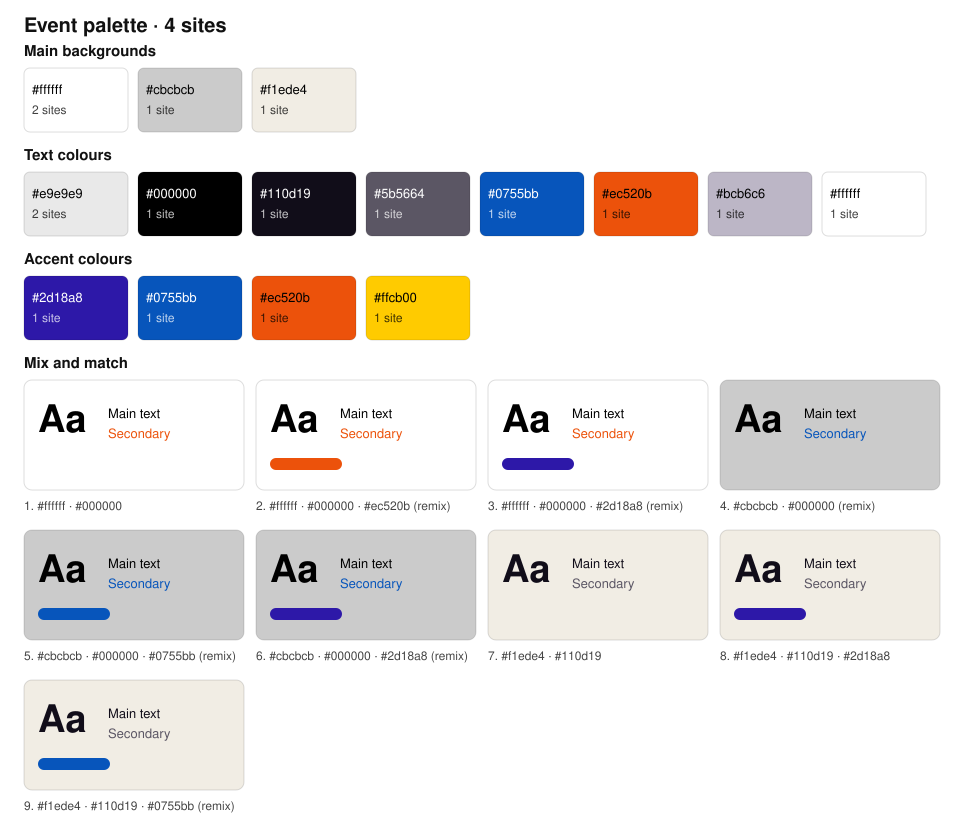

# Event palette

4 sites. 1 of them were captured as one screen only, so their colours come from the first screen.

Colours that look alike are merged and named by the most used shade; the counts are sites, not uses. Translucent colours are mixed onto each site's main background first.

## Main backgrounds

| Colour | Sites | Merged shades | Seen on |
| --- | --- | --- | --- |
| `#ffffff` | 2 of 4 | — | [Readymag Madrid Meetup](../../readymag.com-madrid-meetup/overview.md), [Spatial Festival](../../spatial-festival.program.studio/overview.md) |
| `#cbcbcb` | 1 of 4 | — | [Wild Week - Athens](../../week.wild.plus-athens-26/overview.md) |
| `#f1ede4` | 1 of 4 | — | [Kelvin Music Festival 2027](../../kelvin.8b.com/overview.md) |

## Second backgrounds

Section and panel colours that differ from the site's main background.

| Colour | Sites | Merged shades | Seen on |
| --- | --- | --- | --- |
| `#000000` | 1 of 4 | — | [Spatial Festival](../../spatial-festival.program.studio/overview.md) |
| `#110d19` | 1 of 4 | — | [Kelvin Music Festival 2027](../../kelvin.8b.com/overview.md) |
| `#1c1c1c` | 1 of 4 | — | [Readymag Madrid Meetup](../../readymag.com-madrid-meetup/overview.md) |
| `#282828` | 1 of 4 | — | [Readymag Madrid Meetup](../../readymag.com-madrid-meetup/overview.md) |
| `#2d18a8` | 1 of 4 | — | [Kelvin Music Festival 2027](../../kelvin.8b.com/overview.md) |
| `#dcdbd5` | 1 of 4 | — | [Wild Week - Athens](../../week.wild.plus-athens-26/overview.md) |

## Text colours

| Colour | Sites | Contrast on `#ffffff` | Contrast on `#cbcbcb` | Seen on |
| --- | --- | --- | --- | --- |
| `#e9e9e9` | 2 of 4 | 1.2 | 1.3 | [Readymag Madrid Meetup](../../readymag.com-madrid-meetup/overview.md), [Kelvin Music Festival 2027](../../kelvin.8b.com/overview.md) |
| `#000000` | 1 of 4 | 21.0 | 12.9 | [Spatial Festival](../../spatial-festival.program.studio/overview.md) |
| `#110d19` | 1 of 4 | 19.2 | 11.8 | [Kelvin Music Festival 2027](../../kelvin.8b.com/overview.md) |
| `#5b5664` | 1 of 4 | 7.1 | 4.4 | [Kelvin Music Festival 2027](../../kelvin.8b.com/overview.md) |
| `#0755bb` | 1 of 4 | 6.9 | 4.3 | [Wild Week - Athens](../../week.wild.plus-athens-26/overview.md) |
| `#ec520b` | 1 of 4 | 3.6 | 2.2 | [Readymag Madrid Meetup](../../readymag.com-madrid-meetup/overview.md) |
| `#bcb6c6` | 1 of 4 | 2.0 | 1.2 | [Kelvin Music Festival 2027](../../kelvin.8b.com/overview.md) |
| `#ffffff` | 1 of 4 | 1.0 | 1.6 | [Readymag Madrid Meetup](../../readymag.com-madrid-meetup/overview.md) |

## Accent colours

Any colour with real saturation (OKLab chroma 0.06 or more) that is not near-black, wherever the site uses it.

| Colour | Sites | Merged shades | Seen on |
| --- | --- | --- | --- |
| `#2d18a8` | 1 of 4 | — | [Kelvin Music Festival 2027](../../kelvin.8b.com/overview.md) |
| `#0755bb` | 1 of 4 | — | [Wild Week - Athens](../../week.wild.plus-athens-26/overview.md) |
| `#ec520b` | 1 of 4 | — | [Readymag Madrid Meetup](../../readymag.com-madrid-meetup/overview.md) |
| `#ffcb00` | 1 of 4 | — | [Readymag Madrid Meetup](../../readymag.com-madrid-meetup/overview.md) |

## Mix and match

For each of the most common backgrounds: a main text colour at 7:1 or more where one exists (never below 4.5:1, WCAG AA body text), a muted secondary text between 3:1 and 7:1, and up to two accents at 3:1 or more (large text and UI parts). Colours that appear together on the same site are picked first; a remix borrows colours from different sites in this category.

| # | Background | Text | Secondary | Accent | Contrast text / secondary / accent | Source |
| --- | --- | --- | --- | --- | --- | --- |
| 1 | `#ffffff` | `#000000` | `#ec520b` | — | 21.0 / 3.6 / — | seen on [Spatial Festival](../../spatial-festival.program.studio/overview.md) |
| 2 | `#ffffff` | `#000000` | `#ec520b` | `#ec520b` | 21.0 / 3.6 / 3.6 | remix: ground from [Readymag Madrid Meetup](../../readymag.com-madrid-meetup/overview.md), text from [Spatial Festival](../../spatial-festival.program.studio/overview.md), accent from [Readymag Madrid Meetup](../../readymag.com-madrid-meetup/overview.md) |
| 3 | `#ffffff` | `#000000` | `#ec520b` | `#2d18a8` | 21.0 / 3.6 / 11.6 | remix: ground from [Readymag Madrid Meetup](../../readymag.com-madrid-meetup/overview.md), text from [Spatial Festival](../../spatial-festival.program.studio/overview.md), accent from [Kelvin Music Festival 2027](../../kelvin.8b.com/overview.md) |
| 4 | `#cbcbcb` | `#000000` | `#0755bb` | — | 12.9 / 4.3 / — | remix: ground from [Wild Week - Athens](../../week.wild.plus-athens-26/overview.md), text from [Spatial Festival](../../spatial-festival.program.studio/overview.md) |
| 5 | `#cbcbcb` | `#000000` | `#0755bb` | `#0755bb` | 12.9 / 4.3 / 4.3 | remix: ground from [Wild Week - Athens](../../week.wild.plus-athens-26/overview.md), text from [Spatial Festival](../../spatial-festival.program.studio/overview.md), accent from [Wild Week - Athens](../../week.wild.plus-athens-26/overview.md) |
| 6 | `#cbcbcb` | `#000000` | `#0755bb` | `#2d18a8` | 12.9 / 4.3 / 7.2 | remix: ground from [Wild Week - Athens](../../week.wild.plus-athens-26/overview.md), text from [Spatial Festival](../../spatial-festival.program.studio/overview.md), accent from [Kelvin Music Festival 2027](../../kelvin.8b.com/overview.md) |
| 7 | `#f1ede4` | `#110d19` | `#5b5664` | — | 16.4 / 6.1 / — | seen on [Kelvin Music Festival 2027](../../kelvin.8b.com/overview.md) |
| 8 | `#f1ede4` | `#110d19` | `#5b5664` | `#2d18a8` | 16.4 / 6.1 / 9.9 | seen on [Kelvin Music Festival 2027](../../kelvin.8b.com/overview.md) |
| 9 | `#f1ede4` | `#110d19` | `#5b5664` | `#0755bb` | 16.4 / 6.1 / 5.9 | remix: ground from [Kelvin Music Festival 2027](../../kelvin.8b.com/overview.md), text from [Kelvin Music Festival 2027](../../kelvin.8b.com/overview.md), accent from [Wild Week - Athens](../../week.wild.plus-athens-26/overview.md) |
