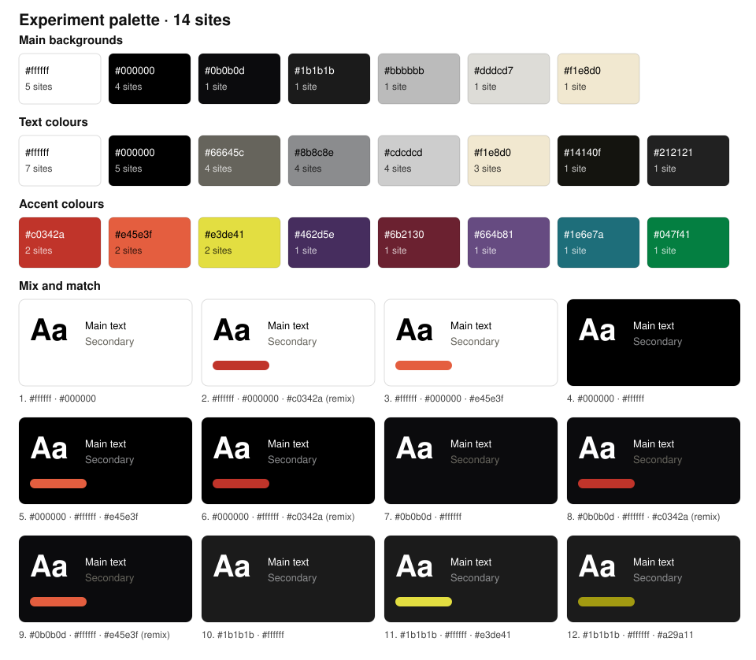

# Experiment palette

14 sites. 11 of them were captured as one screen only, so their colours come from the first screen. Left out as failed captures: [The Future In Black](../../thefutureinblack.com/overview.md).

Colours that look alike are merged and named by the most used shade; the counts are sites, not uses. Translucent colours are mixed onto each site's main background first.

## Main backgrounds

| Colour | Sites | Merged shades | Seen on |
| --- | --- | --- | --- |
| `#ffffff` | 5 of 14 | `#f2f2f2`, `#f4f3ef`, `#f6f3ee` | [ATO 痕時の器](../../atotimecapsule.com/overview.md), [Truth Generation](../../blurthetruth.com/overview.md), [A24](../../a24.raviklaassens.com/overview.md), [Dont Look up game](../../dontlookup.app/overview.md) and 1 more |
| `#000000` | 4 of 14 | `#080808` | [aorum](../../aorum.io/overview.md), [Awards Racing](../../awards.racing/overview.md), [Save for later](../../clicktokeep.com/overview.md), [ASTRODITHER](../../astrodither.robertborghesi.is/overview.md) |
| `#0b0b0d` | 1 of 14 | — | [Still Night](../../stillnight.joshua-garcia.com/overview.md) |
| `#1b1b1b` | 1 of 14 | — | [Night Drive Racing Game](../../threejspunk.com/overview.md) |
| `#bbbbbb` | 1 of 14 | — | [John and Patricia's Space](../../john-and-patricias-comfort-site-about-attachment-styles.com/overview.md) |
| `#dddcd7` | 1 of 14 | — | [Half the Sky](../../halfthesky.app/overview.md) |
| `#f1e8d0` | 1 of 14 | — | [Nocturnal Dream](../../nocturnaldream.com/overview.md) |

## Second backgrounds

Section and panel colours that differ from the site's main background.

| Colour | Sites | Merged shades | Seen on |
| --- | --- | --- | --- |
| `#000000` | 3 of 14 | `#020203` | [A24](../../a24.raviklaassens.com/overview.md), [Truth Generation](../../blurthetruth.com/overview.md), [Nocturnal Dream](../../nocturnaldream.com/overview.md) |
| `#ede9e5` | 3 of 14 | `#efefef`, `#f0f0f0`, `#f5ecd7` | [Truth Generation](../../blurthetruth.com/overview.md), [Save for later](../../clicktokeep.com/overview.md), [John and Patricia's Space](../../john-and-patricias-comfort-site-about-attachment-styles.com/overview.md) |
| `#0a0908` | 2 of 14 | `#0a0a0a` | [A tribute to Piet Mondrian](../../mondriantribute.com/overview.md), [Night Drive Racing Game](../../threejspunk.com/overview.md) |
| `#212121` | 1 of 14 | — | [ATO 痕時の器](../../atotimecapsule.com/overview.md) |
| `#cdc4ab` | 1 of 14 | — | [Nocturnal Dream](../../nocturnaldream.com/overview.md) |

## Text colours

| Colour | Sites | Contrast on `#ffffff` | Contrast on `#000000` | Seen on |
| --- | --- | --- | --- | --- |
| `#ffffff` | 7 of 14 | 1.0 | 21.0 | [ATO 痕時の器](../../atotimecapsule.com/overview.md), [Awards Racing](../../awards.racing/overview.md), [Truth Generation](../../blurthetruth.com/overview.md), [Save for later](../../clicktokeep.com/overview.md) and 3 more |
| `#000000` | 5 of 14 | 21.0 | 1.0 | [A24](../../a24.raviklaassens.com/overview.md), [ATO 痕時の器](../../atotimecapsule.com/overview.md), [Truth Generation](../../blurthetruth.com/overview.md), [Save for later](../../clicktokeep.com/overview.md) and 1 more |
| `#66645c` | 4 of 14 | 5.9 | 3.5 | [Half the Sky](../../halfthesky.app/overview.md), [Still Night](../../stillnight.joshua-garcia.com/overview.md), [ATO 痕時の器](../../atotimecapsule.com/overview.md), [John and Patricia's Space](../../john-and-patricias-comfort-site-about-attachment-styles.com/overview.md) |
| `#8b8c8e` | 4 of 14 | 3.4 | 6.2 | [Night Drive Racing Game](../../threejspunk.com/overview.md), [Nocturnal Dream](../../nocturnaldream.com/overview.md), [Still Night](../../stillnight.joshua-garcia.com/overview.md), [aorum](../../aorum.io/overview.md) |
| `#cdcdcd` | 4 of 14 | 1.6 | 13.2 | [Night Drive Racing Game](../../threejspunk.com/overview.md), [A tribute to Piet Mondrian](../../mondriantribute.com/overview.md), [Still Night](../../stillnight.joshua-garcia.com/overview.md), [Nocturnal Dream](../../nocturnaldream.com/overview.md) |
| `#f1e8d0` | 3 of 14 | 1.2 | 17.2 | [Nocturnal Dream](../../nocturnaldream.com/overview.md), [John and Patricia's Space](../../john-and-patricias-comfort-site-about-attachment-styles.com/overview.md), [Still Night](../../stillnight.joshua-garcia.com/overview.md) |
| `#14140f` | 1 of 14 | 18.5 | 1.1 | [Dont Look up game](../../dontlookup.app/overview.md) |
| `#212121` | 1 of 14 | 16.1 | 1.3 | [ATO 痕時の器](../../atotimecapsule.com/overview.md) |

## Accent colours

Any colour with real saturation (OKLab chroma 0.06 or more) that is not near-black, wherever the site uses it.

| Colour | Sites | Merged shades | Seen on |
| --- | --- | --- | --- |
| `#c0342a` | 2 of 14 | `#c1121f` | [Dont Look up game](../../dontlookup.app/overview.md), [A tribute to Piet Mondrian](../../mondriantribute.com/overview.md) |
| `#e45e3f` | 2 of 14 | `#fb3d3a` | [ATO 痕時の器](../../atotimecapsule.com/overview.md), [Save for later](../../clicktokeep.com/overview.md) |
| `#e3de41` | 2 of 14 | `#fcee0a` | [Truth Generation](../../blurthetruth.com/overview.md), [Night Drive Racing Game](../../threejspunk.com/overview.md) |
| `#462d5e` | 1 of 14 | — | [Night Drive Racing Game](../../threejspunk.com/overview.md) |
| `#6b2130` | 1 of 14 | `#76224e` | [Night Drive Racing Game](../../threejspunk.com/overview.md) |
| `#664b81` | 1 of 14 | — | [Night Drive Racing Game](../../threejspunk.com/overview.md) |
| `#1e6e7a` | 1 of 14 | `#1f6376`, `#1f7784`, `#1f808f`, `#217e98` | [Night Drive Racing Game](../../threejspunk.com/overview.md) |
| `#047f41` | 1 of 14 | — | [Truth Generation](../../blurthetruth.com/overview.md) |

## Mix and match

For each of the most common backgrounds: a main text colour at 7:1 or more where one exists (never below 4.5:1, WCAG AA body text), a muted secondary text between 3:1 and 7:1, and up to two accents at 3:1 or more (large text and UI parts). Colours that appear together on the same site are picked first; a remix borrows colours from different sites in this category.

| # | Background | Text | Secondary | Accent | Contrast text / secondary / accent | Source |
| --- | --- | --- | --- | --- | --- | --- |
| 1 | `#ffffff` | `#000000` | `#66645c` | — | 21.0 / 5.9 / — | seen on [A24](../../a24.raviklaassens.com/overview.md), [ATO 痕時の器](../../atotimecapsule.com/overview.md) and 1 more |
| 2 | `#ffffff` | `#000000` | `#66645c` | `#c0342a` | 21.0 / 5.9 / 5.6 | remix: ground from [ATO 痕時の器](../../atotimecapsule.com/overview.md), text from [A24](../../a24.raviklaassens.com/overview.md), accent from [Dont Look up game](../../dontlookup.app/overview.md) |
| 3 | `#ffffff` | `#000000` | `#66645c` | `#e45e3f` | 21.0 / 5.9 / 3.5 | seen on [ATO 痕時の器](../../atotimecapsule.com/overview.md) |
| 4 | `#000000` | `#ffffff` | `#8b8c8e` | — | 21.0 / 6.2 / — | seen on [ASTRODITHER](../../astrodither.robertborghesi.is/overview.md), [Awards Racing](../../awards.racing/overview.md) and 1 more |
| 5 | `#000000` | `#ffffff` | `#8b8c8e` | `#e45e3f` | 21.0 / 6.2 / 6.0 | seen on [Save for later](../../clicktokeep.com/overview.md) |
| 6 | `#000000` | `#ffffff` | `#8b8c8e` | `#c0342a` | 21.0 / 6.2 / 3.8 | remix: ground from [aorum](../../aorum.io/overview.md), text from [ATO 痕時の器](../../atotimecapsule.com/overview.md), accent from [Dont Look up game](../../dontlookup.app/overview.md) |
| 7 | `#0b0b0d` | `#ffffff` | `#66645c` | — | 19.7 / 3.3 / — | seen on [Still Night](../../stillnight.joshua-garcia.com/overview.md) |
| 8 | `#0b0b0d` | `#ffffff` | `#66645c` | `#c0342a` | 19.7 / 3.3 / 3.5 | remix: ground from [Still Night](../../stillnight.joshua-garcia.com/overview.md), text from [ATO 痕時の器](../../atotimecapsule.com/overview.md), accent from [Dont Look up game](../../dontlookup.app/overview.md) |
| 9 | `#0b0b0d` | `#ffffff` | `#66645c` | `#e45e3f` | 19.7 / 3.3 / 5.6 | remix: ground from [Still Night](../../stillnight.joshua-garcia.com/overview.md), text from [ATO 痕時の器](../../atotimecapsule.com/overview.md), accent from [ATO 痕時の器](../../atotimecapsule.com/overview.md) |
| 10 | `#1b1b1b` | `#ffffff` | `#8b8c8e` | — | 17.2 / 5.1 / — | seen on [Night Drive Racing Game](../../threejspunk.com/overview.md) |
| 11 | `#1b1b1b` | `#ffffff` | `#8b8c8e` | `#e3de41` | 17.2 / 5.1 / 12.1 | seen on [Night Drive Racing Game](../../threejspunk.com/overview.md) |
| 12 | `#1b1b1b` | `#ffffff` | `#8b8c8e` | `#a29a11` | 17.2 / 5.1 / 5.9 | seen on [Night Drive Racing Game](../../threejspunk.com/overview.md) |
