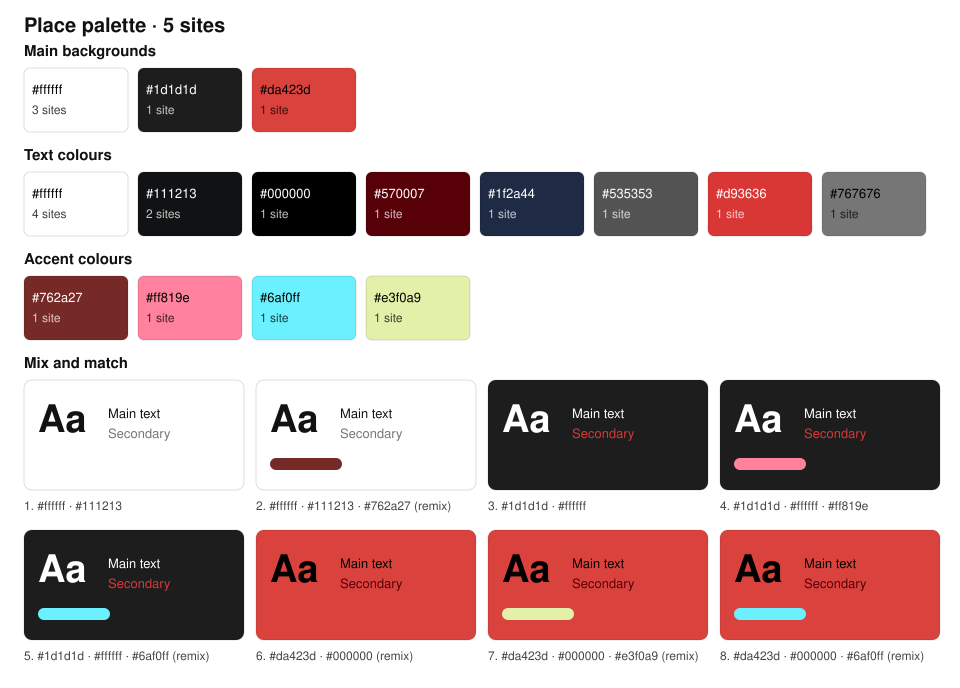

# Place palette

5 sites. 0 of them were captured as one screen only, so their colours come from the first screen.

Colours that look alike are merged and named by the most used shade; the counts are sites, not uses. Translucent colours are mixed onto each site's main background first.

## Main backgrounds

| Colour | Sites | Merged shades | Seen on |
| --- | --- | --- | --- |
| `#ffffff` | 3 of 5 | — | [360 Lexington Ave](../../360lexingtonave.com/overview.md), [Here & Away](../../here-away.com/overview.md), [White Desert](../../white-desert.com/overview.md) |
| `#1d1d1d` | 1 of 5 | — | [https://orbita.bar](../../orbita.bar/overview.md) |
| `#da423d` | 1 of 5 | — | [https://www.terrenohotel.com/](../../terrenohotel.com-en/overview.md) |

## Second backgrounds

Section and panel colours that differ from the site's main background.

| Colour | Sites | Merged shades | Seen on |
| --- | --- | --- | --- |
| `#e5e5e5` | 2 of 5 | `#f0efed`, `#f7efdc` | [Here & Away](../../here-away.com/overview.md), [https://orbita.bar](../../orbita.bar/overview.md) |
| `#090b10` | 1 of 5 | — | [White Desert](../../white-desert.com/overview.md) |
| `#762a27` | 1 of 5 | — | [https://www.terrenohotel.com/](../../terrenohotel.com-en/overview.md) |
| `#bc433f` | 1 of 5 | — | [https://www.terrenohotel.com/](../../terrenohotel.com-en/overview.md) |
| `#ffffff` | 1 of 5 | — | [https://orbita.bar](../../orbita.bar/overview.md) |

## Text colours

| Colour | Sites | Contrast on `#ffffff` | Contrast on `#1d1d1d` | Seen on |
| --- | --- | --- | --- | --- |
| `#ffffff` | 4 of 5 | 1.0 | 16.9 | [360 Lexington Ave](../../360lexingtonave.com/overview.md), [Here & Away](../../here-away.com/overview.md), [https://orbita.bar](../../orbita.bar/overview.md), [White Desert](../../white-desert.com/overview.md) |
| `#111213` | 2 of 5 | 18.8 | 1.1 | [360 Lexington Ave](../../360lexingtonave.com/overview.md), [https://orbita.bar](../../orbita.bar/overview.md) |
| `#000000` | 1 of 5 | 21.0 | 1.2 | [Here & Away](../../here-away.com/overview.md) |
| `#570007` | 1 of 5 | 14.9 | 1.1 | [https://www.terrenohotel.com/](../../terrenohotel.com-en/overview.md) |
| `#1f2a44` | 1 of 5 | 14.3 | 1.2 | [White Desert](../../white-desert.com/overview.md) |
| `#535353` | 1 of 5 | 7.7 | 2.2 | [White Desert](../../white-desert.com/overview.md) |
| `#d93636` | 1 of 5 | 4.6 | 3.6 | [https://www.terrenohotel.com/](../../terrenohotel.com-en/overview.md) |
| `#767676` | 1 of 5 | 4.5 | 3.7 | [Here & Away](../../here-away.com/overview.md) |

## Accent colours

Any colour with real saturation (OKLab chroma 0.06 or more) that is not near-black, wherever the site uses it.

| Colour | Sites | Merged shades | Seen on |
| --- | --- | --- | --- |
| `#762a27` | 1 of 5 | — | [https://www.terrenohotel.com/](../../terrenohotel.com-en/overview.md) |
| `#ff819e` | 1 of 5 | — | [https://orbita.bar](../../orbita.bar/overview.md) |
| `#6af0ff` | 1 of 5 | — | [White Desert](../../white-desert.com/overview.md) |
| `#e3f0a9` | 1 of 5 | `#ecffb2`, `#ecffb3` | [https://www.terrenohotel.com/](../../terrenohotel.com-en/overview.md) |

## Mix and match

For each of the most common backgrounds: a main text colour at 7:1 or more where one exists (never below 4.5:1, WCAG AA body text), a muted secondary text between 3:1 and 7:1, and up to two accents at 3:1 or more (large text and UI parts). Colours that appear together on the same site are picked first; a remix borrows colours from different sites in this category.

| # | Background | Text | Secondary | Accent | Contrast text / secondary / accent | Source |
| --- | --- | --- | --- | --- | --- | --- |
| 1 | `#ffffff` | `#111213` | `#767676` | — | 18.8 / 4.5 / — | seen on [360 Lexington Ave](../../360lexingtonave.com/overview.md) |
| 2 | `#ffffff` | `#111213` | `#767676` | `#762a27` | 18.8 / 4.5 / 9.9 | remix: ground from [360 Lexington Ave](../../360lexingtonave.com/overview.md), text from [360 Lexington Ave](../../360lexingtonave.com/overview.md), accent from [https://www.terrenohotel.com/](../../terrenohotel.com-en/overview.md) |
| 3 | `#1d1d1d` | `#ffffff` | `#d93636` | — | 16.9 / 3.6 / — | seen on [https://orbita.bar](../../orbita.bar/overview.md) |
| 4 | `#1d1d1d` | `#ffffff` | `#d93636` | `#ff819e` | 16.9 / 3.6 / 7.1 | seen on [https://orbita.bar](../../orbita.bar/overview.md) |
| 5 | `#1d1d1d` | `#ffffff` | `#d93636` | `#6af0ff` | 16.9 / 3.6 / 12.5 | remix: ground from [https://orbita.bar](../../orbita.bar/overview.md), text from [360 Lexington Ave](../../360lexingtonave.com/overview.md), accent from [White Desert](../../white-desert.com/overview.md) |
| 6 | `#da423d` | `#000000` | `#570007` | — | 4.8 / 3.4 / — | remix: ground from [https://www.terrenohotel.com/](../../terrenohotel.com-en/overview.md), text from [Here & Away](../../here-away.com/overview.md) |
| 7 | `#da423d` | `#000000` | `#570007` | `#e3f0a9` | 4.8 / 3.4 / 3.6 | remix: ground from [https://www.terrenohotel.com/](../../terrenohotel.com-en/overview.md), text from [Here & Away](../../here-away.com/overview.md), accent from [https://www.terrenohotel.com/](../../terrenohotel.com-en/overview.md) |
| 8 | `#da423d` | `#000000` | `#570007` | `#6af0ff` | 4.8 / 3.4 / 3.2 | remix: ground from [https://www.terrenohotel.com/](../../terrenohotel.com-en/overview.md), text from [Here & Away](../../here-away.com/overview.md), accent from [White Desert](../../white-desert.com/overview.md) |
