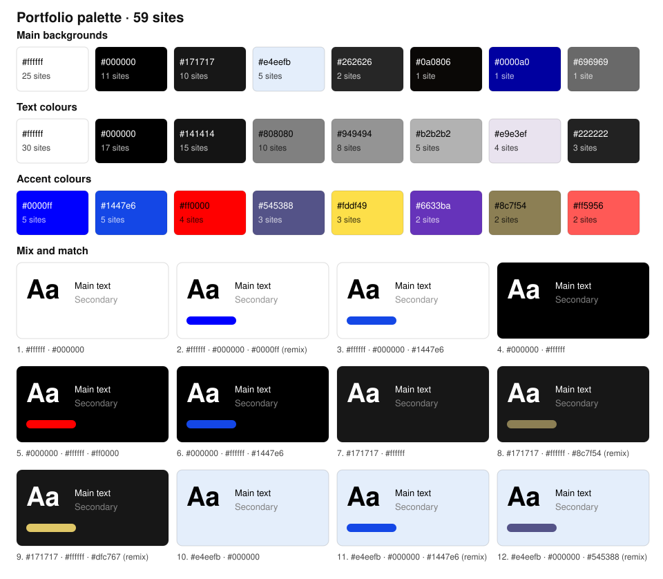

# Portfolio palette

59 sites. 36 of them were captured as one screen only, so their colours come from the first screen.

Colours that look alike are merged and named by the most used shade; the counts are sites, not uses. Translucent colours are mixed onto each site's main background first.

## Main backgrounds

| Colour | Sites | Merged shades | Seen on |
| --- | --- | --- | --- |
| `#ffffff` | 25 of 59 | `#f2f2f2`, `#f4f2ec`, `#f4f2f0`, `#f4f4f0` | [Alicia Dubuis](../../aliciadubuis.com/overview.md), [bleibtgleich'26](../../bleibtgleich.dev/overview.md), [Brady Perron](../../bradyperron.com/overview.md), [David Spaeth](../../davidspaeth.com/overview.md) and 21 more |
| `#000000` | 11 of 59 | `#080808`, `#04040e` | [Allan Leone - Product Designer](../../allanleone.com/overview.md), [galekto](../../galekto.com/overview.md), [Nesil's Lucid Dreams](../../nesilnoble.com/overview.md), [Ilnaz Khasanshin](../../ntch.design/overview.md) and 7 more |
| `#171717` | 10 of 59 | `#101012`, `#111111`, `#121212`, `#141414` | [Giordano Betti](../../giordanobetti.com/overview.md), [Sam Goddard](../../samgoddard.co.uk/overview.md), [Nahiyan Khan - Personal Site](../../nahiyan.codes/overview.md), [Arc's Portfolio](../../arcmarumo.com/overview.md) and 6 more |
| `#e4eefb` | 5 of 59 | `#eaece5`, `#ebe1db`, `#ececec`, `#f3f1ea` | [Zesiger.net](../../zesiger.net/overview.md), [Melike Turgut](../../meliketurgut.com/overview.md), [Jaytel](../../jay.tel/overview.md), [Huy Phan Vol.2](../../huyml.co/overview.md) and 1 more |
| `#262626` | 2 of 59 | `#2d2822` | [Josh Goldsmith - Director & EP](../../josh-goldsmith.com/overview.md), [Houmahani Kane](../../houmahani.com/overview.md) |
| `#0a0806` | 1 of 59 | — | [David Estrada](../../david-estrada.dev/overview.md) |
| `#0000a0` | 1 of 59 | — | [TREY HOLLINGER](../../treyhollinger.com/overview.md) |
| `#696969` | 1 of 59 | — | [Martin Foucaut](../../martinfoucaut.com/overview.md) |

## Second backgrounds

Section and panel colours that differ from the site's main background.

| Colour | Sites | Merged shades | Seen on |
| --- | --- | --- | --- |
| `#000000` | 8 of 59 | `#070506` | [Carter Ogunsola](../../carterogunsola.com/overview.md), [Josh Goldsmith - Director & EP](../../josh-goldsmith.com/overview.md), [Martin Foucaut](../../martinfoucaut.com/overview.md), [Reckon House Staples](../../reckon.house/overview.md) and 4 more |
| `#ffffff` | 8 of 59 | `#f5f5f5`, `#f7f7f7`, `#fbfbfb` | [David Estrada](../../david-estrada.dev/overview.md), [Giordano Betti](../../giordanobetti.com/overview.md), [Huy Phan Vol.2](../../huyml.co/overview.md), [Stéfano Girardelli — Designer](../../stefanobg.com/overview.md) and 4 more |
| `#0a0a0a` | 2 of 59 | `#111111` | [Petrillo.studio](../../petrillo.studio/overview.md), [Philipp Hafner](../../philipphafner.com/overview.md) |
| `#001d82` | 2 of 59 | `#201878` | [Houmahani Kane](../../houmahani.com/overview.md), [Design by Ency](../../designbyency.com/overview.md) |
| `#0000ff` | 2 of 59 | `#0625ee` | [Design by Ency](../../designbyency.com/overview.md), [Lydia Leiwang's Portfolio](../../lydialeiwang.com/overview.md) |
| `#ff0000` | 2 of 59 | `#e8271c` | [Petrillo.studio](../../petrillo.studio/overview.md), [Unbelievably Crap](../../unbelievablycrap.com/overview.md) |
| `#d9d5d5` | 2 of 59 | `#e2e0d9` | [pu—ente](../../pu-ente.com-en/overview.md), [Mathis Biabiany](../../mathis-biabiany.fr/overview.md) |
| `#e8e4e0` | 2 of 59 | `#eeeeee` | [Reckon House Staples](../../reckon.house/overview.md), [Alicia Dubuis](../../aliciadubuis.com/overview.md) |

## Text colours

| Colour | Sites | Contrast on `#ffffff` | Contrast on `#000000` | Seen on |
| --- | --- | --- | --- | --- |
| `#ffffff` | 30 of 59 | 1.0 | 21.0 | [Allan Leone - Product Designer](../../allanleone.com/overview.md), [Anthracite Studio](../../anthracitestudio.be/overview.md), [Arc's Portfolio](../../arcmarumo.com/overview.md), [Brady Perron](../../bradyperron.com/overview.md) and 26 more |
| `#000000` | 17 of 59 | 21.0 | 1.0 | [bleibtgleich'26](../../bleibtgleich.dev/overview.md), [Brady Perron](../../bradyperron.com/overview.md), [David Spaeth](../../davidspaeth.com/overview.md), [David McGillivray](../../dmcg.co/overview.md) and 13 more |
| `#141414` | 15 of 59 | 18.4 | 1.1 | [Mathis Biabiany](../../mathis-biabiany.fr/overview.md), [Stéfano Girardelli — Designer](../../stefanobg.com/overview.md), [Gianluca Boccia — Still Drawing](../../gianlucaboccia.me/overview.md), [Giordano Betti](../../giordanobetti.com/overview.md) and 11 more |
| `#808080` | 10 of 59 | 3.9 | 5.3 | [Martin Foucaut](../../martinfoucaut.com/overview.md), [Petrillo.studio](../../petrillo.studio/overview.md), [Brady Perron](../../bradyperron.com/overview.md), [Unbelievably Crap](../../unbelievablycrap.com/overview.md) and 6 more |
| `#949494` | 8 of 59 | 3.0 | 6.9 | [Reckon House Staples](../../reckon.house/overview.md), [Mathis Biabiany](../../mathis-biabiany.fr/overview.md), [Stéfano Girardelli — Designer](../../stefanobg.com/overview.md), [Brady Perron](../../bradyperron.com/overview.md) and 4 more |
| `#b2b2b2` | 5 of 59 | 2.1 | 9.9 | [Brady Perron](../../bradyperron.com/overview.md), [Tommy Biglow](../../tommybiglow.com/overview.md), [Carter Ogunsola](../../carterogunsola.com/overview.md), [Anthracite Studio](../../anthracitestudio.be/overview.md) and 1 more |
| `#e9e3ef` | 4 of 59 | 1.3 | 16.7 | [Hamza's Desk](../../raomuhammadhamza.tech/overview.md), [Nahiyan Khan - Personal Site](../../nahiyan.codes/overview.md), [TREY HOLLINGER](../../treyhollinger.com/overview.md), [Martin Foucaut](../../martinfoucaut.com/overview.md) |
| `#222222` | 3 of 59 | 15.9 | 1.3 | [Félix Péault](../../felixpeault.com/overview.md), [Houmahani Kane](../../houmahani.com/overview.md), [Sam Thies](../../samthies.com/overview.md) |

## Accent colours

Any colour with real saturation (OKLab chroma 0.06 or more) that is not near-black, wherever the site uses it.

| Colour | Sites | Merged shades | Seen on |
| --- | --- | --- | --- |
| `#0000ff` | 5 of 59 | `#0625ee`, `#1d00ff`, `#251aff` | [Design by Ency](../../designbyency.com/overview.md), [galekto](../../galekto.com/overview.md), [Lydia Leiwang's Portfolio](../../lydialeiwang.com/overview.md), [Shelby's Desk](../../shelbykho.com/overview.md) and 1 more |
| `#1447e6` | 5 of 59 | `#1f66dc`, `#2a52f0`, `#2b2bce`, `#3d4bff` | [Kalok Yeung](../../kalokyeung.com/overview.md), [Zesiger.net](../../zesiger.net/overview.md), [Pier Gorelli](../../piergorelli.com/overview.md), [The Robot and Me](../../therobotand.me/overview.md) and 1 more |
| `#ff0000` | 4 of 59 | `#e8271c` | [David Spaeth](../../davidspaeth.com/overview.md), [galekto](../../galekto.com/overview.md), [Petrillo.studio](../../petrillo.studio/overview.md), [Unbelievably Crap](../../unbelievablycrap.com/overview.md) |
| `#545388` | 3 of 59 | `#565a92`, `#576a90` | [Nesil's Lucid Dreams](../../nesilnoble.com/overview.md), [Design by Ency](../../designbyency.com/overview.md), [Zesiger.net](../../zesiger.net/overview.md) |
| `#fddf49` | 3 of 59 | `#ffd60a`, `#ffe566` | [Rozalia Boma - Writer](../../rozaliabomawrites.com/overview.md), [Design by Ency](../../designbyency.com/overview.md), [galekto](../../galekto.com/overview.md) |
| `#6633ba` | 2 of 59 | `#6b248f`, `#7828c8`, `#7e22ce` | [Petrillo.studio](../../petrillo.studio/overview.md), [Rozalia Boma - Writer](../../rozaliabomawrites.com/overview.md) |
| `#8c7f54` | 2 of 59 | `#a67300` | [Frédéric Lord](../../fredericlord.com/overview.md), [galekto](../../galekto.com/overview.md) |
| `#ff5956` | 2 of 59 | `#ff633d` | [The Robot and Me](../../therobotand.me/overview.md), [bleibtgleich'26](../../bleibtgleich.dev/overview.md) |

## Mix and match

For each of the most common backgrounds: a main text colour at 7:1 or more where one exists (never below 4.5:1, WCAG AA body text), a muted secondary text between 3:1 and 7:1, and up to two accents at 3:1 or more (large text and UI parts). Colours that appear together on the same site are picked first; a remix borrows colours from different sites in this category.

| # | Background | Text | Secondary | Accent | Contrast text / secondary / accent | Source |
| --- | --- | --- | --- | --- | --- | --- |
| 1 | `#ffffff` | `#000000` | `#949494` | — | 21.0 / 3.0 / — | seen on [bleibtgleich'26](../../bleibtgleich.dev/overview.md), [Brady Perron](../../bradyperron.com/overview.md) and 7 more |
| 2 | `#ffffff` | `#000000` | `#949494` | `#0000ff` | 21.0 / 3.0 / 8.6 | remix: ground from [Alicia Dubuis](../../aliciadubuis.com/overview.md), text from [bleibtgleich'26](../../bleibtgleich.dev/overview.md), accent from [Design by Ency](../../designbyency.com/overview.md) |
| 3 | `#ffffff` | `#000000` | `#949494` | `#1447e6` | 21.0 / 3.0 / 6.8 | seen on [Kalok Yeung](../../kalokyeung.com/overview.md) |
| 4 | `#000000` | `#ffffff` | `#808080` | — | 21.0 / 5.3 / — | seen on [Allan Leone - Product Designer](../../allanleone.com/overview.md), [Anthracite Studio](../../anthracitestudio.be/overview.md) and 6 more |
| 5 | `#000000` | `#ffffff` | `#808080` | `#ff0000` | 21.0 / 5.3 / 5.3 | seen on [Unbelievably Crap](../../unbelievablycrap.com/overview.md) |
| 6 | `#000000` | `#ffffff` | `#808080` | `#1447e6` | 21.0 / 5.3 / 3.1 | seen on [Anthracite Studio](../../anthracitestudio.be/overview.md) |
| 7 | `#171717` | `#ffffff` | `#808080` | — | 17.9 / 4.5 / — | seen on [Arc's Portfolio](../../arcmarumo.com/overview.md), [Carter Ogunsola](../../carterogunsola.com/overview.md) and 5 more |
| 8 | `#171717` | `#ffffff` | `#808080` | `#8c7f54` | 17.9 / 4.5 / 4.5 | remix: ground from [Giordano Betti](../../giordanobetti.com/overview.md), text from [Allan Leone - Product Designer](../../allanleone.com/overview.md), accent from [Frédéric Lord](../../fredericlord.com/overview.md) |
| 9 | `#171717` | `#ffffff` | `#808080` | `#dfc767` | 17.9 / 4.5 / 10.7 | remix: ground from [Giordano Betti](../../giordanobetti.com/overview.md), text from [Allan Leone - Product Designer](../../allanleone.com/overview.md), accent from [Frédéric Lord](../../fredericlord.com/overview.md) |
| 10 | `#e4eefb` | `#000000` | `#808080` | — | 17.9 / 3.4 / — | seen on [Jaytel](../../jay.tel/overview.md), [Melike Turgut](../../meliketurgut.com/overview.md) |
| 11 | `#e4eefb` | `#000000` | `#808080` | `#1447e6` | 17.9 / 3.4 / 5.8 | remix: ground from [Zesiger.net](../../zesiger.net/overview.md), text from [bleibtgleich'26](../../bleibtgleich.dev/overview.md), accent from [Kalok Yeung](../../kalokyeung.com/overview.md) |
| 12 | `#e4eefb` | `#000000` | `#808080` | `#545388` | 17.9 / 3.4 / 6.0 | remix: ground from [Zesiger.net](../../zesiger.net/overview.md), text from [bleibtgleich'26](../../bleibtgleich.dev/overview.md), accent from [Nesil's Lucid Dreams](../../nesilnoble.com/overview.md) |
