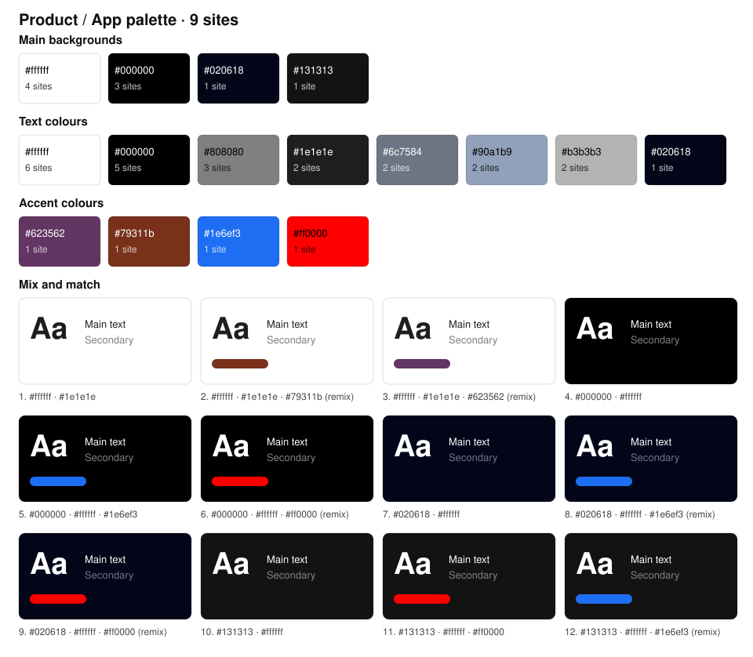

# Product / App palette

9 sites. 2 of them were captured as one screen only, so their colours come from the first screen.

Colours that look alike are merged and named by the most used shade; the counts are sites, not uses. Translucent colours are mixed onto each site's main background first.

## Main backgrounds

| Colour | Sites | Merged shades | Seen on |
| --- | --- | --- | --- |
| `#ffffff` | 4 of 9 | `#f9f7f2`, `#fafafa` | [.txt](../../dottxt.ai/overview.md), [Zenarate](../../zenarate.com/overview.md), [GoShuin — Every stamp, a memory.](../../aestudio.studio-goshuin-en/overview.md), [Butter](../../butter.video/overview.md) |
| `#000000` | 3 of 9 | — | [DeepBook](../../deepbook-v2-wip.webflow.io/overview.md), [Grail](../../grail-app.com/overview.md), [Sui](../../sui.io/overview.md) |
| `#020618` | 1 of 9 | — | [Redesigning Trust: Level2](../../trylevel2.com/overview.md) |
| `#131313` | 1 of 9 | — | [Elva](../../elva-labs.com/overview.md) |

## Second backgrounds

Section and panel colours that differ from the site's main background.

| Colour | Sites | Merged shades | Seen on |
| --- | --- | --- | --- |
| `#ffffff` | 4 of 9 | `#f4f5f7`, `#f6f6f6`, `#f8fafc` | [DeepBook](../../deepbook-v2-wip.webflow.io/overview.md), [Sui](../../sui.io/overview.md), [Grail](../../grail-app.com/overview.md), [Redesigning Trust: Level2](../../trylevel2.com/overview.md) |
| `#e7e5df` | 2 of 9 | `#eee7d4`, `#eee9da`, `#eee9dc`, `#efefef` | [GoShuin — Every stamp, a memory.](../../aestudio.studio-goshuin-en/overview.md), [.txt](../../dottxt.ai/overview.md) |
| `#000000` | 1 of 9 | — | [.txt](../../dottxt.ai/overview.md) |
| `#79311b` | 1 of 9 | — | [.txt](../../dottxt.ai/overview.md) |
| `#1e6ef3` | 1 of 9 | — | [DeepBook](../../deepbook-v2-wip.webflow.io/overview.md) |
| `#ff0000` | 1 of 9 | — | [Elva](../../elva-labs.com/overview.md) |
| `#ddb8ca` | 1 of 9 | — | [.txt](../../dottxt.ai/overview.md) |
| `#d3d3d3` | 1 of 9 | — | [Butter](../../butter.video/overview.md) |

## Text colours

| Colour | Sites | Contrast on `#ffffff` | Contrast on `#000000` | Seen on |
| --- | --- | --- | --- | --- |
| `#ffffff` | 6 of 9 | 1.0 | 21.0 | [DeepBook](../../deepbook-v2-wip.webflow.io/overview.md), [.txt](../../dottxt.ai/overview.md), [Elva](../../elva-labs.com/overview.md), [Grail](../../grail-app.com/overview.md) and 2 more |
| `#000000` | 5 of 9 | 21.0 | 1.0 | [DeepBook](../../deepbook-v2-wip.webflow.io/overview.md), [.txt](../../dottxt.ai/overview.md), [Elva](../../elva-labs.com/overview.md), [Grail](../../grail-app.com/overview.md) and 1 more |
| `#808080` | 3 of 9 | 3.9 | 5.3 | [DeepBook](../../deepbook-v2-wip.webflow.io/overview.md), [Grail](../../grail-app.com/overview.md), [Zenarate](../../zenarate.com/overview.md) |
| `#1e1e1e` | 2 of 9 | 16.7 | 1.3 | [Butter](../../butter.video/overview.md), [Zenarate](../../zenarate.com/overview.md) |
| `#6c7584` | 2 of 9 | 4.7 | 4.5 | [Sui](../../sui.io/overview.md), [Redesigning Trust: Level2](../../trylevel2.com/overview.md) |
| `#90a1b9` | 2 of 9 | 2.6 | 8.0 | [Redesigning Trust: Level2](../../trylevel2.com/overview.md), [Butter](../../butter.video/overview.md) |
| `#b3b3b3` | 2 of 9 | 2.1 | 10.0 | [Elva](../../elva-labs.com/overview.md), [Grail](../../grail-app.com/overview.md) |
| `#020618` | 1 of 9 | 20.2 | 1.0 | [Redesigning Trust: Level2](../../trylevel2.com/overview.md) |

## Accent colours

Any colour with real saturation (OKLab chroma 0.06 or more) that is not near-black, wherever the site uses it.

| Colour | Sites | Merged shades | Seen on |
| --- | --- | --- | --- |
| `#623562` | 1 of 9 | — | [Grail](../../grail-app.com/overview.md) |
| `#79311b` | 1 of 9 | — | [.txt](../../dottxt.ai/overview.md) |
| `#1e6ef3` | 1 of 9 | — | [DeepBook](../../deepbook-v2-wip.webflow.io/overview.md) |
| `#ff0000` | 1 of 9 | — | [Elva](../../elva-labs.com/overview.md) |

## Mix and match

For each of the most common backgrounds: a main text colour at 7:1 or more where one exists (never below 4.5:1, WCAG AA body text), a muted secondary text between 3:1 and 7:1, and up to two accents at 3:1 or more (large text and UI parts). Colours that appear together on the same site are picked first; a remix borrows colours from different sites in this category.

| # | Background | Text | Secondary | Accent | Contrast text / secondary / accent | Source |
| --- | --- | --- | --- | --- | --- | --- |
| 1 | `#ffffff` | `#1e1e1e` | `#808080` | — | 16.7 / 3.9 / — | seen on [Butter](../../butter.video/overview.md), [Zenarate](../../zenarate.com/overview.md) |
| 2 | `#ffffff` | `#1e1e1e` | `#808080` | `#79311b` | 16.7 / 3.9 / 9.3 | remix: ground from [.txt](../../dottxt.ai/overview.md), text from [Butter](../../butter.video/overview.md), accent from [.txt](../../dottxt.ai/overview.md) |
| 3 | `#ffffff` | `#1e1e1e` | `#808080` | `#623562` | 16.7 / 3.9 / 9.5 | remix: ground from [.txt](../../dottxt.ai/overview.md), text from [Butter](../../butter.video/overview.md), accent from [Grail](../../grail-app.com/overview.md) |
| 4 | `#000000` | `#ffffff` | `#808080` | — | 21.0 / 5.3 / — | seen on [DeepBook](../../deepbook-v2-wip.webflow.io/overview.md), [Grail](../../grail-app.com/overview.md) and 1 more |
| 5 | `#000000` | `#ffffff` | `#808080` | `#1e6ef3` | 21.0 / 5.3 / 4.6 | seen on [DeepBook](../../deepbook-v2-wip.webflow.io/overview.md) |
| 6 | `#000000` | `#ffffff` | `#808080` | `#ff0000` | 21.0 / 5.3 / 5.3 | remix: ground from [DeepBook](../../deepbook-v2-wip.webflow.io/overview.md), text from [DeepBook](../../deepbook-v2-wip.webflow.io/overview.md), accent from [Elva](../../elva-labs.com/overview.md) |
| 7 | `#020618` | `#ffffff` | `#6c7584` | — | 20.2 / 4.3 / — | seen on [Redesigning Trust: Level2](../../trylevel2.com/overview.md) |
| 8 | `#020618` | `#ffffff` | `#6c7584` | `#1e6ef3` | 20.2 / 4.3 / 4.4 | remix: ground from [Redesigning Trust: Level2](../../trylevel2.com/overview.md), text from [DeepBook](../../deepbook-v2-wip.webflow.io/overview.md), accent from [DeepBook](../../deepbook-v2-wip.webflow.io/overview.md) |
| 9 | `#020618` | `#ffffff` | `#6c7584` | `#ff0000` | 20.2 / 4.3 / 5.0 | remix: ground from [Redesigning Trust: Level2](../../trylevel2.com/overview.md), text from [DeepBook](../../deepbook-v2-wip.webflow.io/overview.md), accent from [Elva](../../elva-labs.com/overview.md) |
| 10 | `#131313` | `#ffffff` | `#808080` | — | 18.6 / 4.7 / — | seen on [Elva](../../elva-labs.com/overview.md) |
| 11 | `#131313` | `#ffffff` | `#808080` | `#ff0000` | 18.6 / 4.7 / 4.6 | seen on [Elva](../../elva-labs.com/overview.md) |
| 12 | `#131313` | `#ffffff` | `#808080` | `#1e6ef3` | 18.6 / 4.7 / 4.1 | remix: ground from [Elva](../../elva-labs.com/overview.md), text from [DeepBook](../../deepbook-v2-wip.webflow.io/overview.md), accent from [DeepBook](../../deepbook-v2-wip.webflow.io/overview.md) |
