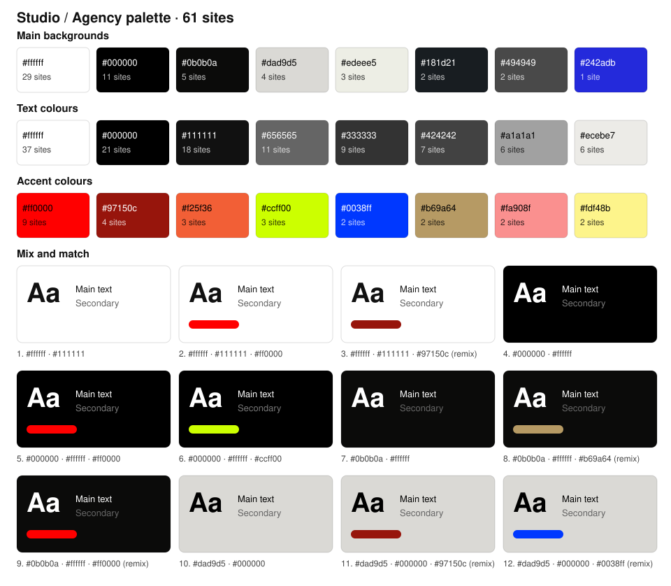

# Studio / Agency palette

61 sites. 17 of them were captured as one screen only, so their colours come from the first screen. Left out as failed captures: [Seek and Deploy](../../seekanddeploy.com/overview.md).

Colours that look alike are merged and named by the most used shade; the counts are sites, not uses. Translucent colours are mixed onto each site's main background first.

## Main backgrounds

| Colour | Sites | Merged shades | Seen on |
| --- | --- | --- | --- |
| `#ffffff` | 29 of 61 | `#f1f1f1`, `#f1f3f5`, `#f4f4f2`, `#f4f4f4` | [AAT Architecten](../../aat-architecten.be/overview.md), [Arrova](../../arrova.eu/overview.md), [AVEA](../../avea.studio/overview.md), [Awake Agency](../../awakeagency.dev/overview.md) and 25 more |
| `#000000` | 11 of 61 | `#050505`, `#06070a` | [Clevermellow](../../clevermellow.co/overview.md), [Dash Creative](../../dashcreative.co/overview.md), [Dopamine Studio](../../dopaminestudio.io/overview.md), [GOBOLD™ Agency](../../gobold.live/overview.md) and 7 more |
| `#0b0b0a` | 5 of 61 | `#0e0e0e`, `#111111`, `#121212`, `#161515` | [Yuya Film Studio](../../yuyafilmstudio.dev/overview.md), [Produx Design](../../produx.design/overview.md), [Boldium](../../boldium.com/overview.md), [Share Bien](../../sharebien.com/overview.md) and 1 more |
| `#dad9d5` | 4 of 61 | `#dddbe7`, `#e4e3da`, `#e4e4e4` | [Grafik](../../grafik.nz/overview.md), [Made in May](../../madeinmay.studio/overview.md), [tricks GmbH](../../tricks.de/overview.md), [Lesse Studio](../../lessestudio.com/overview.md) |
| `#edeee5` | 3 of 61 | `#f2ecdf`, `#f5efff` | [AUGE Experience](../../auge-xp.com/overview.md), [Studio OL](../../ol.studio/overview.md), [Emotion Agency](../../emotion-agency.com/overview.md) |
| `#181d21` | 2 of 61 | `#1a1a1a` | [Boc.Studio](../../boc.studio/overview.md), [Flesh and Bones](../../wearefleshandbones.com/overview.md) |
| `#494949` | 2 of 61 | `#594037` | [Onseis Studio](../../onseis.com/overview.md), [dsgn Interior](../../dsgninterior.se/overview.md) |
| `#242adb` | 1 of 61 | — | [Pixelismo Studio](../../pixelismo.it/overview.md) |

## Second backgrounds

Section and panel colours that differ from the site's main background.

| Colour | Sites | Merged shades | Seen on |
| --- | --- | --- | --- |
| `#000000` | 10 of 61 | `#050505`, `#080808` | [AUGE Experience](../../auge-xp.com/overview.md), [Grounded](../../grounded2026.com/overview.md), [Lesse Studio](../../lessestudio.com/overview.md), [Onseis Studio](../../onseis.com/overview.md) and 6 more |
| `#101010` | 10 of 61 | `#070b00`, `#0a0a0a`, `#0d0c0b`, `#13151a` | [Extrafazant](../../extrafazant.nl/overview.md), [Lesse Studio](../../lessestudio.com/overview.md), [Made in May](../../madeinmay.studio/overview.md), [Vantra (Featured Template)](../../vantra-studio.webflow.io/overview.md) and 6 more |
| `#ffffff` | 8 of 61 | `#f6f5f4`, `#fdf8f5`, `#fffeea` | [Boldium](../../boldium.com/overview.md), [Grafik](../../grafik.nz/overview.md), [La boite à slides](../../laboiteaslides.fr/overview.md), [Lesse Studio](../../lessestudio.com/overview.md) and 4 more |
| `#ecebe7` | 4 of 61 | `#efece8`, `#f8eee8`, `#fae3e2`, `#faeed9` | [Hello Party](../../thisishelloparty.com/overview.md), [Kigo Studio](../../kigo.studio/overview.md), [Two26 Studio](../../two26.studio/overview.md), [Flesh and Bones](../../wearefleshandbones.com/overview.md) |
| `#031b36` | 2 of 61 | `#161d25` | [Think Company](../../thinkcompany.com/overview.md), [Awake Agency](../../awakeagency.dev/overview.md) |
| `#201d1d` | 2 of 61 | `#222222` | [ViV Management](../../vivmgmt.com/overview.md), [Onlines](../../onlines.com.ar/overview.md) |
| `#606162` | 2 of 61 | `#666666` | [Preymaker](../../preymaker.com/overview.md), [Grounded](../../grounded2026.com/overview.md) |
| `#ff0000` | 2 of 61 | `#ff003d` | [Studio OL](../../ol.studio/overview.md), [Awake Agency](../../awakeagency.dev/overview.md) |

## Text colours

| Colour | Sites | Contrast on `#ffffff` | Contrast on `#000000` | Seen on |
| --- | --- | --- | --- | --- |
| `#ffffff` | 37 of 61 | 1.0 | 21.0 | [AUGE Experience](../../auge-xp.com/overview.md), [Awake Agency](../../awakeagency.dev/overview.md), [blue2purple](../../blue2purple.com/overview.md), [Boc.Studio](../../boc.studio/overview.md) and 33 more |
| `#000000` | 21 of 61 | 21.0 | 1.0 | [Arrova](../../arrova.eu/overview.md), [AVEA](../../avea.studio/overview.md), [Dopamine Studio](../../dopaminestudio.io/overview.md), [Grafik](../../grafik.nz/overview.md) and 17 more |
| `#111111` | 18 of 61 | 18.9 | 1.1 | [Boldium](../../boldium.com/overview.md), [Pixelismo Studio](../../pixelismo.it/overview.md), [SYBIOSME](../../sybiosme.com-en/overview.md), [blue2purple](../../blue2purple.com/overview.md) and 14 more |
| `#656565` | 11 of 61 | 5.8 | 3.6 | [incredibles](../../incredibles.dev/overview.md), [Orionix - Creative Agency](../../orionix.framer.website/overview.md), [Junca Studio](../../juncastudio.com/overview.md), [UNDPLUS](../../undplus.com/overview.md) and 7 more |
| `#333333` | 9 of 61 | 12.6 | 1.7 | [Dokmeh Agency](../../hidokmeh.com/overview.md), [Junca Studio](../../juncastudio.com/overview.md), [Two26 Studio](../../two26.studio/overview.md), [incredibles](../../incredibles.dev/overview.md) and 5 more |
| `#424242` | 7 of 61 | 10.0 | 2.1 | [Onlines](../../onlines.com.ar/overview.md), [IWONDERU Studios](../../iwonderu.se/overview.md), [Studio OL](../../ol.studio/overview.md), [Kigo Studio](../../kigo.studio/overview.md) and 3 more |
| `#a1a1a1` | 6 of 61 | 2.6 | 8.1 | [Mubien](../../mubien.com/overview.md), [Orionix - Creative Agency](../../orionix.framer.website/overview.md), [Produx Design](../../produx.design/overview.md), [SYBIOSME](../../sybiosme.com-en/overview.md) and 2 more |
| `#ecebe7` | 6 of 61 | 1.2 | 17.6 | [Hello Party](../../thisishelloparty.com/overview.md), [Yuya Film Studio](../../yuyafilmstudio.dev/overview.md), [Core-A Studios](../../coreastudios.com/overview.md), [Onseis Studio](../../onseis.com/overview.md) and 2 more |

## Accent colours

Any colour with real saturation (OKLab chroma 0.06 or more) that is not near-black, wherever the site uses it.

| Colour | Sites | Merged shades | Seen on |
| --- | --- | --- | --- |
| `#ff0000` | 9 of 61 | `#f44a32`, `#fe4701`, `#ff003d`, `#ff004d` | [GOBOLD™ Agency](../../gobold.live/overview.md), [Studio OL](../../ol.studio/overview.md), [Extrafazant](../../extrafazant.nl/overview.md), [SYBIOSME](../../sybiosme.com-en/overview.md) and 5 more |
| `#97150c` | 4 of 61 | `#990000`, `#9b0000`, `#a3003f` | [Junca Studio](../../juncastudio.com/overview.md), [IWONDERU Studios](../../iwonderu.se/overview.md), [Septiembre Arquitectura](../../septiembrearquitectura.com/overview.md), [PSP Production](../../productionportugal.com/overview.md) |
| `#f25f36` | 3 of 61 | `#fa6b2a`, `#ff7136` | [Flesh and Bones](../../wearefleshandbones.com/overview.md), [SYBIOSME](../../sybiosme.com-en/overview.md), [Right Hemisphere](../../righthemisphere.studio/overview.md) |
| `#ccff00` | 3 of 61 | `#d9ff81`, `#f9fb00` | [Dopamine Studio](../../dopaminestudio.io/overview.md), [tricks GmbH](../../tricks.de/overview.md), [Hello Party](../../thisishelloparty.com/overview.md) |
| `#0038ff` | 2 of 61 | `#0c00ff` | [Extrafazant](../../extrafazant.nl/overview.md), [blue2purple](../../blue2purple.com/overview.md) |
| `#b69a64` | 2 of 61 | `#ba9e72`, `#c9a96e` | [Yuya Film Studio](../../yuyafilmstudio.dev/overview.md), [Love and Money](../../loveandmoney.com/overview.md) |
| `#fa908f` | 2 of 61 | `#ff8585` | [metic. – Take a closer look](../../metic.studio-en/overview.md), [tricks GmbH](../../tricks.de/overview.md) |
| `#fdf48b` | 2 of 61 | `#fee897` | [AUGE Experience](../../auge-xp.com/overview.md), [Extrafazant](../../extrafazant.nl/overview.md) |

## Mix and match

For each of the most common backgrounds: a main text colour at 7:1 or more where one exists (never below 4.5:1, WCAG AA body text), a muted secondary text between 3:1 and 7:1, and up to two accents at 3:1 or more (large text and UI parts). Colours that appear together on the same site are picked first; a remix borrows colours from different sites in this category.

| # | Background | Text | Secondary | Accent | Contrast text / secondary / accent | Source |
| --- | --- | --- | --- | --- | --- | --- |
| 1 | `#ffffff` | `#111111` | `#656565` | — | 18.9 / 5.8 / — | seen on [AAT Architecten](../../aat-architecten.be/overview.md), [Awake Agency](../../awakeagency.dev/overview.md) and 11 more |
| 2 | `#ffffff` | `#111111` | `#656565` | `#ff0000` | 18.9 / 5.8 / 4.0 | seen on [Awake Agency](../../awakeagency.dev/overview.md), [Extrafazant](../../extrafazant.nl/overview.md) and 2 more |
| 3 | `#ffffff` | `#111111` | `#656565` | `#97150c` | 18.9 / 5.8 / 8.6 | remix: ground from [AAT Architecten](../../aat-architecten.be/overview.md), text from [Boldium](../../boldium.com/overview.md), accent from [Junca Studio](../../juncastudio.com/overview.md) |
| 4 | `#000000` | `#ffffff` | `#777777` | — | 21.0 / 4.7 / — | seen on [Clevermellow](../../clevermellow.co/overview.md), [Dash Creative](../../dashcreative.co/overview.md) and 6 more |
| 5 | `#000000` | `#ffffff` | `#777777` | `#ff0000` | 21.0 / 4.7 / 5.3 | seen on [PSP Production](../../productionportugal.com/overview.md) |
| 6 | `#000000` | `#ffffff` | `#777777` | `#ccff00` | 21.0 / 4.7 / 17.9 | seen on [Dopamine Studio](../../dopaminestudio.io/overview.md) |
| 7 | `#0b0b0a` | `#ffffff` | `#656565` | — | 19.7 / 3.4 / — | seen on [Boldium](../../boldium.com/overview.md), [Produx Design](../../produx.design/overview.md) and 1 more |
| 8 | `#0b0b0a` | `#ffffff` | `#656565` | `#b69a64` | 19.7 / 3.4 / 7.3 | remix: ground from [Yuya Film Studio](../../yuyafilmstudio.dev/overview.md), text from [AUGE Experience](../../auge-xp.com/overview.md), accent from [Yuya Film Studio](../../yuyafilmstudio.dev/overview.md) |
| 9 | `#0b0b0a` | `#ffffff` | `#656565` | `#ff0000` | 19.7 / 3.4 / 4.9 | remix: ground from [Yuya Film Studio](../../yuyafilmstudio.dev/overview.md), text from [AUGE Experience](../../auge-xp.com/overview.md), accent from [GOBOLD™ Agency](../../gobold.live/overview.md) |
| 10 | `#dad9d5` | `#000000` | `#656565` | — | 14.9 / 4.1 / — | seen on [Grafik](../../grafik.nz/overview.md), [Lesse Studio](../../lessestudio.com/overview.md) and 1 more |
| 11 | `#dad9d5` | `#000000` | `#656565` | `#97150c` | 14.9 / 4.1 / 6.1 | remix: ground from [Grafik](../../grafik.nz/overview.md), text from [Arrova](../../arrova.eu/overview.md), accent from [Junca Studio](../../juncastudio.com/overview.md) |
| 12 | `#dad9d5` | `#000000` | `#656565` | `#0038ff` | 14.9 / 4.1 / 4.9 | remix: ground from [Grafik](../../grafik.nz/overview.md), text from [Arrova](../../arrova.eu/overview.md), accent from [Extrafazant](../../extrafazant.nl/overview.md) |
